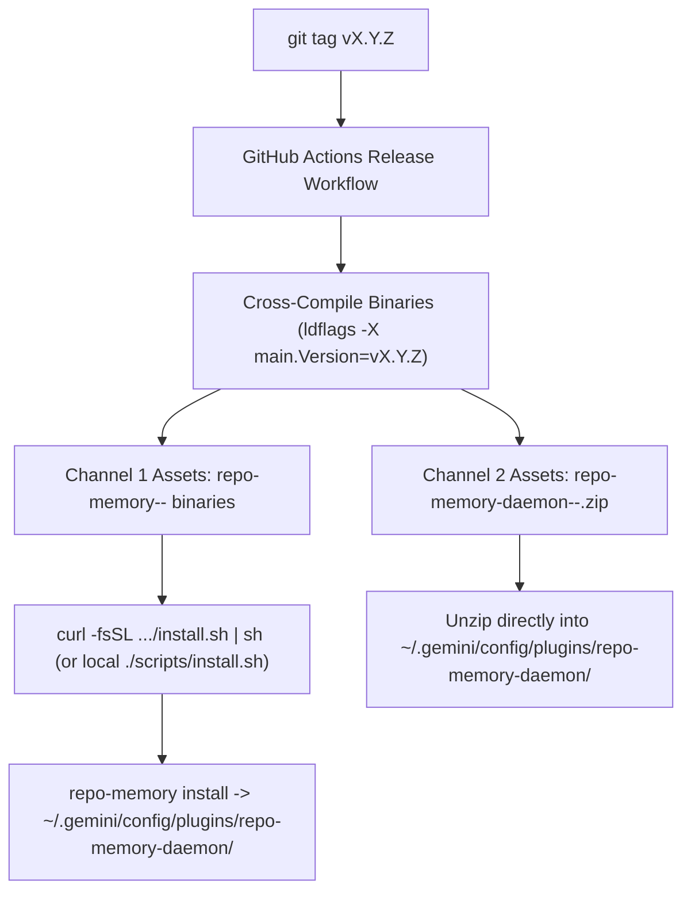

# Plugin Packaging, Distribution & Versioning Guide

> **Scope:** Canonical architecture and reusable blueprint for packaging, distributing, and maintaining versions of Antigravity plugins—covering both **compiled binary plugins** (Go/Rust, such as `repo-memory`) and **script/interpreted plugins** (Python/Node, such as `principal-architect`).

---

## 1. Executive Summary

A production Antigravity plugin that combines background automation (`sidecar.json`), workspace lifecycle hooks (`hooks.json`), MCP tools (`mcp_config.json`), custom subagents (`agents/`), and slash-command skills (`skills/`) faces three packaging constraints:

1. **Global vs. Per-Workspace Isolation:** Scheduled or UI sidecars (`sidecar.json`) only launch from global plugins under `~/.gemini/config/plugins/<daemon-name>/`, whereas lifecycle hooks (`PreInvocation`, `PreToolUse`, `PostToolUse`, `Stop`) and MCP servers should only fire inside **explicitly enrolled repositories** (`<repo>/.agents/plugins.json`) so unenrolled workspaces experience zero hook overhead.
2. **Machine-Specific Path Resolution:** Antigravity's configuration loaders apply different path-expansion rules across `.agents/plugins.json`, `hooks.json`, `mcp_config.json`, and `sidecar.json`. Naive zipping of an installed plugin directory captures hardcoded `/Users/<author>/...` paths that break on another user's machine.
3. **Compiled Binary Portability vs. Zero-CLI Drop-In Bundles:** Compiled plugins require OS/architecture-specific binaries (`darwin-arm64`, `darwin-amd64`, `linux-amd64`, `linux-arm64`, `windows-amd64`), while users want either a one-command CLI installer **or** a self-contained `.zip` they can extract directly into `~/.gemini/config/plugins/`.

This document defines the **Dual-Channel Distribution & Single-Source Versioning Architecture** that solves all three constraints cleanly and reusably across plugins.

---

## 2. Core Architectural Principles

### 2.1 The Two-Plugin Packaging Split (`<name>-daemon` + `workspace-plugin/<name>`)

Every multi-repo plugin uses a **single installation directory** under `~/.gemini/config/plugins/<name>-daemon/` containing two distinct plugin manifests:

```text
~/.gemini/config/plugins/<name>-daemon/              # 1. Global Daemon Plugin (discovered at IDE startup)
├── plugin.json                                      #    name: "<name>-daemon", version: "<semver>"
├── config.json                                      #    { "enabled": true }
├── bin/                                             #    Bundled executable(s) (for portable .zip distribution)
│   └── <binary>
├── sidecars/
│   └── <sidecar-name>/
│       └── sidecar.json                             #    Global background schedule or AuxPane UI sidecar
├── skills/
│   └── <name>-admin/
│       └── SKILL.md                                 #    Global /<name>-admin skill (enroll, status, doctor)
└── workspace-plugin/                                # 2. Nested Workspace Bundle (ignored by global scanner)
    └── <name>/
        ├── plugin.json                              #    name: "<name>", version: "<semver>"
        ├── hooks.json                               #    PreInvocation, PreToolUse, PostToolUse, Stop
        ├── mcp_config.json                          #    Per-workspace stdio MCP server
        ├── agents/                                  #    Role/distiller subagents
        ├── rules/                                   #    Workspace-scoped rules (if any)
        └── skills/                                  #    Workspace-scoped skills (if any)
```

**Why this works:**
- Global plugin discovery scans `~/.gemini/config/plugins/` strictly **one level deep**. It discovers `<name>-daemon` (starting its sidecar and registering the global `/<name>-admin` management skill) and completely ignores `workspace-plugin/<name>/`.
- When a user enrolls a repository (via `/<name>-admin enroll` or `<binary> enroll`), the tool writes the resolved **absolute path** of `workspace-plugin` into `<repo>/.agents/plugins.json` (and adds `.agents/plugins.json` to `<repo>/.git/info/exclude`).
- Only enrolled repositories load `workspace-plugin/<name>/hooks.json` and `mcp_config.json`.

### 2.2 Stateless Plugin Directory (`100% Replaceable on Upgrade`)

The directory `~/.gemini/config/plugins/<name>-daemon/` must be treated as **read-only, stateless application code**:
- **Repository-shared state** belongs in `<repo>/.memory/` or `<repo>/.agents/plugins/<workspace-state>/` (tracked in Git).
- **Machine-local runtime state** (SQLite indexes, job queues, spool files, enrolled repo registries, backups) belongs in the OS user data directory (`~/.local/share/<name>/` on Linux, `~/Library/Application Support/<name>/` on macOS, `%LOCALAPPDATA%\<name>\` on Windows)—or, if kept under `<daemon>/state/`, must be explicitly backed up and restored by `install`.

Because `~/.gemini/config/plugins/<name>-daemon/` holds no irreplaceable state, upgrading or reinstalling the plugin is simply **overwriting that directory** (either by running `<binary> install` or extracting a new `.zip`).

### 2.3 Two Plugin Archetypes

| Dimension | Archetype A: Compiled Binary Plugin (`repo-memory`) | Archetype B: Interpreted Script Plugin (`principal-architect`) |
|---|---|---|
| **Runtime** | Single static Go/Rust binary (`CGO_ENABLED=0`) | Python 3.11+ / Node.js scripts |
| **Source of plugin files** | Embedded in binary via `//go:embed` (`packaging/antigravity/templates.go`) | Committed directory tree (`daemon/`) in source repo |
| **Platform matrix** | Per-OS/Arch (`darwin-arm64`, `darwin-amd64`, `linux-amd64`, `linux-arm64`, `windows-amd64`) | Universal (`any` platform, requires host interpreter) |
| **CLI entry point** | `<binary>` (also runs `hook`, `mcp`, `tick`, `install`, `enroll`) | Wrapper symlink in `~/.local/bin/<cli>` pointing into `<daemon>/...` |

---

## 3. Platform Path-Resolution Mechanics & Gotchas

To build a `.zip` bundle or installer that works on **any** user's machine without hardcoded `/Users/<author>` paths, every configuration file must follow the exact path-expansion rules of the surface that loads it:

| Surface | File Path | Expands `~`? | Expands `$HOME` / Env Vars? | Expands `${PLUGIN_ROOT}`? | Portable Pattern for `.zip` Bundles |
|---|---|---|---|---|---|
| **Workspace Plugin Pointer** | `<repo>/.agents/plugins.json` | **NO** | **NO** | **NO** | Never distribute statically. Generated on the user's machine at `enroll` time using `os.UserHomeDir()` / `filepath.Abs()`. |
| **Lifecycle Hooks** | `workspace-plugin/<name>/hooks.json` | **YES** (`expandHome`) | **YES** (runs via `/bin/sh -c` on Unix) | **NO** (unless set in command string) | `"command": "~/.gemini/config/plugins/<name>-daemon/bin/<binary> hook antigravity PreInvocation"` |
| **MCP Server Config** | `workspace-plugin/<name>/mcp_config.json` | **NO** (`exec.Command`) | **NO** (unless wrapped in `sh -c`) | **NO** | For `install`: absolute path.<br>For portable `.zip`: `"command": "/bin/sh", "args": ["-c", "exec \"$HOME/.gemini/config/plugins/<name>-daemon/bin/<binary>\" mcp"]` |
| **Scheduled Sidecar** | `sidecars/<id>/sidecar.json` (`builtin: "schedule"`) | **NO** | **NO** (unless wrapped in `sh -c`) | **NO** (in `builtin: "schedule"` args) | For `install`: `["*/1 * * * *", "/abs/path/<binary>", "tick"]`<br>For portable `.zip`: `["*/1 * * * *", "/bin/sh", "-c", "exec \"$HOME/.gemini/config/plugins/<name>-daemon/bin/<binary>\" tick"]` |
| **Process / UI Sidecar** | `sidecars/<id>/sidecar.json` (`command: ...`) | **NO** | **NO** | **YES** | `"command": "python3", "args": ["${PLUGIN_ROOT}/..."]` |
| **Admin Skill** | `skills/<name>-admin/SKILL.md` | **YES** (Bash tool) | **YES** (Bash tool) | **NO** | `"~/.gemini/config/plugins/<name>-daemon/bin/<binary>"` (or `<binary>` if on `$PATH`) |

### Critical Platform Gotchas

1. **In-Memory Plugin Path Caching:**
   When Antigravity starts, it caches discovered global plugin root directories in memory and sets `cwd` to that path when invoking hooks. Never delete or rename an active plugin directory while the IDE is running without leaving the directory path valid; overwrite files in-place so running sessions never hit `chdir: no such file or directory`.
2. **`PreToolUse` Implicit Deny:**
   In Antigravity, returning `{}` or an empty stdout on `PreToolUse` causes the host to fail-closed and block tool execution. If the binary is missing or fails during an upgrade, `PreToolUse` must always return `{"decision":"allow"}`.
3. **macOS Gatekeeper Quarantine (`com.apple.quarantine`) on Browser Downloads:**
   When a macOS user downloads a `.zip` in a browser (Chrome/Safari) and extracts it with Finder/Archive Utility, macOS attaches the `com.apple.quarantine` extended attribute to the binary inside. When a background hook or MCP server tries to execute an unsigned quarantined binary, macOS blocks it.
   - **Mitigation in CLI / `install.sh`:** `curl` downloads do not attach browser quarantine, and `install.sh` explicitly runs `xattr -dr com.apple.quarantine <plugin-dir> 2>/dev/null || true`.
   - **Mitigation for `.zip` users on macOS:** Include a 1-line post-unzip command (`xattr -dr com.apple.quarantine ~/.gemini/config/plugins/<name>-daemon`) in the release notes, or run a lightweight shell wrapper in `hooks.json` / `sidecar.json` that strips `com.apple.quarantine` before `exec`ing the binary.

---

## 4. Dual-Channel Distribution Design

To serve both developers who prefer a clean CLI workflow and users who want to download a `.zip` and drop it into `~/.gemini/config/plugins/`, every release publishes **both channels** from the same build pipeline.



### Channel 1: Self-Bootstrapping Binary + `install.sh` (Recommended Primary)

For compiled Go plugins like `repo-memory`, all plugin manifests and templates are embedded inside the binary via `//go:embed` ([`packaging/antigravity/templates.go`](../packaging/antigravity/templates.go)). **Distributing the binary distributes the entire plugin.**

1. **Local Checkout / Developer Install (`./scripts/install.sh` or `make install`):**
   - Compiles `./cmd/repo-memory` with `-ldflags="-X 'main.Version=$(git describe --tags --always --dirty)'"`.
   - Copies the binary into `~/.local/bin/repo-memory` (and also into `~/.gemini/config/plugins/repo-memory-daemon/bin/repo-memory` so both paths exist).
   - Runs `~/.local/bin/repo-memory install --harness antigravity`, which writes all plugin manifests with the resolved absolute binary path and enables `repo-memory-daemon` in `~/.gemini/config/config.json`.
2. **Zero-Clone Release Install (`curl -fsSL .../scripts/install-release.sh | sh`):**
   - Detects `uname -s` (`darwin` / `linux`) and `uname -m` (`arm64` / `amd64`).
   - Downloads `repo-memory-<os>-<arch>` from GitHub Releases into `~/.local/bin/repo-memory` (`chmod +x`).
   - Runs `repo-memory install --harness antigravity`.

### Channel 2: Ready-to-Unzip Plugin Bundle (`<name>-daemon-<os>-<arch>.zip`)

For users who want to download a single `.zip` file and extract it into `~/.gemini/config/plugins/`:

#### Archive Layout (`repo-memory-daemon-<os>-<arch>.zip`)

Unzipping inside `~/.gemini/config/plugins/` produces `~/.gemini/config/plugins/repo-memory-daemon/`:

```text
repo-memory-daemon/
├── plugin.json                                      # {"name": "repo-memory-daemon", "version": "0.2.0", ...}
├── config.json                                      # {"enabled": true}
├── bin/
│   ├── repo-memory                                  # Compiled platform binary (chmod 0755)
│   └── run-repo-memory.sh                           # Portable wrapper: strips macOS quarantine & execs ./repo-memory
├── sidecars/
│   └── tick/
│       └── sidecar.json
├── skills/
│   └── repo-memory-admin/
│       └── SKILL.md
└── workspace-plugin/
    └── repo-memory/
        ├── plugin.json                              # {"name": "repo-memory", "version": "0.2.0", ...}
        ├── hooks.json
        ├── mcp_config.json
        └── agents/
            ├── repo-memory-distiller.md
            └── repo-memory-distiller/
                └── agent.md
```

#### Portable Wrapper (`bin/run-repo-memory.sh`)

Bundling a tiny POSIX shell wrapper alongside `bin/repo-memory` inside the `.zip` solves three problems at once:
1. It resolves its own directory dynamically (`SCRIPT_DIR="$(cd "$(dirname "$0")" && pwd)"`), avoiding any hardcoded user home directory.
2. On macOS (`Darwin`), if `com.apple.quarantine` is present on `$SCRIPT_DIR/repo-memory` after a Finder unzip, the shell script (executed by `/bin/sh`, which is a trusted system binary) automatically clears `xattr -d com.apple.quarantine "$BIN" 2>/dev/null || true` before `exec "$BIN" "$@"`.
3. If the binary is temporarily missing or fails on `PreToolUse`, it fails open (`{"decision":"allow"}`) so the user's IDE session is never bricked.

```sh
#!/bin/sh
# ~/.gemini/config/plugins/repo-memory-daemon/bin/run-repo-memory.sh
SCRIPT_DIR="$(cd "$(dirname "$0")" && pwd)"
BIN="${SCRIPT_DIR}/repo-memory"

# Clear macOS browser quarantine on first run if present
if [ "$(uname -s)" = "Darwin" ] && command -v xattr >/dev/null 2>&1; then
  xattr -d com.apple.quarantine "$BIN" 2>/dev/null || true
fi

if [ ! -x "$BIN" ]; then
  for arg in "$@"; do
    case "$arg" in
      PreToolUse|pre_tool_use)
        echo '{"decision":"allow","reason":"fail-open: binary not found"}'
        exit 0
        ;;
    esac
  done
  echo '{}'
  exit 0
fi

exec "$BIN" "$@"
```

#### Portable JSON Manifests Inside the `.zip`

Using `~/.gemini/config/plugins/repo-memory-daemon/bin/run-repo-memory.sh` (or `/bin/sh -c` for `mcp_config.json` and `sidecar.json`):

- **`workspace-plugin/repo-memory/hooks.json`** (Antigravity expands `~` and executes via `/bin/sh -c`):
  ```json
  {
    "repo-memory": {
      "enabled": true,
      "PreInvocation": [
        {
          "type": "command",
          "command": "~/.gemini/config/plugins/repo-memory-daemon/bin/run-repo-memory.sh hook antigravity PreInvocation"
        }
      ],
      "PreToolUse": [
        {
          "matcher": "run_command|write_to_file|replace_file_content|call_mcp_tool",
          "hooks": [
            {
              "type": "command",
              "command": "~/.gemini/config/plugins/repo-memory-daemon/bin/run-repo-memory.sh hook antigravity PreToolUse"
            }
          ]
        }
      ],
      "PostToolUse": [
        {
          "matcher": "run_command",
          "hooks": [
            {
              "type": "command",
              "command": "~/.gemini/config/plugins/repo-memory-daemon/bin/run-repo-memory.sh hook antigravity PostToolUse"
            }
          ]
        }
      ],
      "Stop": [
        {
          "type": "command",
          "command": "~/.gemini/config/plugins/repo-memory-daemon/bin/run-repo-memory.sh hook antigravity Stop"
        }
      ]
    }
  }
  ```

- **`workspace-plugin/repo-memory/mcp_config.json`** (`exec.Command` does not expand `$HOME` directly, so invoke via `/bin/sh -c`):
  ```json
  {
    "mcpServers": {
      "repo-memory": {
        "command": "/bin/sh",
        "args": [
          "-c",
          "exec \"$HOME/.gemini/config/plugins/repo-memory-daemon/bin/run-repo-memory.sh\" mcp"
        ]
      }
    }
  }
  ```

- **`sidecars/tick/sidecar.json`**:
  ```json
  {
    "builtin": "schedule",
    "args": [
      "*/1 * * * *",
      "/bin/sh",
      "-c",
      "exec \"$HOME/.gemini/config/plugins/repo-memory-daemon/bin/run-repo-memory.sh\" tick"
    ],
    "restart_policy": "always",
    "display_name": "Repo Memory Tick",
    "description": "Advances asynchronous background memory pipeline jobs and scheduled maintenance."
  }
  ```

- **`skills/repo-memory-admin/SKILL.md`**:
  Uses `~/.gemini/config/plugins/repo-memory-daemon/bin/repo-memory` as `<bin>`. When the user types `/repo-memory-admin enroll this repo` in chat after unzipping the plugin and restarting Antigravity, the skill invokes `~/.gemini/config/plugins/repo-memory-daemon/bin/repo-memory enroll`, which resolves the user's `$HOME` and writes the exact absolute path `/Users/<user>/.gemini/config/plugins/repo-memory-daemon/workspace-plugin` into `<repo>/.agents/plugins.json`.

---

## 5. Versioning & Upgrade Architecture

### 5.1 Single Source of Truth (`Git Tag` $\rightarrow$ `Binary` $\rightarrow$ `plugin.json`)

Never maintain separate hardcoded version numbers across `main.go`, `daemon_plugin.json`, and `workspace_plugin.json`.

1. **Git Tag is Canonical:**
   Releases are tagged with semantic versions (`v0.1.0`, `v0.2.0`, etc.). During local development builds without an exact tag, `git describe --tags --always --dirty` produces a traceable build string (e.g., `v0.1.0-14-g8f3a1b2`).
2. **Build-Time Injection (`-ldflags`):**
   ```makefile
   VERSION ?= $(shell git describe --tags --always --dirty 2>/dev/null || echo "0.1.0-dev")
   LDFLAGS := -X 'main.Version=$(VERSION)'
   ```
3. **Dynamic Manifest Rendering:**
   `daemon_plugin.json` and `workspace_plugin.json` templates use a `<version>` placeholder (or JSON marshaling from `main.Version`, stripping any leading `v` for strict SemVer in `plugin.json`). When `repo-memory install` or `repo-memory package` runs, both `plugin.json` files receive the exact version compiled into the binary.

### 5.2 The Three Version Planes

To prevent upgrades from breaking existing repositories, version numbers are separated into three orthogonal planes:

| Plane | Where Stored | Format | Upgrade Behavior |
|---|---|---|---|
| **1. Plugin & Binary Version** | `main.Version`, `repo-memory-daemon/plugin.json`, `workspace-plugin/repo-memory/plugin.json` | SemVer (`0.2.0`) | Updated on every release. Checked by `doctor` and `status` to detect binary vs. plugin-template drift. |
| **2. Committed Repo Schema Version** | `.memory/config.yaml` (`version: 2`), `GEMINI.md` (`<!-- repo-memory:begin v2 -->`) | Integer (`v2`) | Only bumped on breaking changes to committed `.memory/` layout. Backward-compatible migrations run automatically during `enroll` / `reproject`. |
| **3. Private Index / SQLite Schema** | `<data-dir>/repos/<repo-id>/index.db` | SQLite schema / `reindex` | Completely disposable and rebuildable from `.memory/ops/` via `repo-memory reindex`. |

### 5.3 Version Drift Detection in `doctor` and `status`

When a user upgrades the binary (e.g., via `git pull && make install` or downloading a new binary) without refreshing `~/.gemini/config/plugins/repo-memory-daemon/`, the binary's `main.Version` will be newer than the `"version"` field inside `~/.gemini/config/plugins/repo-memory-daemon/plugin.json`.

- **`repo-memory status`** displays both the CLI binary version and the installed daemon plugin version.
- **`repo-memory doctor`** reads `~/.gemini/config/plugins/repo-memory-daemon/plugin.json` and compares `"version"` against `main.Version`. If they differ, `doctor` reports:
  ```text
  [WARN] Plugin bundle version (0.1.0) does not match binary version (0.2.0).
         Run `repo-memory install` to refresh hooks, MCP config, and skills.
  ```
- **Self-Healing Option on `enroll`:** Whenever `repo-memory enroll` runs, if it detects that `~/.gemini/config/plugins/repo-memory-daemon/` is missing or at an older version than the running binary, it can automatically invoke `RunInstall` so the plugin directory is always in sync.

### 5.4 How Upgrades Work Across Enrolled Repositories

Because every enrolled repository's `.agents/plugins.json` points to the stable path:
```json
{
  "entries": [
    {
      "path": "/Users/<user>/.gemini/config/plugins/repo-memory-daemon/workspace-plugin"
    }
  ]
}
```
upgrading `~/.gemini/config/plugins/repo-memory-daemon/` (either via `./scripts/install.sh`, `repo-memory install`, or unzipping a new `repo-memory-daemon-<os>-<arch>.zip`) **atomically upgrades all enrolled repositories on the machine** without touching `<repo>/.agents/plugins.json` or re-enrolling.

---

## 6. Reusable Implementation Blueprint

Below is the standard 4-part setup (`Makefile`, `scripts/install.sh`, `repo-memory install --portable`, and `.github/workflows/release.yml`) to implement both distribution channels.

### 6.1 `Makefile` Targets (`build`, `install`, `dist-zip`)

```makefile
BINARY_NAME := repo-memory
PLUGIN_NAME := repo-memory-daemon
OUTPUT_DIR  := bin
DIST_DIR    := dist

# Strip leading 'v' so plugin.json gets clean SemVer (e.g. 0.2.0)
RAW_VERSION := $(shell git describe --tags --always --dirty 2>/dev/null || echo "0.1.0-dev")
VERSION     ?= $(patsubst v%,%,$(RAW_VERSION))

TARGETS := \
	darwin/arm64 \
	darwin/amd64 \
	linux/amd64 \
	linux/arm64 \
	windows/amd64

.PHONY: all build install test dist-zip clean $(TARGETS)

all: build

# Build all cross-platform release binaries
build: $(TARGETS)

$(TARGETS):
	@mkdir -p $(OUTPUT_DIR)
	$(eval OS := $(word 1,$(subst /, ,$@)))
	$(eval ARCH := $(word 2,$(subst /, ,$@)))
	$(eval EXT := $(if $(filter windows,$(OS)),.exe,))
	CGO_ENABLED=0 GOOS=$(OS) GOARCH=$(ARCH) go build \
		-ldflags="-s -w -X 'main.Version=$(VERSION)'" \
		-o $(OUTPUT_DIR)/$(BINARY_NAME)-$(OS)-$(ARCH)$(EXT) ./cmd/repo-memory

# Build for the current host and install into ~/.local/bin + ~/.gemini/config/plugins/
install:
	./scripts/install.sh

# Build self-contained, ready-to-unzip plugin bundles for each platform
dist-zip: build
	@rm -rf $(DIST_DIR)
	@mkdir -p $(DIST_DIR)
	@for target in $(TARGETS); do \
		os=$$(echo $$target | cut -d/ -f1); \
		arch=$$(echo $$target | cut -d/ -f2); \
		ext=""; [ "$$os" = "windows" ] && ext=".exe"; \
		stage="$(DIST_DIR)/stage-$$os-$$arch/$(PLUGIN_NAME)"; \
		mkdir -p "$$stage/bin"; \
		cp "$(OUTPUT_DIR)/$(BINARY_NAME)-$$os-$$arch$$ext" "$$stage/bin/$(BINARY_NAME)$$ext"; \
		chmod 0755 "$$stage/bin/$(BINARY_NAME)$$ext"; \
		REPO_MEMORY_PLUGIN_DIR="$$stage" go run -ldflags="-X 'main.Version=$(VERSION)'" ./cmd/repo-memory install --portable --os="$$os"; \
		(cd "$(DIST_DIR)/stage-$$os-$$arch" && zip -qr "../$(PLUGIN_NAME)-$$os-$$arch.zip" "$(PLUGIN_NAME)"); \
		rm -rf "$(DIST_DIR)/stage-$$os-$$arch"; \
		echo "Created $(DIST_DIR)/$(PLUGIN_NAME)-$$os-$$arch.zip"; \
	done
```

### 6.2 Developer & Local Installer (`scripts/install.sh`)

```bash
#!/usr/bin/env bash
set -euo pipefail

SCRIPT_DIR="$(cd "$(dirname "${BASH_SOURCE[0]}")" && pwd)"
REPO_ROOT="$(cd "${SCRIPT_DIR}/.." && pwd)"

BIN_DIR="${REPO_MEMORY_BIN_DIR:-$HOME/.local/bin}"
PLUGIN_DIR="${REPO_MEMORY_PLUGIN_DIR:-$HOME/.gemini/config/plugins/repo-memory-daemon}"

RAW_VERSION="$(git -C "${REPO_ROOT}" describe --tags --always --dirty 2>/dev/null || echo "0.1.0-dev")"
VERSION="${RAW_VERSION#v}"

mkdir -p "${BIN_DIR}" "${PLUGIN_DIR}/bin"

echo "Building repo-memory (${VERSION})..."
CGO_ENABLED=0 go build \
  -ldflags="-s -w -X 'main.Version=${VERSION}'" \
  -o "${PLUGIN_DIR}/bin/repo-memory" \
  "${REPO_ROOT}/cmd/repo-memory"

chmod +x "${PLUGIN_DIR}/bin/repo-memory"
ln -sf "${PLUGIN_DIR}/bin/repo-memory" "${BIN_DIR}/repo-memory"

# Render plugin bundle and register in ~/.gemini/config/config.json
"${BIN_DIR}/repo-memory" install --harness antigravity
```

### 6.3 GitHub Actions Release Pipeline (`.github/workflows/release.yml`)

```yaml
name: Release

on:
  push:
    tags:
      - 'v*'

permissions:
  contents: write

jobs:
  release:
    name: Build Binaries & Plugin Zip Bundles
    runs-on: ubuntu-latest
    steps:
      - name: Checkout code
        uses: actions/checkout@v4
        with:
          fetch-depth: 0

      - name: Set up Go
        uses: actions/setup-go@v5
        with:
          go-version-file: 'go.mod'

      - name: Build cross-platform binaries and portable plugin zips
        run: |
          VERSION="${GITHUB_REF_NAME#v}"
          make build dist-zip VERSION="$VERSION"

      - name: Create Release and Upload Assets
        uses: softprops/action-gh-release@v2
        env:
          GITHUB_TOKEN: ${{ secrets.GITHUB_TOKEN }}
        with:
          generate_release_notes: true
          files: |
            bin/repo-memory-darwin-arm64
            bin/repo-memory-darwin-amd64
            bin/repo-memory-linux-amd64
            bin/repo-memory-linux-arm64
            bin/repo-memory-windows-amd64.exe
            dist/repo-memory-daemon-darwin-arm64.zip
            dist/repo-memory-daemon-darwin-amd64.zip
            dist/repo-memory-daemon-linux-amd64.zip
            dist/repo-memory-daemon-linux-arm64.zip
            dist/repo-memory-daemon-windows-amd64.zip
```

---

## 7. User Experience Comparison

| Workflow | Install Command / Action | Upgrade Command / Action | Enrolling a Repo |
|---|---|---|---|
| **Option A: Drop-In `.zip` (Zero CLI)** | Download `repo-memory-daemon-<os>-<arch>.zip` from GitHub Releases and unzip into `~/.gemini/config/plugins/` (yielding `~/.gemini/config/plugins/repo-memory-daemon/`), then restart Antigravity. | Unzip newer `repo-memory-daemon-<os>-<arch>.zip` over `~/.gemini/config/plugins/repo-memory-daemon/` and restart Antigravity. | In chat: `/repo-memory-admin enroll this repo` |
| **Option B: Source / CLI (`install.sh`)** | `./scripts/install.sh` (or `make install`) | `git pull && ./scripts/install.sh` | In chat: `/repo-memory-admin enroll this repo` or CLI: `repo-memory enroll .` |
| **Option C: Release One-Liner** | `curl -fsSL https://.../install-release.sh \| sh` | Re-run the one-liner | In chat: `/repo-memory-admin enroll this repo` or CLI: `repo-memory enroll .` |
