# Programme Status — repo-memory v2.1

> **Updated:** 2026-10-06T15:46:00+01:00
> **Programme:** 10/19 PRs complete · PR-07 active (WO5/6)

## Dependency Graph

```mermaid
flowchart LR
  PR01["✅ PR-01"] --> PR01b["✅ PR-01b"]
  PR01b --> PR02a["✅ PR-02a"]
  PR02a --> PR02b["✅ PR-02b"]
  PR02b --> PR03["✅ PR-03"]
  PR03 --> PR04["✅ PR-04"]
  PR04 --> PR05a["✅ PR-05a"]
  PR05a --> PR05b["✅ PR-05b"]
  PR05b --> PR05f["✅ PR-05-v2"]
  PR05f --> PR06["✅ PR-06\nX-GATE ✅"]
  PR06 --> PR06b["✅ PR-06b"]
  PR06 --> PR07["🔄 PR-07\nStorage"]
  PR07 --> PR08["☐ PR-08\nDelivery"]
  PR08 --> PR09["⚠️ PR-09\nX6-LITE"]
  PR09 --> PR10["☐ PR-10\nDistillation"]
  PR10 --> PR11["☐ PR-11\nConsolidation"]
  PR11 --> PR12["☐ PR-12\nX6 PILOT"]

  style PR06 fill:#22c55e,color:white
  style PR07 fill:#3b82f6,color:white
  style PR09 fill:#f59e0b,color:black
```



## PR-07-v2-storage WO Progress

| WO | Scope | Model | Status | Commit | Lines |
|---|---|---|---|---|---|
| WO1 op-log | Op types, writer, reader, iterator | flash | ✅ Complete | `e9ce662` | 1824 |
| WO2 dossier-schema | Entry schema, projector, renderer, atlas | pro | ✅ Complete | `4a80f0e` | 926 |
| WO3 scopes-aliases | Scope resolver, alias map | flash | ✅ Complete | `fdb82ed` | 1279 |
| WO4 index-migration | SQLite v2 schema, CRUD, rebuild | flash | ✅ Complete | `694dca9` | 2070 |
| WO5 v1-removal | Remove 7 v1 packages, update consumers | flash | 🔄 Running | — | ~-2500 |
| WO6 seeding | PA parser, ops converter, CLI | pro | ☐ Ready | — | — |

## Key Metrics

- **New code written:** ~6,100 lines across 4 new packages
- **Code to remove:** ~2,500 lines of v1 pipeline, claims, events, views
- **Net change:** ~+3,600 lines (leaner, more capable)
- **Worker efficiency:** WO1-WO4 completed in rapid sequence, ~15 min each

## Architecture After PR-07

```
.memory/ (in git, shared)
├── ops/<yyyy-mm>/<ulid>.json     ← Source of truth (WO1)
├── dossiers/<scope>.md            ← Rendered from ops (WO2)
├── dossiers/<scope>.history.md    ← Retired entries
├── ATLAS.md                       ← Directory of dossiers
└── config.yaml                    ← Declared scopes (WO3)

<data-dir>/<repo-id>/ (private)
├── index.sqlite                   ← Rebuilt from ops (WO4)
└── evidence/                      ← Episodes, notes, artifacts
```

## What's Next

| PR | Purpose | Status |
|---|---|---|
| **PR-08 Delivery** | Channels, moments, injection ledger, compaction re-injection | After PR-07 merges |
| **PR-09 X6-lite** | Early kill gate — test seeded dossiers in live sessions | Critical path |
| **PR-10 Distillation** | Turn notes, sidecar fallback | After X6-lite passes |
