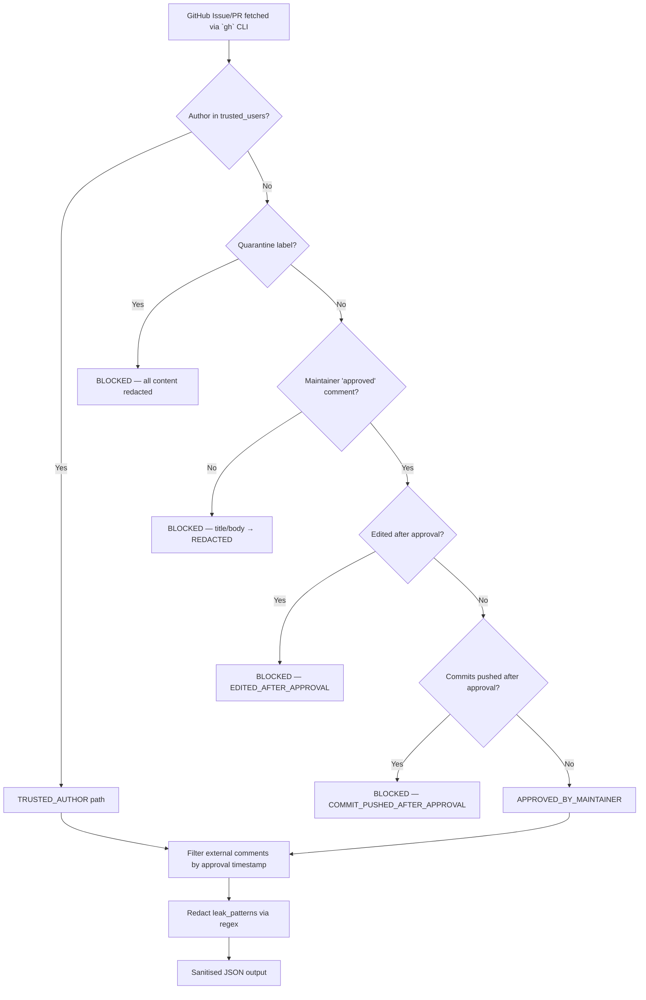
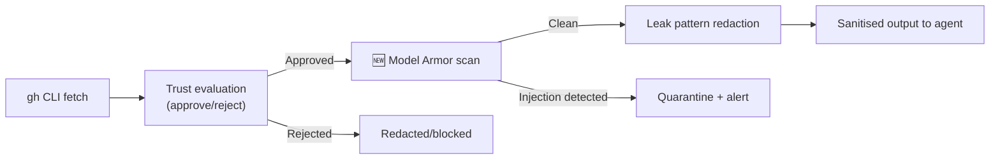
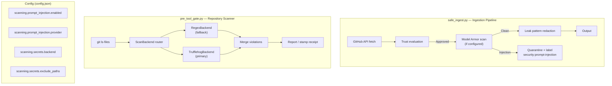
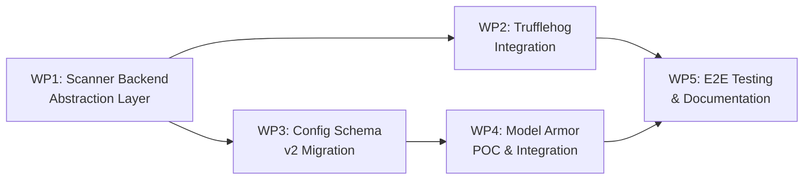

# Architecture Assessment: External Scanning & Prompt Injection Defence

**Issue:** [#22 — Investigate external scanning integrations](https://github.com/matthewmcneill/bug-fixer-loop-plugin/issues/22)
**Assessed:** 2026-10-02
**Status:** T4 (project-candidate) — multi-day research/design spike

---

## 1. Executive Summary

Issue #22 proposes replacing or augmenting the plugin's home-grown regex-based scanning infrastructure with purpose-built external services across two axes:

| Axis | Current | Proposed |
|------|---------|----------|
| **Prompt injection defence** | Regex patterns + trust-gating in `safe_ingest.py` | Google Cloud Model Armor |
| **Secret/leak detection** | Regex `leak_patterns` in `pre_tool_gate.py` | GCP DLP, GitHub Advanced Security, Trufflehog, Gitleaks |

The proposal is **architecturally sound** and addresses a real gap — regex cannot catch semantic prompt injection attacks. However, the current architecture already provides a remarkably strong trust-gating model that addresses the *primary* threat vector (untrusted external content) at the identity layer rather than the content layer. This assessment recommends a **layered approach** that treats external scanning as *defence-in-depth* rather than a wholesale replacement.

---

## 2. Current Architecture Analysis

### 2.1 The Trust Model (safe_ingest.py — 1,561 lines)

The existing security architecture in [`safe_ingest.py`](file:///Users/mcneillm/Documents/Projects/bug-fixer-loop-plugin/scripts/safe_ingest.py) is significantly more sophisticated than the issue description implies. It implements a **multi-layered trust model**:



**Key strengths of the current model:**
- **Identity-first gating** — untrusted content never enters agent context without explicit human approval
- **Temporal integrity** — post-approval edits and force-pushes are detected via GraphQL `lastEditedAt` / `includesCreatedEdit` / commit timestamps
- **Fail-closed semantics** — missing edit metadata, pagination overflow (>100 items), and unparseable timestamps all result in rejection
- **Quarantine labels** (`security:prompt-injection`) for manual flagging
- **Comment-level filtering** — even on approved issues, individual comments from untrusted authors are filtered by the approval timestamp

### 2.2 The Leak Scanner (pre_tool_gate.py — 500 lines)

[`pre_tool_gate.py`](file:///Users/mcneillm/Documents/Projects/bug-fixer-loop-plugin/scripts/pre_tool_gate.py) serves a dual role:

1. **PreToolUse gate** — stdin JSON → evaluate → allow/deny (file writes, shell commands)
2. **Repository scanner** — `--scan-only` / `--git-hook` / `--stamp-receipt` for leak pattern auditing

The scanner ([`scan_repository`](file:///Users/mcneillm/Documents/Projects/bug-fixer-loop-plugin/scripts/pre_tool_gate.py#L296-L338)) walks all git-tracked files against 3 regex patterns:
- `ya29\.[A-Za-z0-9_-]+` (Google OAuth tokens)
- `AKIA[0-9A-Z]{16}` (AWS access keys)
- `-----BEGIN (RSA |EC )?PRIVATE KEY-----` (PEM private keys)

### 2.3 Config Schema

The [`config.json`](file:///Users/mcneillm/Documents/Projects/bug-fixer-loop-plugin/.agents/plugins/bug-fixer-loop-workspace/config.json) schema (`bug-fixer-loop-config-v1`) is flat JSON with no nested objects for scanning config — just a `leak_patterns` string array. This simplicity is both a strength (easy to reason about) and a constraint (harder to configure per-backend options).

---

## 3. Threat Model Assessment

Before evaluating solutions, it's critical to enumerate what we're actually defending against:

### 3.1 Threats the Current System Handles Well

| Threat | Current Defence | Adequacy |
|--------|-----------------|----------|
| Untrusted issue/PR body injection | Identity-gating + approval model | ✅ Excellent |
| Post-approval content modification | Temporal edit checking via GraphQL | ✅ Excellent |
| Post-approval force-push | Commit timestamp validation | ✅ Excellent |
| Known secret patterns in files | Regex `leak_patterns` | ⚠️ Adequate for known patterns |
| Spec file / protected file modification | PreToolUse gate (Gate A) | ✅ Excellent |
| Forbidden `gh` commands | PreToolUse gate (Gate B) | ✅ Excellent |

### 3.2 Threats the Current System Does NOT Handle

| Threat | Gap | Impact |
|--------|-----|--------|
| Semantic prompt injection in *approved* content | Regex cannot detect "ignore previous instructions" variants | 🔴 High — trusted maintainer could unknowingly approve an issue containing adversarial instructions |
| Novel/obfuscated secret formats | Only 3 hardcoded patterns | 🟡 Medium — new cloud provider tokens, API keys, JWTs, etc. |
| Entropy-based secret detection | No entropy analysis | 🟡 Medium — high-entropy random strings in code |
| Exfiltration via indirect prompt injection | No output scanning | 🟡 Medium — agent could be instructed to embed secrets in PR descriptions |
| Base64/encoded payload evasion | Regex operates on raw text only | 🟡 Medium — `base64 -d` encoded injection payloads |

> [!IMPORTANT]
> The **most dangerous gap** is semantic prompt injection in *already-approved* content. The trust model assumes that once a maintainer says "approved", the content is safe. But a maintainer may not recognise adversarial instructions embedded in a long issue body. This is the primary case for Model Armor.

---

## 4. Integration Point Analysis

### 4.1 Where Model Armor Should Sit

The issue proposes Model Armor "between raw GitHub API fetch and the sanitised output" in `safe_ingest.py`. This is correct but needs refinement:



> [!TIP]
> **Critical design decision:** Model Armor should run **after** the trust evaluation gate, not before. Scanning every untrusted issue (which is already going to be blocked) wastes API calls and adds latency. Only scan content that *passes* trust evaluation — these are the items the agent will actually ingest.

**Recommended integration point:** Inside [`evaluate_and_sanitize_item`](file:///Users/mcneillm/Documents/Projects/bug-fixer-loop-plugin/scripts/safe_ingest.py#L672-L807), after the trust decision is `True` but before the final return, add a Model Armor content scan of the concatenated `title + body + comment bodies`.

### 4.2 Where External Secret Scanning Should Sit

The issue correctly identifies `scan_repository` in `pre_tool_gate.py` as the target. The key architectural question is:

**Should external scanning replace or wrap the existing regex engine?**

**Recommendation: Wrap, don't replace.**

```python
# Proposed scanner interface (pre_tool_gate.py)
class ScanBackend(Protocol):
    def scan_file(self, path: str, content: str) -> list[Violation]: ...

class RegexBackend:  # Current implementation
    ...

class TrufflehogBackend:  # External
    ...

class CompositeBackend:  # Runs multiple backends
    def __init__(self, backends: list[ScanBackend]): ...
```

This preserves backward compatibility while allowing backend swapping via config.

---

## 5. Option Evaluation

### 5.1 Prompt Injection Defence

| Criterion | Google Cloud Model Armor | Self-hosted LLM classifier | Enhanced regex heuristics |
|-----------|------------------------|---------------------------|--------------------------|
| **Accuracy** | ✅ High (LLM-aware, trained on adversarial datasets) | ⚠️ Depends on model quality | ❌ Fundamentally limited |
| **Latency** | ⚠️ 100-500ms per request (API call) | ⚠️ Depends on model/hardware | ✅ <1ms |
| **Cost** | ⚠️ Per-request pricing; needs investigation | 🔴 High infra cost | ✅ Free |
| **False positives** | ⚠️ Unknown; needs POC | ⚠️ Unknown | ✅ Controllable |
| **Maintenance** | ✅ Google-managed updates | 🔴 Self-managed model updates | 🔴 Manual pattern maintenance |
| **Batch mode** | ❓ Needs investigation | ✅ Self-controlled | ✅ Native |
| **Offline operation** | ❌ Requires API access | ✅ Local | ✅ Local |

> [!WARNING]
> **Latency is the critical concern for Model Armor.** The triage loop runs on `triage_cron: "0 * * * *"` (hourly) and processes an `issue-list` where each item goes through `evaluate_and_sanitize_item`. Adding 100-500ms per issue to a batch of 50 open issues = 5-25 seconds of additional latency per triage cycle. This is likely acceptable, but the engineering loop (`*/10 * * * *`) with `issue-view` adds per-view latency to the critical fix path.

**Recommendation:** Model Armor for ingestion is the right choice, with **caching** of scan results keyed on `(issue_number, lastEditedAt)` to avoid re-scanning unchanged content.

### 5.2 Secret/Leak Detection

| Criterion | GCP DLP API | GitHub Advanced Security | Trufflehog | Gitleaks | Current regex |
|-----------|-------------|------------------------|------------|----------|---------------|
| **Pattern coverage** | ✅ 150+ infotypes | ✅ 200+ partner patterns | ✅ 700+ detectors | ✅ 150+ rules | ❌ 3 patterns |
| **Entropy detection** | ✅ Built-in | ❌ Pattern-only | ✅ Built-in | ✅ Built-in | ❌ No |
| **Real-time (pre-commit)** | ⚠️ API latency | ⚠️ Push-time only | ✅ Local CLI | ✅ Local CLI | ✅ Local |
| **Batch (CI audit)** | ✅ API | ✅ GitHub Actions | ✅ CLI | ✅ CLI | ✅ CLI |
| **Cost** | ⚠️ Per-item pricing | ⚠️ GHAS license | ✅ Free (OSS) | ✅ Free (OSS) | ✅ Free |
| **Integration effort** | 🟡 API client | 🟡 GitHub-side setup | ✅ Drop-in CLI | ✅ Drop-in CLI | ✅ Already done |
| **Test-file false positives (#16)** | ✅ Path exclusions | ❓ Limited | ✅ `.trufflehogignore` | ✅ `.gitleaksignore` | ❌ No (fixed by #16) |
| **Preserves CLI interface** | ⚠️ Needs wrapper | ❌ Different paradigm | ✅ CLI compatible | ✅ CLI compatible | ✅ Native |

> [!TIP]
> **Trufflehog is the clear winner for the scanning backend.** It's free, local (no API latency), has the broadest detector coverage (700+), supports entropy analysis, has a `.trufflehogignore` file for the #16 false-positive problem, and can be embedded as a subprocess in the existing `scan_repository` function with minimal integration effort. Gitleaks is a strong second choice.

**Recommendation:** Trufflehog as the primary scanning backend, with the existing regex patterns retained as a zero-dependency fallback for environments where Trufflehog isn't installed.

---

## 6. Proposed Architecture

### 6.1 High-Level Design



### 6.2 Config Schema Evolution

The current flat `leak_patterns` array should evolve to a nested `scanning` object while maintaining backward compatibility:

```jsonc
{
  "$schema": "bug-fixer-loop-config-v2",
  
  // V1 backward compat — still honoured if scanning.secrets is absent
  "leak_patterns": ["ya29\\.[A-Za-z0-9_-]+", ...],
  
  // V2 scanning config
  "scanning": {
    "prompt_injection": {
      "enabled": false,  // opt-in initially
      "provider": "model-armor",
      "project": "my-gcp-project",
      "region": "us-central1",
      "cache_ttl_seconds": 3600
    },
    "secrets": {
      "backend": "trufflehog",  // "regex" | "trufflehog" | "gitleaks"
      "exclude_paths": ["tests/"],  // subsumes #16
      "trufflehog": {
        "extra_args": ["--only-verified"]
      },
      "fallback_patterns": ["ya29\\.[A-Za-z0-9_-]+", ...]
    }
  }
}
```

> [!NOTE]
> The schema version bump from `v1` → `v2` with full backward compatibility means existing deployments continue working unmodified. The `scanning` key is entirely optional.

### 6.3 Decomposition into Work Packages



| WP | Scope | Estimated Size | Dependencies |
|----|-------|---------------|--------------|
| **WP1** | Abstract `ScanBackend` protocol in `pre_tool_gate.py`, refactor `scan_repository` to accept backends | ~80 lines | None |
| **WP2** | Implement `TrufflehogBackend` wrapping `trufflehog filesystem` CLI | ~60 lines + tests | WP1 |
| **WP3** | Schema v2 with `scanning` namespace, backward-compat loader, `scan_exclude_paths` (subsumes #16) | ~100 lines | None |
| **WP4** | Model Armor POC: GCP client, cache layer, integration into `evaluate_and_sanitize_item` | ~150 lines + tests | WP3 |
| **WP5** | E2E tests, recommendation doc, migration guide | ~200 lines docs | WP2, WP4 |

---

## 7. Risk Analysis

### 7.1 Risks

| Risk | Likelihood | Impact | Mitigation |
|------|-----------|--------|------------|
| Model Armor false positives block legitimate issues | Medium | High | Soft-block mode: flag + warn rather than hard-reject; human review queue |
| Trufflehog binary not available in all environments | Medium | Medium | Graceful fallback to regex backend; skip with warning |
| GCP auth/credentials management for Model Armor | Low | High | Use Application Default Credentials; document setup |
| Config schema migration breaks existing deployments | Low | High | Full backward compat; `leak_patterns` still honoured |
| Latency regression on triage/engineering cycles | Medium | Medium | Cache scan results by `(number, lastEditedAt)` tuple |
| Model Armor scans the *agent's own bot comments* | Low | Low | Skip comments with `DEFAULT_BOT_PREFIXES` |

### 7.2 Non-Risks (Things the Current Architecture Already Handles)

- **Untrusted content from strangers** — the identity-gating model already blocks this; Model Armor is defence-in-depth
- **Post-approval content modification** — temporal integrity checks are robust
- **Agent modifying security scripts** — `HOST_SECURITY_SCRIPTS` immutability enforced in Gate A

---

## 8. Recommendations

### 8.1 Immediate (Pre-Investigation)

1. **Merge #16 first** — the `scan_exclude_paths` fix unblocks the false-positive problem and establishes the config pattern that WP3 builds on
2. **Install Trufflehog locally** and benchmark against the existing 3-pattern regex to quantify the detection improvement

### 8.2 Investigation Phase

3. **Model Armor POC scope**: Test against a corpus of known prompt injection payloads (e.g., the [Garak](https://github.com/leondz/garak) prompt injection dataset) plus 50 real issues from this repo to measure false-positive rate
4. **Latency benchmark**: Measure Model Armor API latency under `triage_cron` batch conditions (50 issues × 1 API call each)
5. **Cost modelling**: Get Model Armor pricing for estimated monthly volume (hourly triage × avg open issues)

### 8.3 Implementation Phase

6. **Start with WP1 + WP2** (scanner abstraction + Trufflehog) — this delivers immediate value with zero cloud dependency
7. **Model Armor (WP4) as opt-in** — gate behind `scanning.prompt_injection.enabled: true` to avoid forcing GCP dependency on all users
8. **Output scanning** — consider a future WP6 that scans agent *output* (PR descriptions, comments) for inadvertent secret leakage, not just input

### 8.4 What I Would NOT Do

- ❌ **Do not replace the trust model with Model Armor.** The identity-gating architecture is the *primary* defence. Model Armor is a supplementary content-level scan for the "trusted author unknowingly approves adversarial content" edge case.
- ❌ **Do not use GCP DLP for repository scanning.** The API latency and cost are unjustifiable when Trufflehog provides superior detection for free, locally.
- ❌ **Do not rely solely on GitHub Advanced Security.** It only scans at push-time and can't serve the `--git-hook` pre-commit gate.

---

## 9. Open Questions for the Author

1. **Is Model Armor available in your GCP project/region?** The service may have limited availability.
2. **What's the expected volume?** (open issues × triage frequency) — needed for cost modelling.
3. **Is offline/air-gapped operation a requirement?** If so, Model Armor is off the table and a local prompt-injection classifier would need investigation.
4. **Should the Trufflehog integration be mandatory or optional?** i.e., should `scan_repository` fail if Trufflehog isn't installed, or fall back silently?
5. **Is output scanning (agent→GitHub) in scope?** The current proposal only covers input scanning.

---

*Assessment by Antigravity — [Conversation](conversation://2397f715-bdd7-433c-a11a-8dbe008ee578)*
