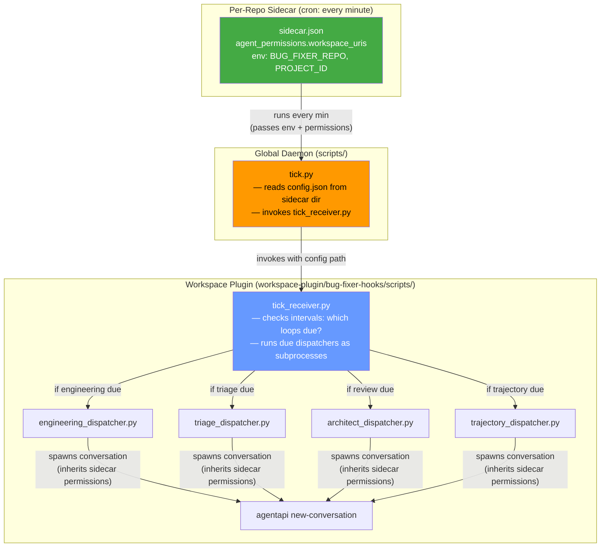

# Bug-Fixer Plugin — Final Architecture

> Incorporating all corrections + both comments on the revised architecture.

---

## Design Principles

1. **Global daemon is just a heartbeat** — `tick.py` routes to the workspace-plugin and nothing else
2. **All logic lives in the workspace-plugin** — dispatchers, hooks, skills, rules, cron scheduling
3. **Per-repo config co-located with per-repo sidecar** — `sidecars/<repo>/config.json` next to `sidecar.json`
4. **No external directories** — everything under `~/.gemini/config/plugins/bug-fixer-daemon/`
5. **Sidecars pass permissions through** — `agent_permissions.workspace_uris` on the sidecar governs all `agentapi` conversations spawned by its process tree

---

## Directory Layout

```
~/.gemini/config/plugins/bug-fixer-daemon/
├── plugin.json                              # { "name": "bug-fixer-daemon" }
│
├── scripts/
│   └── tick.py                              # Minimal: read config, invoke tick_receiver
│
├── sidecars/                                # One directory per enrolled repo
│   ├── esp32-app-foundation/
│   │   ├── sidecar.json                     # Sidecar config (rendered by configure.sh)
│   │   └── config.json                      # Per-repo config (maintainer, intervals, labels, etc.)
│   │
│   └── bug-fixer-loop-plugin/
│       ├── sidecar.json
│       └── config.json
│
└── workspace-plugin/                        # NOT loaded by global plugin reader
    └── bug-fixer-hooks/                     # name ≠ "bug-fixer-loop" (avoids collision)
        ├── plugin.json                      # { "name": "bug-fixer-hooks" }
        ├── hooks.json                       # PreToolUse gates
        │
        ├── rules/
        │   └── AGENTS.md
        │
        ├── skills/
        │   ├── bug-fixer/SKILL.md
        │   ├── bug-fixer-engineering/SKILL.md
        │   ├── bug-fixer-triage/SKILL.md
        │   ├── bug-fixer-trajectory-review/SKILL.md
        │   ├── architect-review/SKILL.md
        │   └── test-quality-audit/SKILL.md
        │
        ├── agents/
        │   └── leak-auditor.md
        │
        └── scripts/                         # ALL executable logic
            ├── tick_receiver.py              # Internal cron: which loops are due?
            ├── engineering_dispatcher.py     # Single-repo, unchanged
            ├── triage_dispatcher.py
            ├── architect_dispatcher.py
            ├── trajectory_dispatcher.py
            ├── pre_tool_gate.py             # Hook script
            ├── github_url_gate.py           # Hook script
            ├── liveness.py
            ├── bugfixer_api.py
            └── safe_ingest.py
```

Per enrolled repo:
```
<repo>/.agents/
└── plugins.json    # { "entries": [{ "path": "~/.gemini/config/plugins/bug-fixer-daemon/workspace-plugin" }] }
```

---

## No External Registry

The "registry" is the `sidecars/` directory itself:

```python
# To discover all enrolled repos:
daemon_dir = Path("~/.gemini/config/plugins/bug-fixer-daemon").expanduser()
for repo_dir in (daemon_dir / "sidecars").iterdir():
    if (repo_dir / "sidecar.json").exists():
        config = json.loads((repo_dir / "config.json").read_text())
        # repo_dir.name == "esp32-app-foundation"
```

**Benefits:**
- No `~/.local/share/` — everything self-contained under the daemon plugin
- Config co-located with the sidecar it belongs to
- Discovery is directory listing, not JSON parsing
- `agy plugin uninstall bug-fixer-daemon` removes everything

> [!NOTE]
> Antigravity's sidecar loader only reads `sidecar.json` from each sidecar directory. Extra files like `config.json` are ignored. **Verify in Phase 0 spike check.**

---

## Data Flow



---

## `tick.py` — Global Daemon (Minimal)

```python
#!/usr/bin/env python3
"""Heartbeat: read config for this repo, invoke tick_receiver in workspace plugin."""
import os, subprocess, sys
from pathlib import Path

DAEMON_DIR = Path(__file__).resolve().parent.parent       # bug-fixer-daemon/
TICK_RECEIVER = DAEMON_DIR / "workspace-plugin" / "bug-fixer-hooks" / "scripts" / "tick_receiver.py"

# Find this sidecar's config (sidecar.json is in sidecars/<repo>/, config.json beside it)
repo_slug = os.environ.get("BUG_FIXER_REPO", "")
if not repo_slug:
    sys.exit(0)

repo_safe = repo_slug.replace("/", "--")
config_path = DAEMON_DIR / "sidecars" / repo_safe / "config.json"

if not config_path.exists():
    print(f"TICK: No config for {repo_slug}, skipping", flush=True)
    sys.exit(0)

# Invoke the workspace plugin's tick_receiver with the config path
# All env vars (BUG_FIXER_REPO, ANTIGRAVITY_PROJECT_ID, PATH) propagate
subprocess.run(
    [sys.executable, str(TICK_RECEIVER), str(config_path)],
    env=os.environ,
)
```

**12 lines of logic.** That's the entire global daemon.

---

## `tick_receiver.py` — Workspace Plugin (Internal Cron)

```python
#!/usr/bin/env python3
"""Internal cron: check which loops are due for this repo, run them."""
import json, os, subprocess, sys, time
from pathlib import Path

SCRIPT_DIR = Path(__file__).resolve().parent
CONFIG_PATH = Path(sys.argv[1])
config = json.loads(CONFIG_PATH.read_text())

LOOPS = {
    "triage":       {"script": "triage_dispatcher.py",      "interval_min": config.get("triage_interval_min", 60)},
    "engineering":  {"script": "engineering_dispatcher.py",  "interval_min": config.get("engineering_interval_min", 10)},
    "pr_review":    {"script": "architect_dispatcher.py",    "interval_min": config.get("review_interval_min", 15)},
    "trajectory":   {"script": "trajectory_dispatcher.py",   "interval_min": config.get("trajectory_interval_min", 1440)},
}

# State: track last-run times next to config.json
state_dir = CONFIG_PATH.parent / "state"
state_dir.mkdir(parents=True, exist_ok=True)

for name, loop in LOOPS.items():
    marker = state_dir / f"{name}.last"
    if marker.exists():
        elapsed_min = (time.time() - marker.stat().st_mtime) / 60
        if elapsed_min < loop["interval_min"]:
            continue

    script = SCRIPT_DIR / loop["script"]
    print(f"TICK_RECEIVER: {name} is due — running {script.name}", flush=True)

    # Run dispatcher as subprocess (inherits all env: BUG_FIXER_REPO, PROJECT_ID, etc.)
    subprocess.Popen(
        [sys.executable, str(script)],
        env={**os.environ, "BUG_FIXER_CONFIG": str(CONFIG_PATH)},
    )
    marker.touch()
```

**Benefits:**
- All cron/interval logic in the workspace plugin — change once, updates everywhere
- Dispatchers don't change — they still read `BUG_FIXER_CONFIG` from env
- State files (`state/triage.last`, etc.) live next to the sidecar's `config.json`

---

## Per-Repo `sidecar.json`

```json
{
  "builtin": "schedule",
  "args": [
    "* * * * *",
    "<daemon_abs_path>/scripts/tick.py"
  ],
  "restart_policy": "always",
  "display_name": "Bug Fixer (matthewmcneill/esp32-app-foundation)",
  "description": "Runs triage, engineering, review, and trajectory loops for this repo.",
  "agent_permissions": {
    "workspace_uris": [
      "file:///Users/mcneillm/Documents/Projects/esp32-app-foundation"
    ]
  },
  "env": {
    "BUG_FIXER_REPO": "matthewmcneill/esp32-app-foundation",
    "ANTIGRAVITY_PROJECT_ID": "fee1fa3f-77c2-48e9-bf1f-649ba5599473",
    "PATH": "<captured at enrol>"
  }
}
```

---

## Per-Repo `config.json` (Same Directory)

```json
{
  "target_repo": "matthewmcneill/esp32-app-foundation",
  "repo_dir": "/Users/mcneillm/Documents/Projects/esp32-app-foundation",
  "maintainer": "matthewmcneill",
  "spec_file_path": "docs/design_specification.md",
  "test_command": "pio test -e native",
  "lint_command": "",
  "engineering_interval_min": 10,
  "triage_interval_min": 60,
  "review_interval_min": 15,
  "trajectory_interval_min": 1440,
  "project_id": "fee1fa3f-77c2-48e9-bf1f-649ba5599473",
  "required_labels": ["bug-fixer:engineer:needs-fix", "..."]
}
```

---

## Hook Config Resolution (Updated)

The hook scripts need to find the right per-repo config. In the new layout, the hooks fire in an enrolled workspace. The config lives in the daemon's `sidecars/<repo>/config.json`.

```python
def _load_config(workspace_path=None):
    # 1. BUG_FIXER_CONFIG env var (set by sidecar → tick.py → dispatcher)
    if os.environ.get("BUG_FIXER_CONFIG"):
        return json.loads(Path(os.environ["BUG_FIXER_CONFIG"]).read_text())

    # 2. Scan sidecars/ to find config matching this workspace
    daemon_dir = Path("~/.gemini/config/plugins/bug-fixer-daemon").expanduser()
    sidecars_dir = daemon_dir / "sidecars"
    if workspace_path and sidecars_dir.exists():
        workspace_resolved = str(Path(workspace_path).resolve())
        for repo_dir in sidecars_dir.iterdir():
            config_file = repo_dir / "config.json"
            if config_file.exists():
                config = json.loads(config_file.read_text())
                if workspace_resolved.startswith(config.get("repo_dir", "")):
                    return config

    # 3. Fail-open defaults
    return {"spec_file_path": "docs/design_specification.md", ...}
```

> [!NOTE]
> The scanning cost is trivial: iterate N directories (typically 1–5), read one JSON each, compare one string. Sub-millisecond.

---

## `configure.sh` Flow

```bash
# Enrol a repo:
./scripts/configure.sh --repo owner/repo --repo-dir /path/to/repo

# What it does:
# 1. Validate GitHub access, spec file, test command (existing logic)
# 2. Create labels on GitHub (existing logic)
# 3. Write sidecars/<repo-slug>/config.json (per-repo config)
# 4. Render sidecars/<repo-slug>/sidecar.json (with agent_permissions + env vars)
# 5. Write <repo>/.agents/plugins.json (enables workspace plugin)
# 6. Print: "Enable 'Bug Fixer (owner/repo)' in the Automations dashboard"
```

---

## What Changes vs. Current

| Component | Current | New |
|-----------|---------|-----|
| **Plugin location** | `.agents/plugins/` (workspace submodule) | `~/.gemini/config/plugins/bug-fixer-daemon/` (global) |
| **Hooks** | Injected into `.agents/hooks.json` (standalone, always fires) | Plugin-bundled in `workspace-plugin/`, loaded via `plugins.json` (per-repo, gated) |
| **Sidecars** | 4 × N standalone in `~/.gemini/config/sidecars/` | N plugin-bundled in `sidecars/<repo>/` |
| **Config** | `<repo>/.agents/plugins/bug-fixer-loop-workspace/config.json` | `sidecars/<repo>/config.json` (co-located with sidecar) |
| **Dispatchers** | In plugin source repo, referenced by absolute path | In `workspace-plugin/`, referenced relative to daemon |
| **Global daemon** | N/A | `tick.py` — 12 lines, just a router |
| **Cron scheduling** | One sidecar per loop per repo (4 × N) | One sidecar per repo (N), `tick_receiver.py` handles internal cron |

---

## Updated Phase 0 Spike Checks

| # | Check | Pass | If fail |
|---|-------|------|---------|
| 1 | Add a second `sidecars/<name>/sidecar.json` to loaded plugin | Appears in Automations dashboard without restart | Use standalone sidecars, or accept restart per enrolment |
| 2 | Sidecar with `agent_permissions` has its own switch | Recorded in `config.json` as `bug-fixer-spike/<name>` | Standalone sidecars |
| 3 | Extra files (`config.json`) in sidecar directory are ignored by loader | Sidecar starts normally | Move config elsewhere within daemon dir |
| 4 | Sidecar subprocess spawns `agentapi new-conversation` | Conversation inherits `agent_permissions`, writes file, runs commands | Revisit permission model |
| 5 | Conversation scoped to one repo can't write to another | **Denied** | Design needs rethinking |
| 6 | Check `${PLUGIN_ROOT}` substitution in args; check env for `PLUGIN_DATA` | Note which are available | Use absolute paths rendered at install time |
| 7 | `workspace-plugin/x/plugin.json` inside spike plugin | NOT listed globally; listed in repo naming it in `.agents/plugins.json` | Move workspace plugin elsewhere within daemon dir |
| 8 | Hook's stdin `workspacePaths` contains repo path | Present, including multi-root windows | Fall back to cwd + sidecars scan |

---

## Updated Phase Plan

### Phase 0 — Spike (~half day)
Run checks above. Pick daemon-plugin or fallback layout.

### Phase 1 — Workspace Plugin (PR1)
- [ ] Create `workspace-plugin/bug-fixer-hooks/` with hooks, skills, rules, agents, ALL scripts
- [ ] Name the workspace plugin `bug-fixer-hooks`
- [ ] Update `pre_tool_gate.py` to resolve config via `workspacePaths` → sidecars scan
- [ ] In each consumer repo (same PR): add `.agents/plugins.json`, remove injected hooks, remove submodule
- [ ] Leave existing 8 standalone sidecars running, pointed at new script locations

### Phase 2 — Per-Repo Sidecars (PR2)
- [ ] Write `tick.py` (router) and `tick_receiver.py` (internal cron)
- [ ] Have dispatchers read repo from `BUG_FIXER_REPO` env var + `BUG_FIXER_CONFIG` path
- [ ] `configure.sh` renders `sidecars/<repo>/sidecar.json` + `config.json`, writes `.agents/plugins.json`
- [ ] Enable new sidecar for one repo, confirm full cycle, delete 4 old standalone sidecars. Repeat.

### Phase 3 — Cleanup & Install Model (PR3)
- [ ] `install.sh` installs a tagged copy of the plugin
- [ ] Delete `hooks.json.template` and injection code
- [ ] Remove stale entries from `config.json` via LS RPC
- [ ] Write uninstall steps
- [ ] Update README
