# Implementation Plan v3.1: Plugin Architecture Migration

> **v3.1** fixes 5 blocking bugs in v3's own code, adds stdin-mode guard,
> incorporates should-fix items into WOs. Ready for WO0.

## Goal

Migrate from hacked architecture (injected hooks, 4×N standalone sidecars,
relative-path config resolution) to split daemon + workspace plugin pattern.

**Base branch:** `main` (at `50f406a`)
**Project name:** `plugin-architecture`
**Branch format:** `plugin-architecture/wo[N]-[topic]`

---

## Resolved Questions

- **Q1:** `configure.sh` → `enroll.sh` + `unenroll.sh`.
- **Q2:** Single merged config per repo at `sidecars/<repo>/config.json` (v2 schema, `repo_dir` required).
- **Q3:** No rename of `bug-fixer-loop-workspace` in fallback paths. Old name kept in migration code and `_repo_root()` compat check only. New layout has no workspace directory at all — config lives in `sidecars/<repo>/`.

---

## v2 → v3 Changes

| # | v2 bug | v3 fix |
|---|--------|--------|
| 1 | `rsync --delete-excluded` wipes `sidecars/` | `rsync -a --delete --exclude='sidecars/'` (no `--delete-excluded`) |
| 2 | `git mv scripts/` moves shell scripts too | Only `git mv` the `.py` files; `.sh` scripts stay at `scripts/` |
| 3 | Hyphenated dirs can't be Python imports | Per-file `sys.path.insert` (existing pattern); plain `import pre_tool_gate` |
| 4 | WO1 breaks live sidecars + hooks | Pre-WO1 step: pause old sidecars, disable hooks in this repo |
| 5 | `load_config()` calls before stdin read | `workspace_paths` passed as parameter; `main()` reads stdin first |
| 6 | Empty `repo_dir` matches cwd | Skip configs where `repo_dir` is missing or empty |
| 7 | Gate A gaps (installed scripts, `plugins.json` abs path, `rel_ws` vs hook cwd) | Prefix-protect entire install dir except `state/` |
| 8 | `Path("") or fallback` is truthy | Explicit `if env_val:` check |
| 9 | State migration during old sidecar writes | Reorder: remove old sidecars → migrate state → approve new |
| 10 | `bug-fixer-workspace` rename breaks existing installs | Drop rename in fallbacks; old name in migration only |
| 11 | `safe_ingest` silently returns defaults | Add `require=True` parameter |
| 12 | WO2 too large (16 files, `architect`) | Split into WO2a (gate core) + WO2b (other scripts, skills, rules) |
| 13 | `integrity_monitor` can't `git checkout` in install dir | Note: needs snapshot-based revert, not just path fix |
| 14 | Spike missing check 14 | Added: does `schedule` builtin handle overlapping ticks? |

## v3 → v3.1 Changes

| # | v3 bug | v3.1 fix |
|---|--------|----------|
| 1 | `_find_daemon_dir()` matches workspace plugin's `plugin.json` first | Match on `name == "bug-fixer-daemon"` in manifest |
| 2 | `Popen` `close_fds=True` drops lock fd; parent closes it immediately | `pass_fds=(fd,)` + `start_new_session=True`; parent closes its copy |
| 3 | `STATE_DIR = Path("")` truthiness bug (again); nested key lookup mismatches flat config | Explicit `if _state_env:` check; `CONFIG.get(loop["key"])` for flat keys |
| 4 | `tests/__init__.py` never runs with `discover -s tests` | Per-file `sys.path.insert` (existing pattern); `-t .` in all test commands |
| 5 | `.agents/hooks.json` copied not moved — still active | Pre-step: verify actually moved |
| 6 | Reading stdin in `main()` breaks `--git-hook`/`--scan-only` modes | Guard: only read stdin in hook mode; `isinstance(raw, dict)` check |
| 7 | `github_url_gate` calls `load_config()` without `workspace_paths` | Added to WO2a scope |
| 8 | `state/` exception too broad; `injection_cache.json` writable | Exact `<daemon>/sidecars/*/state/` match; keep `injection_cache.json` + `.integrity_snapshot.json` protected |
| 9 | `integrity_monitor` revert fix deferred with no WO | Moved into WO2b (before WO5); snapshot-based revert |
| 10 | WO5 missing `install.sh` step | Added as Step 2 |
| 11 | Dead code in `_repo_root()` sidecar branch | Removed — `config["repo_dir"]` returned before it |
| 12 | Wrong baseline: "203 pass" | Corrected: 200 pass, 3 skipped, 2 known failures |

---

## Deferred Fixes (apply before each WO's worker starts)

### WO2a
- **State exception is still substring match.** Code checks `"/state/" in f"/{rel}"` — matches `rules/state/`, `skills/state/`. Fix: match `rel.split("/")[0:3] == ["sidecars", <x>, "state"]` exactly. Add trailing `/` to prefix check. Resolve relative shell-command paths against the command's cwd before `realpath`.
- **Stdin guard misses `--stamp-pass` and `--verify-receipt`.** Define `hook_mode = not any mode flag set`. Also: empty stdin now hits `JSONDecodeError` → deny. Make that a deliberate choice with a comment.

### WO2b
- **Trust-sensitive files location.** Keep `injection_cache.json` and `.integrity_snapshot.json` in `sidecars/<repo>/` (not `state/`). Gate A prefix rule protects them automatically. Drop the basename exceptions inside `state/`. Integrity snapshot copies go in `.integrity_snapshot/` dir.
- **`bugfixer_api` dispatches path.** It reads `BUG_FIXER_CONFIG` parent + `/dispatches`, but dispatches now live in `state/dispatches`. Must read `BUG_FIXER_STATE_DIR` or derive `<config dir>/state`.

### WO3
- **Exit code collection.** With `start_new_session`, children outlive `tick_receiver`. A later tick can't `wait()`. Have each dispatcher write exit status to `state/<loop>.exit`.
- **Redirect stdout/stderr.** Children inherit the sidecar's pipe; once `tick.py` exits that pipe may close → EPIPE. Redirect to `state/<loop>.log`.

### Accepted Risk
- **Gates are off in this repo from WO1 through WO5.** Moving `.agents/hooks.json` aside means agents implementing these changes run with no gates. This is deliberate — the hooks file blocks edits to the very scripts being migrated.

### Pre-step (before WO1)
- **Both `.agents/hooks.json` and `.agents/hooks.json.disabled` still exist at 1705 bytes.** Must be resolved (move, not copy) before WO1 checkout.

---

## Dependency Graph

```mermaid
flowchart LR
    WO0["WO0: Spike<br/>(interactive)"]
    WO1["WO1: git-mv .py<br/>+ Daemon Scaffold"]
    WO2a["WO2a: load_config<br/>+ Gate A"]
    WO2b["WO2b: Other Scripts<br/>+ Skills + Rules"]
    WO3["WO3: tick.py +<br/>Dispatchers"]
    WO4["WO4: install.sh +<br/>enroll.sh"]
    WO5["WO5: Ordered<br/>Cutover"]
    WO6["WO6: Cleanup<br/>+ Docs + Tests"]

    WO0 --> WO1
    WO1 --> WO2a
    WO2a --> WO2b
    WO2b --> WO3
    WO3 --> WO4
    WO4 --> WO5
    WO5 --> WO6

    style WO0 fill:#f90,color:#000
    style WO1 fill:#69f,color:#fff
    style WO2a fill:#c33,color:#fff
    style WO2b fill:#69f,color:#fff
    style WO3 fill:#69f,color:#fff
    style WO4 fill:#69f,color:#fff
    style WO5 fill:#f90,color:#000
    style WO6 fill:#4a4,color:#fff
```



---

## WO0 — Phase 0 Spike (`interactive`)

14 checks with a throwaway plugin. No code changes. No branch.

| # | Check | Pass looks like |
|---|-------|-----------------|
| 1 | Second `sidecars/<name>/sidecar.json` appears without restart | In dashboard |
| 2 | Sidecar with `agent_permissions` gets own approval switch | Per-sidecar, not plugin-level |
| 3 | Extra files in sidecar dir ignored by loader | Sidecar starts normally |
| 4 | `agentapi new-conversation` inherits `agent_permissions` | Conversation can write in scoped repo |
| 5 | Conversation denied access to second repo | Denied |
| 6 | `${PLUGIN_ROOT}` / `PLUGIN_DATA` availability | Note which are available |
| 7 | `workspace-plugin/x/plugin.json` not listed globally; listed via `plugins.json` | Correct scoping |
| 8 | `workspacePaths` in hook stdin | Present and correct |
| 9 | **Workspace-plugin hooks fire in sidecar-started conversations** | Gates active |
| 10 | **Hook cwd is the directory containing hooks.json** | Relative `scripts/...` resolves |
| 11 | **`${PLUGIN_ROOT}` substituted in skill/rule text?** | Or only in sidecar args |
| 12 | **`plugins.json` expands `~`? Points at `workspace-plugin/` or `workspace-plugin/bug-fixer/`?** | Determines entry format |
| 13 | **`agy plugin enable` exists as CLI command?** | Or must use config.json |
| 14 | **`schedule` builtin: does it start a second tick while one runs, or kill it?** | Determines whether tick_receiver needs external overlap guard |

---

## WO1 — git-mv .py + Daemon Scaffold (`standard`)

**Base:** `main`
**Branch:** `plugin-architecture/wo1-daemon-scaffold`

### Pre-step: Prevent live breakage

> [!CAUTION]
> This repo's `.agents/hooks.json` and 4 standalone sidecars reference
> `scripts/*.py` by absolute path. Moving those files breaks the live system.

Before checking out WO1 in the main working tree:
1. Disable this repo's sidecars: remove `bug-fixer-*--bug-fixer-loop-plugin` entries from `~/.gemini/config/config.json` (set `enabled: false`)
2. Move `.agents/hooks.json` → `.agents/hooks.json.disabled` (**verify it's moved, not copied** — currently both files exist at 1705 bytes)
3. Record the 2 pre-existing test failures as known baseline (200 pass, 3 skipped, 2 fail)

esp32-app-foundation is safe — its submodule is pinned to an old commit.

### Step 1: Create daemon directory structure

```
daemon/
├── plugin.json                  # name: "bug-fixer-daemon"
├── scripts/
│   └── tick.py                  # scaffold only
└── workspace-plugin/
    └── bug-fixer/
        ├── plugin.json          # name: "bug-fixer"
        └── hooks.json           # 4 hook groups, relative paths
```

### Step 2: git mv .py files only

```bash
# Move Python scripts into workspace plugin
mkdir -p daemon/workspace-plugin/bug-fixer/scripts
for f in scripts/*.py; do
  git mv "$f" "daemon/workspace-plugin/bug-fixer/scripts/$(basename "$f")"
done

# Move skills, rules, agents
git mv skills/  daemon/workspace-plugin/bug-fixer/skills/
git mv rules/   daemon/workspace-plugin/bug-fixer/rules/
git mv agents/  daemon/workspace-plugin/bug-fixer/agents/
```

Shell scripts stay at `scripts/`: `install.sh`, `configure.sh`, `uninstall.sh`,
`migrate_labels.sh`, `setup_model_armor.sh`.

### Step 3: Update test imports

> [!CAUTION]
> `tests/__init__.py` does NOT run with `python3 -m unittest discover -s tests`.
> The top-level directory is `tests/` itself, so the package isn't imported.

Keep the existing per-file `sys.path.insert` pattern. Each test file already does this.
Update the path in each test file to point to the new scripts location:

```python
# At top of each test file (existing pattern, updated path):
import sys
from pathlib import Path
sys.path.insert(0, str(Path(__file__).resolve().parent.parent / "daemon" / "workspace-plugin" / "bug-fixer" / "scripts"))
```

Test files then use plain imports: `from pre_tool_gate import load_config`.

The intra-script imports (e.g. `pre_tool_gate.py` line 52: `from scripts.X import ...`)
need updating to plain imports too, since all `.py` files are now co-located.

### Step 4: Create hooks.json

4 hook groups from current main, with relative paths:
```json
{
  "bug-fixer-file-gate": {
    "PreToolUse": [{"matcher": "write_to_file|replace_file_content",
      "hooks": [{"type": "command", "command": "python3 scripts/pre_tool_gate.py", "timeout": 10}]}]
  },
  "bug-fixer-command-gate": {
    "PreToolUse": [{"matcher": "run_command",
      "hooks": [{"type": "command", "command": "python3 scripts/pre_tool_gate.py", "timeout": 10}]}],
    "PostToolUse": [{"matcher": "run_command",
      "hooks": [{"type": "command", "command": "python3 scripts/integrity_monitor.py --post", "timeout": 10}]}]
  },
  "bug-fixer-integrity-snapshot": {
    "PreToolUse": [{"matcher": "run_command",
      "hooks": [{"type": "command", "command": "python3 scripts/integrity_monitor.py --pre", "timeout": 10}]}]
  },
  "bug-fixer-url-gate": {
    "PreToolUse": [{"matcher": "read_url_content",
      "hooks": [{"type": "command", "command": "python3 scripts/github_url_gate.py", "timeout": 10}]}]
  }
}
```

### Verification
```bash
python3 -c "import sys; sys.path.insert(0, 'daemon/workspace-plugin/bug-fixer/scripts'); import pre_tool_gate; print('OK')"
python3 -m unittest discover -s tests -t . -v  # -t . required for imports; same 2 known failures
```

**Files moved:** ~20 `.py` files + skills/ + rules/ + agents/
**Files created:** 4 (`daemon/plugin.json`, workspace `plugin.json`, `hooks.json`, `tick.py` scaffold)
**Files modified:** ~12 test files (sys.path.insert update) + intra-script imports

---

## WO2a — load_config + Gate A Trust Anchors (`architect`)

**Base:** `plugin-architecture/wo1-daemon-scaffold`
**Branch:** `plugin-architecture/wo2a-config-gate`

**Objective:** Update `pre_tool_gate.py` only. Fix config resolution, extend Gate A.
Single file, highest risk, needs thorough testing.

### [MODIFY] `pre_tool_gate.py`

**(a) `load_config()` (line 225) — add workspace_paths parameter, extend candidates:**

```python
def load_config(
    config_path: str | Path | None = None,
    workspace_paths: list[str] | None = None,
) -> dict[str, Any]:
    target_path: Path | None = None

    # 1. Explicit path (fail-closed)
    if config_path:
        target_path = Path(config_path).expanduser().resolve()
        if not target_path.is_file():
            raise FileNotFoundError(f"Config not found: {target_path}")

    # 2. BUG_FIXER_CONFIG env (fail-closed)
    elif os.environ.get("BUG_FIXER_CONFIG"):
        env_path = Path(os.environ["BUG_FIXER_CONFIG"]).expanduser().resolve()
        if not env_path.is_file():
            raise FileNotFoundError(f"BUG_FIXER_CONFIG not found: {env_path}")
        target_path = env_path

    else:
        # 3. Sidecars scan (match workspace_paths)
        daemon_dir = _find_daemon_dir(Path(__file__).resolve().parent)
        if daemon_dir and workspace_paths:
            sidecars_dir = daemon_dir / "sidecars"
            if sidecars_dir.is_dir():
                for repo_dir_entry in sidecars_dir.iterdir():
                    cfg = repo_dir_entry / "config.json"
                    if not cfg.is_file():
                        continue
                    try:
                        data = json.loads(cfg.read_text())
                        cfg_repo_dir = data.get("repo_dir", "")
                        if not cfg_repo_dir:        # ← skip empty/missing
                            continue
                        cfg_repo_path = Path(cfg_repo_dir).resolve()
                        for wp in workspace_paths:
                            if Path(wp).resolve().is_relative_to(cfg_repo_path):
                                target_path = cfg
                                break
                    except (json.JSONDecodeError, OSError):
                        continue
                    if target_path:
                        break

        # 4. Legacy fallbacks (dev installs, old layout)
        if not target_path:
            script_dir = Path(__file__).resolve().parent
            plugin_dir = script_dir.parent
            for cand in [
                plugin_dir.parent / "bug-fixer-loop-workspace" / "config.json",
                Path.cwd() / ".agents" / "plugins" / "bug-fixer-loop-workspace" / "config.json",
            ]:
                if cand.is_file():
                    target_path = cand
                    break

    # 5. Defaults (fail-open)
    if target_path is None or not target_path.is_file():
        return normalise_config({
            "spec_file_path": "docs/plugin-architecture.md",
            "protected_files": ["docs/plugin-architecture.md"],
            "leak_patterns": [],
            "scan_exclude_paths": ["tests/"],
        })

    try:
        with open(target_path, "r", encoding="utf-8") as f:
            data = json.load(f)
            if not isinstance(data, dict):
                raise ValueError(f"Config at {target_path} must be a JSON object")
            data["_loaded_from"] = str(target_path)
            return normalise_config(data)
    except json.JSONDecodeError as exc:
        raise ValueError(f"Invalid JSON: {target_path}: {exc}") from exc
```

Key points:
- Legacy fallbacks keep `bug-fixer-loop-workspace` (the real existing name)
- `repo_dir` empty/missing → `continue` (not `Path("").resolve()` → cwd match)
- `workspace_paths` is a parameter, not read from stdin
- `normalise_config()` and `_loaded_from` stamping preserved exactly

**(b) `_find_daemon_dir()` — match daemon by manifest name:**

> [!CAUTION]
> v3 matched the first `plugin.json` it found walking up. The first hit is
> `workspace-plugin/bug-fixer/plugin.json` (name: `bug-fixer`), so `sidecars/`
> was never found and prefix protection covered the wrong tree.

```python
def _find_daemon_dir(script_dir: Path) -> Path | None:
    """Find the daemon plugin root by matching name == 'bug-fixer-daemon'.

    Must check the manifest name, not just existence, because the workspace
    plugin also has a plugin.json (name: 'bug-fixer').
    """
    for ancestor in [script_dir.parent, script_dir.parent.parent,
                     script_dir.parent.parent.parent]:
        manifest = ancestor / "plugin.json"
        if manifest.is_file():
            try:
                data = json.loads(manifest.read_text())
                if data.get("name") == "bug-fixer-daemon":
                    return ancestor
            except (json.JSONDecodeError, OSError):
                continue
    return None
```

**Test:** `test_find_daemon_dir_skips_workspace_plugin` — create the real WO1
directory layout in a tmpdir, verify the daemon dir (not workspace plugin) is returned.

**(c) `main()` — stdin-mode guard, read stdin first in hook mode only:**

```python
def main() -> int:
    # ... argparse ...

    # Stdin carries hook JSON only in hook mode.
    # --git-hook, --scan-only, --stamp-receipt use stdin for other purposes
    # (e.g. pre-push hook sends ref lines).
    stdin_data = {}
    workspace_paths = []
    if not (args.git_hook or args.scan_only or args.stamp_receipt):
        if not sys.stdin.isatty():
            try:
                raw = json.load(sys.stdin)
                if isinstance(raw, dict):    # guard: a JSON list would crash
                    stdin_data = raw
            except (json.JSONDecodeError, ValueError):
                # Invalid JSON from hook → deny (fail-closed, matches existing behavior)
                return _deny("Invalid JSON payload on stdin")

    workspace_paths = stdin_data.get("workspacePaths", [])

    config = load_config(args.config, workspace_paths=workspace_paths)
    # ... rest of main ...
```

**(c) `_derive_workspace_paths()` — prefix-protect install dir:**

```python
def _derive_workspace_paths(loaded_config_path: Path | None = None) -> frozenset[str]:
    protected = set(_STATIC_PROTECTED)

    # Protect the loaded config's directory
    if loaded_config_path:
        ws_dir = loaded_config_path.resolve().parent
        protected.add(str(ws_dir / "config.json"))
        protected.add(str(ws_dir / "injection_cache.json"))
        protected.add(str(ws_dir / "sidecar.json"))

    # Legacy relative paths (for shell command matching)
    protected.add(".agents/plugins/bug-fixer-loop-workspace/config.json")
    protected.add(".agents/plugins/bug-fixer-loop-workspace/injection_cache.json")

    # Protect .agents/plugins.json (both absolute and relative)
    protected.add(".agents/plugins.json")
    if loaded_config_path:
        repo_dir_str = None
        try:
            data = json.loads(loaded_config_path.read_text())
            repo_dir_str = data.get("repo_dir")
        except (json.JSONDecodeError, OSError):
            pass
        if repo_dir_str:
            protected.add(str(Path(repo_dir_str) / ".agents" / "plugins.json"))

    # Prefix-protect the entire daemon install directory (except state/)
    daemon_dir = _find_daemon_dir(Path(__file__).resolve().parent)
    if daemon_dir:
        protected.add(f"PREFIX:{daemon_dir}")  # handled by _ProtectedPaths

    return frozenset(protected)
```

**(d) `_ProtectedPaths.mentioned_in()` — handle PREFIX: entries:**

Extend the path matching to treat `PREFIX:<dir>` entries as directory prefixes.
Exception: allow writes under `<daemon>/sidecars/*/state/` EXCEPT
`injection_cache.json` and `.integrity_snapshot.json` (an agent rewriting these
could mark injected content as clean or forge snapshot hashes).

```python
# In _ProtectedPaths.build():
for entry in SCANNER_PROTECTED_FILES:
    if entry.startswith("PREFIX:"):
        self.protected_prefixes.append(entry[7:])
    else:
        # existing logic

# In _ProtectedPaths.mentioned_in():
def _is_prefix_protected(self, path: str) -> bool:
    norm = os.path.normpath(os.path.realpath(path))
    for prefix in self.protected_prefixes:
        if norm.startswith(prefix):
            # Allow state/ writes (but not trust-sensitive files inside it)
            rel = norm[len(prefix):].lstrip("/")
            if "/state/" in f"/{rel}" or rel.startswith("state/"):
                basename = os.path.basename(norm)
                if basename in ("injection_cache.json", ".integrity_snapshot.json"):
                    return True   # still protected
                return False      # allow
            return True           # protected
    return False
```

Paths are normalised before checking, so `sidecars/x/state/../config.json` resolves
to `sidecars/x/config.json` and is correctly blocked. Shell forms (`~/.gemini/...`,
`$HOME/.gemini/...`) are also tested in Gate B (see test list below).

**(e) `HOST_SECURITY_SCRIPTS` — add `integrity_monitor.py`:**
```python
HOST_SECURITY_SCRIPTS = frozenset({
    "pre_tool_gate.py", "safe_ingest.py", "safe_post.py",
    "injection_scanner.py", "shell_analysis.py", "github_url_gate.py",
    "integrity_monitor.py",
})
```

**(f) `_repo_root()` — keep old name in compat check only:**
```python
if ws_dir.name in ("bug-fixer-loop-workspace",) \
        and ws_dir.parent.parent.name == ".agents":
    return str(ws_dir.parent.parent.parent)
# Note: the sidecar layout (sidecars/<repo>/config.json) doesn't need
# _repo_root() — config["repo_dir"] is returned before this point.
```

### [NEW] Tests for load_config and Gate A

- `test_load_config_explicit_path` — loads, stamps `_loaded_from`
- `test_load_config_bad_explicit_raises` — `FileNotFoundError`
- `test_load_config_bad_env_raises` — `FileNotFoundError`
- `test_load_config_sidecars_scan_match` — correct config, skips empty `repo_dir`
- `test_load_config_defaults` — correct `spec_file_path`
- `test_find_daemon_dir_skips_workspace_plugin` — real WO1 layout in tmpdir
- `test_gate_a_deny_plugins_json` — both relative and absolute
- `test_gate_a_deny_sidecar_config` — sidecar dir protected
- `test_gate_a_deny_install_dir_script` — prefix protection
- `test_gate_a_allow_state_dir_write` — state/ exception works
- `test_gate_a_deny_state_injection_cache` — `injection_cache.json` in state/ still protected
- `test_gate_a_deny_state_integrity_snapshot` — `.integrity_snapshot.json` in state/ still protected
- `test_gate_a_deny_integrity_monitor` — now in HOST_SECURITY_SCRIPTS
- `test_gate_b_deny_edit_installed_hooks_json` — shell command protection
- `test_gate_b_prefix_shell_forms` — test `~/.gemini/...`, `$HOME/.gemini/...`, `../../` forms
- `test_gate_b_state_path_traversal` — `sidecars/x/state/../config.json` → denied

**Files modified:** 1 (`pre_tool_gate.py`)
**Tests added:** ~100 lines
**Complexity:** `architect`

**Also in WO2a:** Update `github_url_gate.py` to pass `workspace_paths` from
stdin to `load_config()` (same pattern as `main()`). Without this, interactive
sessions fall back to defaults and configured leak patterns are dropped.

---

## WO2b — Other Scripts + Skills + Rules (`standard`)

**Base:** `plugin-architecture/wo2a-config-gate`
**Branch:** `plugin-architecture/wo2b-scripts-skills`

**Objective:** Update path resolution in remaining 9 scripts, 5 skills, and 2 rules.

### Scripts with sibling-vs-nested bugs (3 scripts)

| Script | Line | Bug | Fix |
|--------|------|-----|-----|
| `integrity_monitor.py` | L36, L71 | `plugin_dir / ".agents/plugins/..."` | Use `BUG_FIXER_CONFIG` env → parent, fallback to `git rev-parse --show-toplevel` |
| `safe_post.py` | L37 | `PLUGIN_DIR / ".agents/plugins/..."` | Same pattern |
| `injection_scanner.py` | L214-216 | `parent.parent / ".agents/plugins/..."` | Same pattern |

> [!IMPORTANT]
> `integrity_monitor.py` does `git checkout` to revert changes, which won't work
> in the installed daemon directory (not a git repo). **Fix in this WO** (before
> WO5 runs): change to snapshot-based revert (copy files to `.integrity_snapshot/`
> in the pre-hook, restore from copies in the post-hook). Also add the installed
> `hooks.json`, `sidecar.json`, and `plugins.json` to its watch list.

### safe_ingest.py — deduplicate + add require parameter

- Import `load_config` from `pre_tool_gate` instead of duplicating
- Import `normalise_config` from `pre_tool_gate` instead of duplicating
- Add `require: bool = False` parameter: when `True`, raise if no config found
  (preserves safe_ingest's current fail-closed behavior for skill callers)
- When called from skills (no `BUG_FIXER_CONFIG` env, no `workspacePaths`),
  fall back to `cwd` or `git rev-parse --show-toplevel`

### bugfixer_api.py — keep old workspace name for now

`_WORKSPACE_NAME = "bug-fixer-loop-workspace"` stays — that's the real directory
name in existing installs. Updated only in the sidecar layout path.

### 4 dispatchers — update fallback paths

```python
# Keep: BUG_FIXER_CONFIG env (set by sidecar, always works)
# Update fallback only:
_config_relative = PLUGIN_DIR / "../bug-fixer-loop-workspace/config.json"  # unchanged - real name
```

### STATE_DIR in dispatchers — fix truthiness bug

```python
# WRONG (v2):
STATE_DIR = Path(os.environ.get("BUG_FIXER_STATE_DIR", "")) or CONFIG_FILE.parent / "state"
# FIXED (v3):
_state_env = os.environ.get("BUG_FIXER_STATE_DIR")
STATE_DIR = Path(_state_env) if _state_env else (CONFIG_FILE.parent / "state" if CONFIG_FILE else Path.cwd())
```

### 5 skills — update STATE_DIR references

Update `STATE_DIR` descriptions to note it comes from the `BUG_FIXER_STATE_DIR`
env var when running under the sidecar. Keep legacy path descriptions for
when running interactively.

### rules/github-reads.md + github_url_gate.py REASON

Use absolute installed path: `python3 <abs_path>/safe_ingest.py`.
If WO0 check 11 confirms `${PLUGIN_ROOT}` works in rule text, use that instead.
Also update the `REASON` string in `github_url_gate.py`.

**Files modified:** ~14
**Complexity:** `standard`

---

## WO3 — tick.py + tick_receiver.py (`standard`)

**Base:** `plugin-architecture/wo2b-scripts-skills`
**Branch:** `plugin-architecture/wo3-tick-dispatchers`

### [MODIFY] `daemon/scripts/tick.py`

Minimal router (~15 lines). `BUG_FIXER_CONFIG` already in env from sidecar.
Invokes `tick_receiver.py`, propagates exit code.

### [NEW] `daemon/workspace-plugin/bug-fixer/scripts/tick_receiver.py`

~120 lines. Design points from review:

- **Persistent last-run times:** `state/<loop>.last` (mtime-based)
- **Missed-tick policy:** run immediately if overdue
- **Locking:** `fcntl.flock()` on `state/<loop>.lock` — auto-released on crash
- **Parallel dispatch:** `subprocess.Popen` with `pass_fds` so triage
  isn't blocked by a long engineering run
- **Exit code logging:** parent reaps finished children each tick
- **Cron-to-interval:** `enroll.sh` converts existing `*_cron` keys to
  `*_interval_min` flat keys. Trajectory `"0 18 * * *"` → `1440` (24h).

> [!CAUTION]
> **v3 bugs fixed:** (1) `Path("")` is truthy — use explicit `if` check.
> (2) `Popen` defaults to `close_fds=True` so child never inherits lock fd —
> use `pass_fds`. (3) `CONFIG.get(name, {}).get("interval_min")` expects nested
> key, but `enroll.sh` writes flat `triage_interval_min` — use flat key.

```python
import fcntl, json, os, subprocess, sys, time
from pathlib import Path

CONFIG = json.loads(Path(os.environ["BUG_FIXER_CONFIG"]).read_text())

_state_env = os.environ.get("BUG_FIXER_STATE_DIR")
STATE_DIR = Path(_state_env) if _state_env else Path(os.environ["BUG_FIXER_CONFIG"]).parent / "state"
STATE_DIR.mkdir(parents=True, exist_ok=True)
SCRIPTS_DIR = Path(__file__).resolve().parent

LOOPS = {
    "triage":      {"script": "triage_dispatcher.py",     "key": "triage_interval_min",      "default": 60},
    "engineering": {"script": "engineering_dispatcher.py", "key": "engineering_interval_min",  "default": 10},
    "architect":   {"script": "architect_dispatcher.py",   "key": "architect_interval_min",    "default": 15},
    "trajectory":  {"script": "trajectory_dispatcher.py",  "key": "trajectory_interval_min",   "default": 1440},
}

for name, loop in LOOPS.items():
    interval = CONFIG.get(loop["key"], loop["default"])  # flat key, not nested
    marker = STATE_DIR / f"{name}.last"
    lock_file = STATE_DIR / f"{name}.lock"

    # Check if due
    if marker.exists():
        elapsed = time.time() - marker.stat().st_mtime
        if elapsed < interval * 60:
            continue

    # Try lock (non-blocking)
    lock_fd = open(lock_file, "w")
    try:
        fcntl.flock(lock_fd, fcntl.LOCK_EX | fcntl.LOCK_NB)
    except BlockingIOError:
        lock_fd.close()
        continue  # already running

    # Launch — pass the lock fd to the child so IT holds the lock
    marker.touch()
    child_fd = lock_fd.fileno()
    proc = subprocess.Popen(
        [sys.executable, str(SCRIPTS_DIR / loop["script"])],
        env=os.environ,
        pass_fds=(child_fd,),
        start_new_session=True,  # survive parent exit
    )
    lock_fd.close()  # parent releases its copy; child still holds it
    # Child's copy of lock_fd auto-closes (and releases flock) when it exits
```

> [!NOTE]
> **Spike check 14 extension:** also verify that children started with
> `Popen(..., start_new_session=True)` survive when `tick.py` exits. If the
> `schedule` builtin kills the entire process group, every dispatcher dies
> within milliseconds. If so, tick_receiver must `wait()` for all children.

**Files created:** 1 (`tick_receiver.py`)
**Files modified:** 1 (`tick.py`)

---

## WO4 — install.sh + enroll.sh (`architect`)

**Base:** `plugin-architecture/wo3-tick-dispatchers`
**Branch:** `plugin-architecture/wo4-install-enroll`

### [MODIFY] `scripts/install.sh`

```bash
INSTALL_DIR="$HOME/.gemini/config/plugins/bug-fixer-daemon"
mkdir -p "$INSTALL_DIR/sidecars"

# Targeted install — never touches sidecars/ (per-repo data)
rsync -a --delete --exclude='sidecars/' daemon/ "$INSTALL_DIR/"

echo "Installed to $INSTALL_DIR"
echo "Run: ./scripts/enroll.sh -r <owner/repo> -d <repo-dir> to enroll a repo"
```

No `--delete-excluded`. The `--delete` flag removes stale daemon-owned files
(old scripts, updated skills) but `--exclude='sidecars/'` prevents it from
touching per-repo data.

### [NEW] `scripts/enroll.sh`

Carries over interactive wizard from `configure.sh` with updated output locations:
- Config: `$INSTALL_DIR/sidecars/<repo-slug>/config.json` (merged v2 schema)
  - `repo_dir` is required and validated
  - Converts `*_cron` → `*_interval_min`
- Sidecar: `$INSTALL_DIR/sidecars/<repo-slug>/sidecar.json`
  - `BUG_FIXER_CONFIG` set to absolute config path
  - `BUG_FIXER_STATE_DIR` set to absolute state dir
- State dir: `$INSTALL_DIR/sidecars/<repo-slug>/state/` (created empty)
- Consumer repo: `<repo>/.agents/plugins.json`

Supports `--migrate-state` flag for explicit state migration (used in cutover).

### [NEW] `scripts/unenroll.sh`

~40 lines. Removes sidecar dir, removes `.agents/plugins.json` entry.
Warns about in-flight claims.

### [DELETE] `scripts/configure.sh`

**Files renamed:** 1
**Files modified:** 1
**Files created:** 1

---

## WO5 — Ordered Cutover (`interactive`)

**Complexity:** `interactive` — user drives. No branch (touches external repo).

> [!WARNING]
> Between steps 2 and 4, both old and new **hooks** fire on the same tool calls.
> This is harmless for deny-gates (double-deny is fine) but means `integrity_monitor`
> runs twice. This is a brief window, not "zero duplicate-fire."

### Cutover sequence per repo:

**Step 1: Remove old sidecars** (stop writes to old state)
```bash
# Remove standalone sidecars for this repo
rm -rf ~/.gemini/config/sidecars/bug-fixer-*--<repo-slug>/

# Remove their entries from ~/.gemini/config/config.json
# (edit manually or use jq)
```

**Step 2: Install the daemon plugin** (if not already installed)
```bash
cd /path/to/bug-fixer-loop-plugin
./scripts/install.sh
```

**Step 3: Enroll + migrate state**
```bash
./scripts/enroll.sh -r <owner/repo> -d <repo-dir> --migrate-state
# --migrate-state copies claims/, dispatches/, pr_completions.jsonl, etc.
# from <repo>/.agents/plugins/bug-fixer-loop-workspace/ to
# ~/.gemini/config/plugins/bug-fixer-daemon/sidecars/<repo-slug>/state/
```

**Step 4: Verify new hooks fire**
- Open workspace in Antigravity
- Confirm hooks load from `plugins.json` → workspace plugin
- Test: write to a protected file → denied

**Step 5: Remove injected hooks from consumer repo**
- esp32-app-foundation `.agents/hooks.json`: remove all 4 `bug-fixer-*` entries
  (keep `flash-tag-gate`, `pio-cli-gate`, `pio-reset-gate`)
- bug-fixer-loop-plugin `.agents/hooks.json`: remove all bug-fixer hooks (gitignored)

**Step 6: Remove git submodule** from esp32-app-foundation
```bash
git submodule deinit .agents/plugins/bug-fixer-loop-plugin
git rm .agents/plugins/bug-fixer-loop-plugin
```

**Step 7: Remove old workspace dirs**
```bash
rm -rf <repo>/.agents/plugins/bug-fixer-loop-workspace/
```

**Step 8: Remove plugin rules from `.agents/rules/`** (both repos)
```bash
rm .agents/rules/bug-fixer-AGENTS.md
rm .agents/rules/github-reads.md
```

**Step 9: Approve new sidecars** in Automations dashboard

---

## WO6 — Legacy Cleanup + Docs + Tests (`standard`)

**Base:** `plugin-architecture/wo4-install-enroll`
**Branch:** `plugin-architecture/wo6-cleanup-docs-tests`

### [DELETE] Legacy files
- `hooks.json.template`
- `sidecars/` directory (4 old templates)
- Root `plugin.json`
- Root `config.json`

### [DELETE] Root clutter
- `pr_52.json`, `update_pr.sh`, `update_pr2.sh`, `approve_pr.sh`
- `test-repo/`, `test-remote/`
- `matthewmcneill_bug-fixer-loop-plugin_triage_preview.json`

### [MODIFY] `scripts/uninstall.sh`
- Remove `~/.gemini/config/plugins/bug-fixer-daemon/`
  - Require `--force` if `sidecars/` is non-empty
  - Warn about per-repo data loss
- Clean stale entries from `~/.gemini/config/config.json`

### [MODIFY] `docs/plugin-architecture.md`
Update for split-daemon pattern, enroll/unenroll commands, new directory layout.

### [MODIFY] `README.md`
Update installation and usage.

### Fix pre-existing test failures
- `test_legitimate_commands_are_allowed` (`git push` blocked)
- `test_no_function_scoped_imports_in_scripts` (`injection_scanner.py:82`)

Record or fix before claiming "tests pass after each WO."

---

## Verification Plan

### Automated Tests

```bash
# After each WO (known baseline: 200 pass, 3 skipped, 2 known failures):
python3 -m unittest discover -s tests -t . -v
```

### Manual Verification

**After WO2a:** Gate A denies writes to `.agents/plugins.json`, sidecar configs,
installed scripts, `integrity_monitor.py`. Allows writes to `state/` paths.

**After WO4:** `install.sh` + `enroll.sh` creates correct structure.
Re-running `install.sh` does NOT wipe `sidecars/`.

**After WO5:** Hooks fire via `plugins.json`. No stale standalone sidecars.
Dispatcher runs, creates PR. State migrated correctly.
