# Implementation Plan: Plugin Architecture Migration

## Goal

Migrate the bug-fixer-loop-plugin from its current hacked architecture (injected hooks, 4×N standalone sidecars, relative-path config resolution) to the split daemon + workspace plugin pattern (1 global daemon, per-repo sidecars, per-workspace activation via `plugins.json`).

**Base branch:** `main` (at `50f406a` — PR#47 scanning-infra and all fixes merged)
**Project name:** `plugin-architecture`
**Branch format:** `plugin-architecture/wo[N]-[topic]`

---

## User Review Required

> [!IMPORTANT]
> **WO0 (Phase 0 spike) is `interactive`.** It requires you to run checks in a live Antigravity session with a throwaway plugin. I will provide a bridge prompt — you drive the testing session, then return with results. The architecture choice (daemon-plugin vs standalone-sidecars fallback) depends on WO0 outcomes.

> [!WARNING]
> **Consumer repo changes (WO5) touch `esp32-app-foundation`.** This WO modifies `.agents/hooks.json`, removes the git submodule at `.agents/plugins/bug-fixer-loop-plugin`, and removes `.agents/plugins/bug-fixer-workspace/`. These are committed artifacts in a separate repository. You'll need to commit and push those changes from the esp32-app-foundation repo.

> [!IMPORTANT]
> **This repo is also a consumer.** The bug-fixer-loop-plugin repo itself is enrolled (has `.agents/hooks.json` with bug-fixer hooks, `.agents/plugins/bug-fixer-workspace/`). WO5 needs to handle BOTH repos.

---

## Resolved Questions

- **Q1: Command naming** — ✅ `configure.sh` → `enroll.sh`, add `unenroll.sh`. Full verb set: `install`/`uninstall` (machine), `enroll`/`unenroll` (repo).
- **Q2: Config merge** — ✅ Single merged config per repo at `sidecars/<repo>/config.json` (v2 schema). `enroll.sh` produces one file. Old `bug-fixer-workspace/config.json` and root `config.json` cleaned up.
- **Naming** — ✅ `bug-fixer-loop-workspace` → `bug-fixer-workspace` in all references.

---

## Proposed Changes

### Dependency Graph

```mermaid
flowchart LR
    WO0["WO0: Spike<br/>(interactive)"]
    WO1["WO1: Daemon Scaffold<br/>+ Workspace Plugin"]
    WO2["WO2: Hook Config<br/>Resolution"]
    WO3["WO3: tick.py +<br/>Dispatchers"]
    WO4["WO4: install.sh +<br/>enroll.sh"]
    WO5["WO5: Consumer<br/>Cleanup"]
    WO6["WO6: Legacy Cleanup<br/>+ Docs + Tests"]

    WO0 --> WO1
    WO1 --> WO2
    WO2 --> WO3
    WO3 --> WO4
    WO4 --> WO5
    WO5 --> WO6

    style WO0 fill:#f90,color:#000
    style WO1 fill:#69f,color:#fff
    style WO2 fill:#69f,color:#fff
    style WO3 fill:#69f,color:#fff
    style WO4 fill:#69f,color:#fff
    style WO5 fill:#4a4,color:#fff
    style WO6 fill:#4a4,color:#fff
```



All WOs strictly serialised. No parallel execution.

---

### WO0 — Phase 0 Spike (`interactive`)

**Complexity:** `interactive` — not spawned, bridge prompt to user.

**Objective:** Validate 8 undocumented Antigravity behaviors with a throwaway `bug-fixer-spike` plugin before committing to the daemon-plugin layout.

**Checks:**

| # | Check | Pass looks like |
|---|-------|-----------------|
| 1 | Add second `sidecars/<name>/sidecar.json` to loaded plugin | Appears in Automations dashboard without restart |
| 2 | Sidecar with `agent_permissions.workspace_uris` has own switch | Recorded in `config.json` as `bug-fixer-spike/<name>` |
| 3 | Extra files (`config.json`) in sidecar dir ignored by loader | Sidecar starts normally |
| 4 | `agentapi new-conversation` from sidecar inherits `agent_permissions` | Conversation writes file + runs commands |
| 5 | Conversation can't write in second repo | **Denied** |
| 6 | `${PLUGIN_ROOT}` substitution; `PLUGIN_DATA` vs `ANTIGRAVITY_EXECUTABLE_DATA_DIR` | Note which are available |
| 7 | `workspace-plugin/x/plugin.json` NOT listed globally; listed via `plugins.json` | Global: absent. Workspace: present with hooks |
| 8 | Hook stdin `workspacePaths` contains correct repo path | Present, even in multi-root window |

**If checks 1–2 pass:** proceed with daemon-plugin layout.
**If either fails:** use standalone sidecars in `~/.gemini/config/sidecars/` (everything else stays the same).

**No branch created for WO0 — no code changes.**

---

### WO1 — Daemon Scaffold + Workspace Plugin (`standard`)

**Base:** `main`
**Branch:** `plugin-architecture/wo1-daemon-scaffold`

**Objective:** Create the global daemon plugin directory structure and the workspace plugin bundle containing all hooks, skills, rules, and agents. This is a pure file-creation WO — no behavior changes yet.

#### [NEW] `daemon/plugin.json`
```json
{
  "name": "bug-fixer-daemon",
  "version": "0.3.0",
  "description": "Bug Fixer background service — per-repo sidecars for autonomous bug fixing loops."
}
```

> [!NOTE]
> The `daemon/` directory is the **source layout** within the repo. `install.sh` (WO4) will copy/symlink it to `~/.gemini/config/plugins/bug-fixer-daemon/`. We do NOT create files directly at the install location in source control.

#### [NEW] `daemon/workspace-plugin/bug-fixer/plugin.json`
```json
{
  "name": "bug-fixer",
  "version": "0.3.0",
  "description": "Autonomous bug fixer loop — hooks, skills, and rules for enrolled workspaces."
}
```

#### [NEW] `daemon/workspace-plugin/bug-fixer/hooks.json`
Converted from current `.agents/hooks.json` on main with paths made relative:
```json
{
  "bug-fixer-file-gate": {
    "PreToolUse": [{
      "matcher": "write_to_file|replace_file_content",
      "hooks": [{"type": "command", "command": "python3 scripts/pre_tool_gate.py", "timeout": 10}]
    }]
  },
  "bug-fixer-command-gate": {
    "PreToolUse": [{
      "matcher": "run_command",
      "hooks": [{"type": "command", "command": "python3 scripts/pre_tool_gate.py", "timeout": 10}]
    }],
    "PostToolUse": [{
      "matcher": "run_command",
      "hooks": [{"type": "command", "command": "python3 scripts/integrity_monitor.py --post", "timeout": 10}]
    }]
  },
  "bug-fixer-integrity-snapshot": {
    "PreToolUse": [{
      "matcher": "run_command",
      "hooks": [{"type": "command", "command": "python3 scripts/integrity_monitor.py --pre", "timeout": 10}]
    }]
  },
  "bug-fixer-url-gate": {
    "PreToolUse": [{
      "matcher": "read_url_content",
      "hooks": [{"type": "command", "command": "python3 scripts/github_url_gate.py", "timeout": 10}]
    }]
  }
}
```

#### [NEW] `daemon/workspace-plugin/bug-fixer/rules/AGENTS.md`
Copy of `rules/AGENTS.md` (121 lines, 18 safety rules).

#### [NEW] `daemon/workspace-plugin/bug-fixer/rules/github-reads.md`
Copy of `rules/github-reads.md`.

#### [NEW] `daemon/workspace-plugin/bug-fixer/skills/` (entire tree)
Copy of `skills/` (6 skill directories with SKILL.md, EVAL.md, references/).

#### [NEW] `daemon/workspace-plugin/bug-fixer/agents/leak-auditor.md`
Copy of `agents/leak-auditor.md`.

#### [NEW] `daemon/workspace-plugin/bug-fixer/scripts/`
Copy of hook scripts and security scripts: `pre_tool_gate.py`, `github_url_gate.py`, `integrity_monitor.py`, `shell_analysis.py`.
(Dispatchers and supporting scripts moved here in WO3.)

#### [NEW] `daemon/scripts/tick.py`
Minimal heartbeat script (~15 lines). Full implementation in WO3, but scaffold here:
```python
#!/usr/bin/env python3
"""Heartbeat: invoke tick_receiver in workspace plugin."""
# TODO: Full implementation in WO3
import sys
print("tick.py: not yet implemented", file=sys.stderr)
sys.exit(0)
```

**Files created:** ~30 new files under `daemon/`
**Files modified:** none
**Files deleted:** none

---

### WO2 — Hook Config Resolution (`standard`)

**Base:** `plugin-architecture/wo1-daemon-scaffold`
**Branch:** `plugin-architecture/wo2-hook-config-resolution`

**Objective:** Update `pre_tool_gate.py` and `github_url_gate.py` in the workspace plugin to resolve config via `workspacePaths` → sidecars directory scan, instead of relative paths from `__file__`.

#### [MODIFY] `daemon/workspace-plugin/bug-fixer/scripts/pre_tool_gate.py`

Replace `_load_config()` (lines 100–130) with new resolution:
```python
def _load_config(explicit_path=None, workspace_path=None):
    """Loads plugin config. Resolution order:
    1. Explicit path (CLI --config)
    2. BUG_FIXER_CONFIG env var (set by sidecar → tick.py → dispatcher)
    3. workspacePaths → sidecars/<repo>/config.json scan
    4. Fail-open defaults
    """
    if explicit_path:
        p = Path(explicit_path).expanduser().resolve()
        if p.is_file():
            return json.loads(p.read_text())

    if os.environ.get("BUG_FIXER_CONFIG"):
        env_path = Path(os.environ["BUG_FIXER_CONFIG"]).expanduser().resolve()
        if env_path.is_file():
            return json.loads(env_path.read_text())

    # Scan sidecars/ for a config matching this workspace
    daemon_dir = Path.home() / ".gemini/config/plugins/bug-fixer-daemon"
    cache_file = daemon_dir / "workspace-cache.json"

    # Try cache first
    if workspace_path and cache_file.exists():
        try:
            cache = json.loads(cache_file.read_text())
            sidecar_name = cache.get(str(Path(workspace_path).resolve()))
            if sidecar_name:
                config_path = daemon_dir / "sidecars" / sidecar_name / "config.json"
                if config_path.exists():
                    return json.loads(config_path.read_text())
        except (json.JSONDecodeError, OSError):
            pass

    # Cache miss → scan sidecars/
    sidecars_dir = daemon_dir / "sidecars"
    if workspace_path and sidecars_dir.exists():
        ws_resolved = str(Path(workspace_path).resolve())
        for repo_dir in sidecars_dir.iterdir():
            cfg = repo_dir / "config.json"
            if cfg.exists():
                try:
                    config = json.loads(cfg.read_text())
                    if ws_resolved.startswith(config.get("repo_dir", "\0")):
                        return config
                except (json.JSONDecodeError, OSError):
                    continue

    # Fail-open defaults
    return {
        "spec_file_path": "docs/design_specification.md",
        "protected_files": ["docs/design_specification.md"],
        "leak_patterns": [],
        "scan_exclude_paths": ["tests/"],
    }
```

Also update `main()` to extract `workspacePaths` from stdin and pass to `_load_config()`.

#### [MODIFY] `daemon/workspace-plugin/bug-fixer/scripts/github_url_gate.py`
Minimal change — this script is 57 lines. Update config resolution to use same pattern (or import from shared module).

#### [MODIFY] `tests/test_pre_tool_gate.py`
Add tests for the new config resolution: cache hit, cache miss → scan, no sidecars dir → defaults.

**Files modified:** 3
**Lines changed:** ~120 net

---

### WO3 — tick.py + tick_receiver.py + Dispatcher Adaptation (`standard`)

**Base:** `plugin-architecture/wo2-hook-config-resolution`
**Branch:** `plugin-architecture/wo3-tick-dispatchers`

**Objective:** Implement the tick/dispatch pipeline. Create `tick_receiver.py` with internal cron logic. Adapt all 4 dispatchers to read repo from env vars instead of relative paths.

#### [MODIFY] `daemon/scripts/tick.py`
Replace the scaffold with the full 15-line implementation:
```python
#!/usr/bin/env python3
"""Heartbeat: read config for this repo, invoke tick_receiver in workspace plugin."""
import os, subprocess, sys
from pathlib import Path

DAEMON_DIR = Path(__file__).resolve().parent.parent
TICK_RECEIVER = DAEMON_DIR / "workspace-plugin" / "bug-fixer" / "scripts" / "tick_receiver.py"

repo_slug = os.environ.get("BUG_FIXER_REPO", "")
if not repo_slug:
    sys.exit(0)

repo_safe = repo_slug.replace("/", "--")
config_path = DAEMON_DIR / "sidecars" / repo_safe / "config.json"

if not config_path.exists():
    print(f"TICK: No config for {repo_slug}, skipping", flush=True)
    sys.exit(0)

subprocess.run([sys.executable, str(TICK_RECEIVER), str(config_path)], env=os.environ)
```

#### [NEW] `daemon/workspace-plugin/bug-fixer/scripts/tick_receiver.py`
Internal cron logic (~45 lines) — checks which loops are due, runs dispatchers as subprocesses.

#### [MODIFY] Move dispatchers to workspace plugin
Copy `scripts/{engineering,triage,architect,trajectory}_dispatcher.py` → `daemon/workspace-plugin/bug-fixer/scripts/`

In each dispatcher, replace the config resolution block:
```python
# OLD (engineering_dispatcher.py lines 138-155):
SCRIPT_DIR = Path(__file__).resolve().parent
PLUGIN_DIR = SCRIPT_DIR.parent
_config_env = os.environ.get("BUG_FIXER_CONFIG", "")
_config_relative = PLUGIN_DIR / "../bug-fixer-loop-workspace/config.json"
WORKSPACE_CONFIG = None
if _config_env and Path(_config_env).exists():
    WORKSPACE_CONFIG = Path(_config_env)
elif _config_relative.exists():
    WORKSPACE_CONFIG = _config_relative

# NEW:
SCRIPT_DIR = Path(__file__).resolve().parent
_config_env = os.environ.get("BUG_FIXER_CONFIG", "")
WORKSPACE_CONFIG = Path(_config_env) if _config_env and Path(_config_env).exists() else None
```

Also copy supporting scripts: `bugfixer_api.py`, `liveness.py`, `safe_ingest.py`, `safe_post.py`, `injection_scanner.py`, `setup_model_armor.sh`, `__init__.py`.

#### [MODIFY] `scripts/bugfixer_api.py`
Update `_resolve_plugin_root()` (lines 82-100) to use `BUG_FIXER_CONFIG` env var instead of walking up from `__file__`.

**Files created:** 1 (`tick_receiver.py`)
**Files moved:** ~10 scripts to workspace plugin
**Files modified:** 5 (config resolution blocks in 4 dispatchers + bugfixer_api.py)
**Lines changed:** ~80 net (mostly deletions of relative-path logic)

---

### WO4 — install.sh + enroll.sh Rewrite (`architect`)

**Base:** `plugin-architecture/wo3-tick-dispatchers`
**Branch:** `plugin-architecture/wo4-install-enroll`

**Objective:** Rewrite `install.sh` as a proper `install` command that copies the daemon plugin to `~/.gemini/config/plugins/bug-fixer-daemon/`. Rewrite `configure.sh` → `enroll.sh` to act as the `enroll` command, writing per-repo sidecar + merged config to the daemon's `sidecars/` directory and `.agents/plugins.json` to the target repo.

#### [MODIFY] `scripts/install.sh`
Complete rewrite. New steps:
1. Copy `daemon/` tree to `~/.gemini/config/plugins/bug-fixer-daemon/`
2. Create `sidecars/` directory
3. Enable the plugin via `agy plugin enable bug-fixer-daemon` (or config.json write)
4. Print success message with `enroll` command instructions

**Remove:** Steps 2 (hook injection), 4 (standalone sidecar provisioning), 5 (gitignore), 6 (workspace plugin.json override).

#### [NEW] `scripts/enroll.sh` (renamed from `configure.sh`)
Carries over the existing interactive wizard (validation, label creation, triage preview) but updates output locations:
- Config → `~/.gemini/config/plugins/bug-fixer-daemon/sidecars/<repo-slug>/config.json` (single merged v2 config)
- Sidecar → `~/.gemini/config/plugins/bug-fixer-daemon/sidecars/<repo-slug>/sidecar.json`
- Write `<repo>/.agents/plugins.json` with entry pointing to workspace plugin
- Invalidate workspace cache: `rm -f ~/.gemini/config/plugins/bug-fixer-daemon/workspace-cache.json`
- Print dashboard link for sidecar approval

**Remove:** Root `config.json` writing, `bug-fixer-workspace/config.json` writing.

#### [DELETE] `scripts/configure.sh`
Replaced by `scripts/enroll.sh`.

#### [NEW] `scripts/unenroll.sh`
~30 lines: remove sidecar dir, remove `.agents/plugins.json` entry, invalidate cache.

#### [NEW] `daemon/sidecar.json.template`
Template for rendered per-repo sidecars:
```json
{
  "builtin": "schedule",
  "args": ["* * * * *", "<daemon_dir>/scripts/tick.py"],
  "restart_policy": "always",
  "display_name": "Bug Fixer (<repo>)",
  "description": "Runs triage, engineering, review, and trajectory loops for <repo>.",
  "agent_permissions": {
    "workspace_uris": ["file://<repo_dir>"]
  },
  "env": {
    "BUG_FIXER_REPO": "<repo>",
    "ANTIGRAVITY_PROJECT_ID": "<project_id>",
    "PATH": "<path>"
  }
}
```

**Files renamed:** 1 (`configure.sh` → `enroll.sh`)
**Files modified:** 1 (`install.sh`)
**Files created:** 2 (`unenroll.sh`, `sidecar.json.template`)
**Lines changed:** ~400 net (major rewrite)

---

### WO5 — Consumer Repo Cleanup (`standard`)

**Base:** `plugin-architecture/wo4-install-enroll`
**Branch:** `plugin-architecture/wo5-consumer-cleanup`

**Objective:** Clean up both enrolled repos (esp32-app-foundation AND bug-fixer-loop-plugin itself).

#### For each consumer repo:

1. **Remove injected bug-fixer hooks** from `.agents/hooks.json`
   - esp32-app-foundation: remove `bug-fixer-file-gate`, `bug-fixer-command-gate`, `bug-fixer-url-gate` entries (keep `flash-tag-gate`, `pio-cli-gate`, `pio-reset-gate`)
   - bug-fixer-loop-plugin: `.agents/hooks.json` is already `{}` (was wiped)

2. **Remove git submodule** `.agents/plugins/bug-fixer-loop-plugin`
   - esp32-app-foundation: `git submodule deinit`, `git rm`, remove from `.gitmodules`

3. **Remove workspace plugin** `.agents/plugins/bug-fixer-workspace/`
   - Both repos: remove entire directory

4. **Add `.agents/plugins.json`**
   ```json
   {
     "entries": [
       { "path": "~/.gemini/config/plugins/bug-fixer-daemon/workspace-plugin" }
     ]
   }
   ```

5. **Remove `bug-fixer-AGENTS.md`** from `.agents/rules/` (now in workspace plugin's `rules/`)

> [!WARNING]
> Consumer repo changes must be committed to the respective repos. The esp32-app-foundation changes are external to this PR — worker should stage them but leave the commit to the user.

**Files modified:** 4-5 per repo
**Files deleted:** submodule dirs + workspace dirs

---

### WO6 — Legacy Cleanup + Docs + Tests (`standard`)

**Base:** `plugin-architecture/wo5-consumer-cleanup`
**Branch:** `plugin-architecture/wo6-cleanup-docs-tests`

**Objective:** Remove legacy files from the plugin source repo, update documentation, and ensure tests pass.

#### [DELETE] Legacy files
- `hooks.json.template` — replaced by `daemon/workspace-plugin/bug-fixer/hooks.json`
- `sidecars/bug-fixer-engineering-loop/sidecar.json` — replaced by `daemon/sidecar.json.template`
- `sidecars/bug-fixer-pr-review-loop/sidecar.json`
- `sidecars/bug-fixer-trajectory-loop/sidecar.json`
- `sidecars/bug-fixer-triage-loop/sidecar.json`
- `sidecars/` directory entirely
- Root `plugin.json` (replaced by `daemon/plugin.json` and `daemon/workspace-plugin/bug-fixer/plugin.json`)
- Root `config.json` (per-repo config now in sidecar dirs)

#### [MODIFY] `scripts/uninstall.sh`
Rewrite to clean up new layout:
1. Remove `~/.gemini/config/plugins/bug-fixer-daemon/` entirely
2. Remove stale sidecar entries from config.json (via LS RPC if available, otherwise manual)
3. Print instructions to remove `.agents/plugins.json` entries from consumer repos

#### [MODIFY] `docs/plugin-architecture.md`
Update the 849-line architecture guide to reflect the new split-daemon pattern:
- Directory layout section
- Installation architecture
- Config management
- Sidecar section (N sidecars, tick.py, tick_receiver.py)

#### [MODIFY] `README.md`
Update installation and usage instructions.

#### [MODIFY] `tests/test_pre_tool_gate.py`
Add/update tests for new config resolution.

#### [MODIFY] `pyproject.toml`
Update if any paths changed.

**Files deleted:** ~8
**Files modified:** ~5
**Lines changed:** ~200 net

---

## Verification Plan

### Automated Tests

```bash
# Run full test suite after each WO
python3 -m unittest discover -s tests -v

# Verify import hygiene (no broken imports from moved scripts)
python3 -m pytest tests/test_import_hygiene.py -v
```

### Manual Verification

After WO4 (install.sh + enroll.sh rewrite):
1. Run `./scripts/install.sh` — verify `~/.gemini/config/plugins/bug-fixer-daemon/` is created correctly
2. Run `./scripts/enroll.sh -r matthewmcneill/bug-fixer-loop-plugin -d /path/to/repo` — verify sidecar + config written
3. Verify sidecar appears in Automations dashboard

After WO5 (consumer cleanup):
1. Open esp32-app-foundation in Antigravity
2. Verify bug-fixer hooks load via `plugins.json` (not injected `.agents/hooks.json`)
3. Verify hooks fire on `write_to_file` and `run_command`
4. Verify no duplicate hook firing

After WO6 (full migration):
1. Disable daemon plugin → verify no hooks fire in any workspace
2. Remove `.agents/plugins.json` from one repo → verify hooks stop for that repo only
3. Verify sidecar fires and dispatchers run correctly
