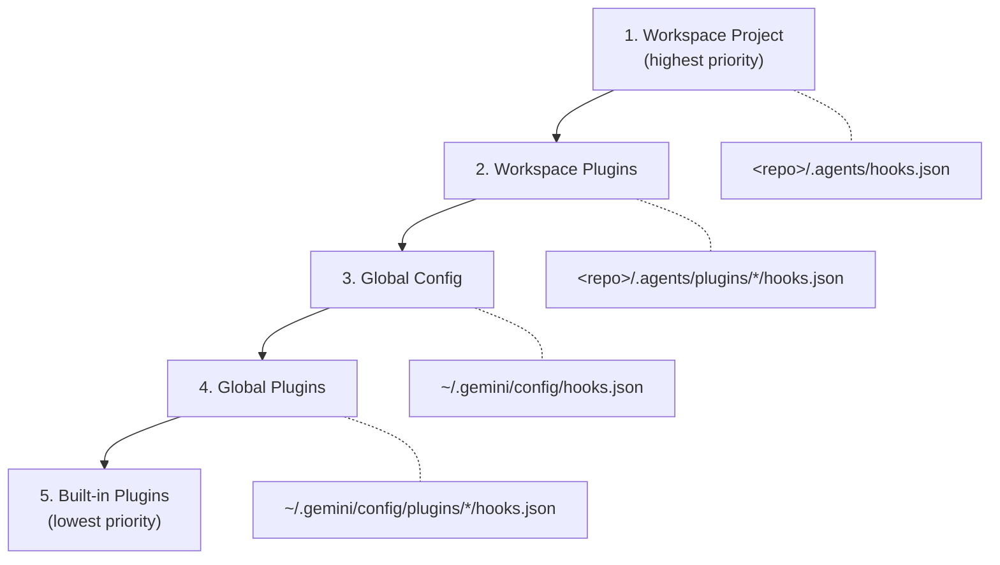
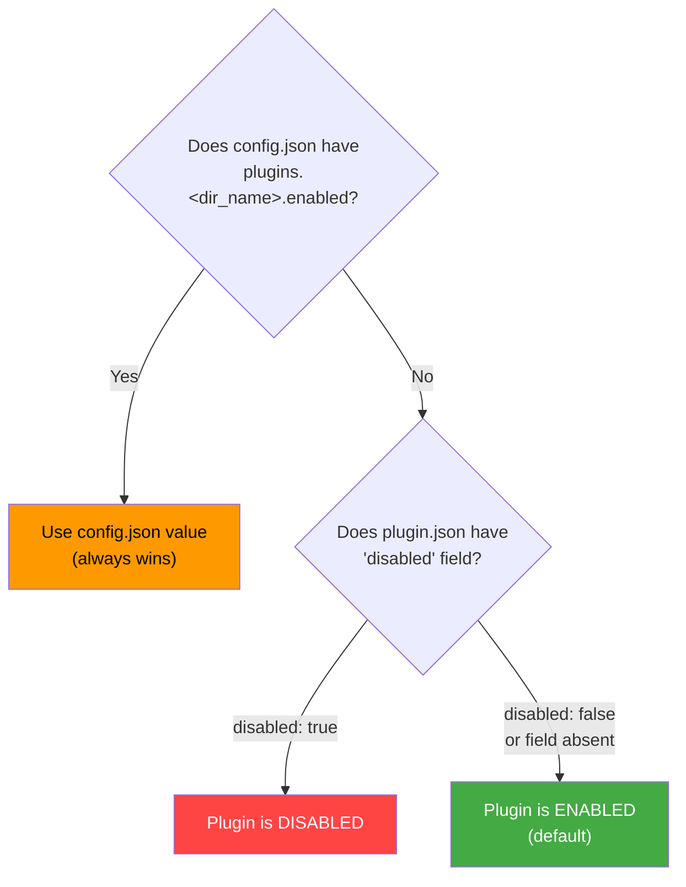
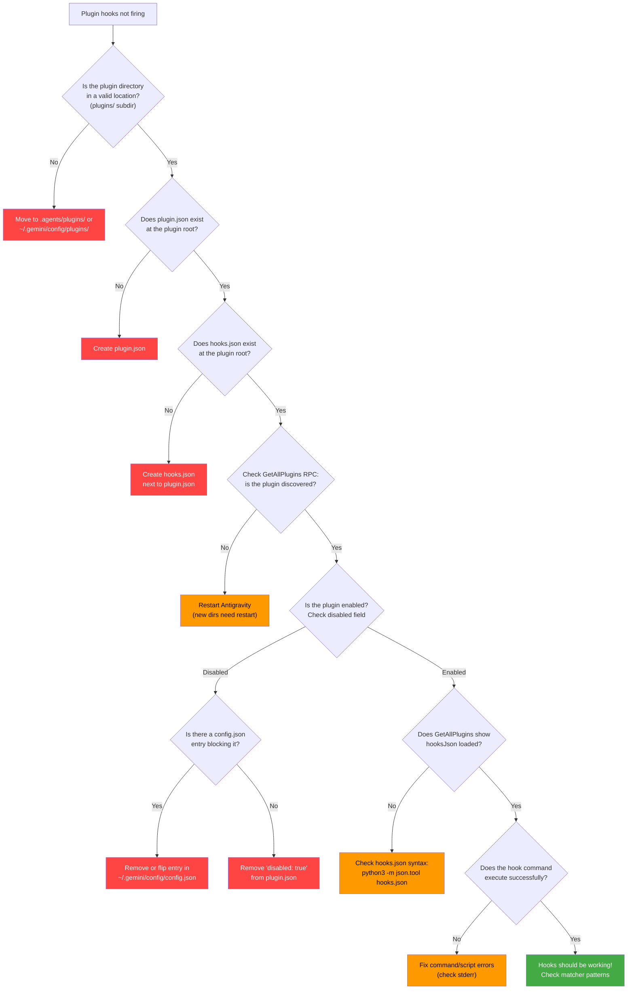
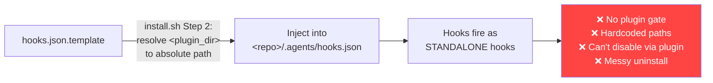
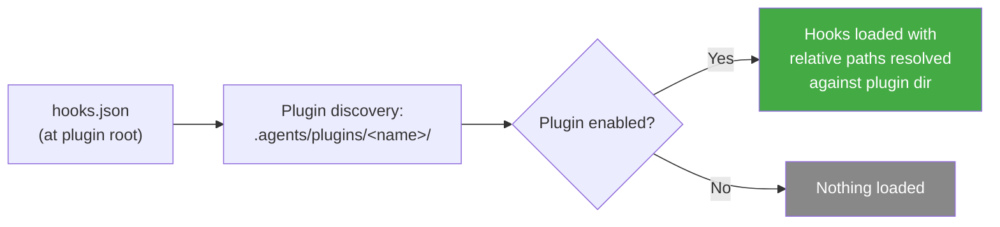

# Antigravity Plugin Hooks — Complete Reference

> How hooks are discovered, loaded, gated by plugin enablement, and what must be true for them to fire.

---

## Table of Contents

1. [Two Hook Systems: Standalone vs Plugin-Bundled](#1-two-hook-systems)
2. [Hook Discovery Locations](#2-hook-discovery-locations)
3. [The Plugin Enablement Gate](#3-the-plugin-enablement-gate)
4. [What Blocks Plugin Hooks](#4-what-blocks-plugin-hooks)
5. [How to Enable/Disable a Plugin](#5-how-to-enabledisable-a-plugin)
6. [Plugin Directory Structure](#6-plugin-directory-structure)
7. [hooks.json File Format](#7-hooksjson-file-format)
8. [Hook Input/Output Contracts](#8-hook-inputoutput-contracts)
9. [Path Resolution in Plugin Hooks](#9-path-resolution-in-plugin-hooks)
10. [Diagnostic Flowchart](#10-diagnostic-flowchart)
11. [Bug Fixer Loop — Current State vs Correct Approach](#11-bug-fixer-loop-analysis)

---

## 1. Two Hook Systems

There are **two fundamentally different ways** hooks can be loaded, and they behave very differently:

### A. Standalone Hooks (Always Loaded)

A `hooks.json` file placed directly in a customization root directory:

| Location | Scope | Gated by plugin enablement? |
|----------|-------|-----------------------------|
| `<repo>/.agents/hooks.json` | Workspace (project-specific) | ❌ **No** — always loaded |
| `~/.gemini/config/hooks.json` | Global (all projects) | ❌ **No** — always loaded |

These hooks fire **unconditionally** whenever the workspace or global config is active. There is no enable/disable gate. The only way to stop them is to delete or rename the file, or set `"enabled": false` on individual hook entries within the file.

### B. Plugin-Bundled Hooks (Gated by Plugin Enablement)

A `hooks.json` file placed **inside a plugin directory**, next to `plugin.json`:

| Location | Scope | Gated by plugin enablement? |
|----------|-------|-----------------------------|
| `<repo>/.agents/plugins/<name>/hooks.json` | Workspace plugin | ✅ **Yes** |
| `~/.gemini/config/plugins/<name>/hooks.json` | Global plugin | ✅ **Yes** |

These hooks **only fire when the plugin is enabled**. When the plugin is disabled, its hooks (along with all other bundled customizations) are not loaded at all.

> [!IMPORTANT]
> This is the critical distinction. If you put hooks in `.agents/hooks.json`, they fire always. If you put them in `.agents/plugins/<name>/hooks.json`, they respect the plugin's enable/disable state.

---

## 2. Hook Discovery Locations

Antigravity discovers hooks by traversing these locations, in priority order:



### Merging Behavior

- Multiple `hooks.json` files from different sources are **merged** together.
- Each named hook (the top-level key) is identified by its name.
- If two sources define a hook with the same name, the higher-priority source wins.
- Within a single event type (e.g., `PreToolUse`), multiple handler entries execute **sequentially**.

---

## 3. The Plugin Enablement Gate

For a plugin's `hooks.json` to be loaded and active, **all** of the following conditions must be true:

### Condition 1: The plugin directory must be discovered

The plugin must exist in a valid plugin discovery location:
- `<repo>/.agents/plugins/<dir_name>/` (workspace)
- `~/.gemini/config/plugins/<dir_name>/` (global)

The directory must contain a valid `plugin.json` manifest file.

> [!NOTE]
> If the plugin directory was created **while Antigravity was already running**, a one-time **restart** is required for initial directory discovery. After that first discovery, enable/disable toggles take effect live.

### Condition 2: The plugin must contain a `plugin.json`

The manifest is the marker that declares the directory as a plugin:

```json
{
  "name": "my-plugin",
  "description": "What this plugin does."
}
```

### Condition 3: The plugin must NOT be disabled

The plugin's enabled/disabled state is resolved using this precedence:



**Key precedence rules:**

1. **`~/.gemini/config/config.json` always wins.** If it has `"plugins": { "<dir_name>": { "enabled": false } }`, the plugin is off regardless of what `plugin.json` says.
2. **`config.json` persists across reinstalls.** If the plugin was ever disabled via config.json, reinstalling or updating the plugin does NOT re-enable it.
3. **`config.json` is keyed by directory name**, not by the `name` field in `plugin.json`. These are often different!
4. **Absent entry = fall through to plugin.json.** If config.json has no entry for the plugin, the `"disabled"` field in `plugin.json` is used. If that's also absent, the plugin defaults to **enabled**.

### Condition 4: The `hooks.json` file must exist at the plugin root

It must be placed directly alongside `plugin.json`:

```
plugins/<name>/
├── plugin.json     ← manifest (required)
├── hooks.json      ← lifecycle hooks (must be here)
├── skills/         ← optional
└── rules/          ← optional
```

### Condition 5: The hooks.json must be valid JSON

If the file has syntax errors, the hooks fail silently or error out. No partial loading.

### Condition 6: Individual hooks must not be disabled

Each named hook within `hooks.json` can be individually disabled:

```json
{
  "my-hook": {
    "enabled": false,
    "PreToolUse": [...]
  }
}
```

---

## 4. What Blocks Plugin Hooks

Here's every reason a plugin's hooks might not fire:

| # | Blocker | How to check | Fix |
|---|---------|-------------|-----|
| 1 | **Plugin directory not discovered** | Check `GetAllPlugins` RPC | Place plugin in `plugins/` dir; restart if new |
| 2 | **No `plugin.json` in directory** | `ls <plugin_dir>/plugin.json` | Create the manifest file |
| 3 | **Plugin disabled in `config.json`** | Check `~/.gemini/config/config.json` → `plugins.<dir>.enabled` | Set to `true` or remove entry |
| 4 | **Plugin ships `"disabled": true`** | Check `plugin.json` → `"disabled"` field | Change to `false`, or enable via config.json |
| 5 | **No `hooks.json` at plugin root** | `ls <plugin_dir>/hooks.json` | Create the file |
| 6 | **`hooks.json` has syntax errors** | `python3 -m json.tool <plugin_dir>/hooks.json` | Fix JSON syntax |
| 7 | **Hook command has errors** | Check stderr from hook execution | Fix the command/script |
| 8 | **Individual hook `"enabled": false`** | Check `hooks.json` entries | Set to `true` or remove field |
| 9 | **Stale `config.json` entry from prior install** | Check config.json for old `"enabled": false` | Remove or flip to `true` |
| 10 | **Name collision with another plugin** | Two plugins share same `name` → one dropped silently | Use unique names |
| 11 | **Sidecar with `agent_permissions`** | Plugin with sidecars declaring permissions may default to disabled | Remove unnecessary `agent_permissions`, or explicitly enable |

---

## 5. How to Enable/Disable a Plugin

### Option A: CLI (Recommended)

```bash
# Enable
agy plugin enable <dir_name>

# Disable
agy plugin disable <dir_name>
```

> [!IMPORTANT]
> `<dir_name>` is the **directory** name (last path segment), NOT the `name` field from `plugin.json`. These are often different!

### Option B: Language Server RPC (Live, no restart)

```bash
# Create the helper
cat > /tmp/lsrpc.sh <<'EOF'
: "${ANTIGRAVITY_LS_ADDRESS:=localhost:5387}"
lsrpc() {
  curl -sS -X POST \
    "http://${ANTIGRAVITY_LS_ADDRESS}/exa.language_server_pb.LanguageServerService/$1" \
    -H "Content-Type: application/json" \
    -H "x-codeium-csrf-token: ${ANTIGRAVITY_CSRF_TOKEN}" \
    -d "$2"
}
EOF

# Enable
source /tmp/lsrpc.sh && lsrpc JetboxWriteState \
  '{"userConfig":{"plugins":{"<dir_name>":{"enabled":true}}}}'

# Disable
source /tmp/lsrpc.sh && lsrpc JetboxWriteState \
  '{"userConfig":{"plugins":{"<dir_name>":{"enabled":false}}}}'
```

### Option C: Manually edit config.json (Not recommended)

You *can* edit `~/.gemini/config/config.json` directly, but:
- Writes that bypass the language server miss the live reload
- Only picked up by a slow backstop poll
- Risk of clobbering sibling state (userSettings, permissions)

### Verifying Plugin State

```bash
source /tmp/lsrpc.sh && lsrpc GetAllPlugins '{}' | jq '[.plugins[] | {
  name,
  dir: (.path | split("/") | last),
  disabled: (.disabled // false),
  hooks: ((.hooksJson // "") | length > 0),
  skills: [.skills[]?.name],
  mcp: [.mcpServers[]?.name]
}]'
```

Or use the `/hooks` slash command inside an Antigravity session to list active hooks from enabled plugins.

---

## 6. Plugin Directory Structure

```
plugins/<dir_name>/
├── plugin.json        # REQUIRED — marks this as a plugin
├── hooks.json         # Optional — lifecycle hooks (loaded when plugin enabled)
├── mcp_config.json    # Optional — MCP servers (launched when plugin enabled)
├── rules/             # Optional — rules merged when plugin enabled
│   └── AGENTS.md      #   Recommended: single consolidated rules file
├── skills/            # Optional — skills available when plugin enabled
│   └── <skill>/
│       └── SKILL.md
├── agents/            # Optional — agent definitions
│   └── <agent>.md
├── assets/            # Optional — logo, images
│   └── logo.svg
└── README.md          # Optional — docs (not read by agent)
```

> [!TIP]
> When a plugin is **enabled**, ALL of its bundled customizations (hooks, MCP servers, rules, skills) are automatically loaded. When **disabled**, NONE of them are loaded. This is the whole point of bundling — atomic enable/disable.

---

## 7. hooks.json File Format

```json
{
  "<hook-name>": {
    "enabled": true,
    "PreToolUse": [
      {
        "matcher": "run_command|write_to_file",
        "hooks": [
          {
            "type": "command",
            "command": "python3 scripts/my_gate.py",
            "timeout": 10
          }
        ]
      }
    ],
    "PostToolUse": [ "..." ],
    "PreInvocation": [ "..." ],
    "PostInvocation": [ "..." ],
    "Stop": [ "..." ]
  }
}
```

### Event Types

| Event | When | Matcher? | Structure |
|-------|------|----------|-----------|
| `PreToolUse` | Before a tool executes | Yes — tool name regex | Grouped: `{ matcher, hooks: [...] }` |
| `PostToolUse` | After a tool completes | Yes — tool name regex | Grouped: `{ matcher, hooks: [...] }` |
| `PreInvocation` | Before the model is called | No | Flat: `[{ command, timeout }]` |
| `PostInvocation` | After tool calls finish | No | Flat: `[{ command, timeout }]` |
| `Stop` | When execution loop terminates | No | Flat: `[{ command, timeout }]` |

### Matcher Patterns

- `"*"` or `""` — matches all tools
- `"run_command"` — exact match
- `"run_command|write_to_file"` — matches either
- `"browser_.*"` — regex: any tool starting with `browser_`

### Handler Fields

| Field | Type | Default | Description |
|-------|------|---------|-------------|
| `type` | string | `"command"` | Only `"command"` is currently supported |
| `command` | string | (required) | Shell command (run via `sh -c`). `~` expands to home. **Working directory = directory containing `hooks.json`** |
| `timeout` | int | `30` | Seconds before timeout |

---

## 8. Hook Input/Output Contracts

### PreToolUse (Gating)

**Input** (stdin):
```json
{
  "toolCall": { "name": "run_command", "args": { "CommandLine": "npm test" } },
  "stepIdx": 19,
  "conversationId": "...",
  "workspacePaths": ["/path/to/workspace"],
  "transcriptPath": "...",
  "modelName": "auto"
}
```

**Output** (stdout):
```json
{
  "decision": "allow|deny|ask|force_ask",
  "reason": "Optional explanation",
  "permissionOverrides": ["command(npm test)"],
  "overwrite": { "CommandLine": "ls -la" }
}
```

### PostToolUse

**Output**: `{}` (empty object)

### PreInvocation / PostInvocation

**Output**:
```json
{
  "injectSteps": [
    { "ephemeralMessage": "Remember to check lint." },
    { "userMessage": "..." },
    { "toolCall": { "name": "...", "args": {} } }
  ],
  "terminationBehavior": "force_continue|terminate"
}
```

### Stop

**Output**:
```json
{
  "decision": "continue",
  "reason": "Tests still running."
}
```

---

## 9. Path Resolution in Plugin Hooks

> [!IMPORTANT]
> When hooks are loaded from a **plugin's** `hooks.json`, the working directory for hook commands is set to the **directory containing `hooks.json`** — i.e., the plugin root directory.

This means you can use **relative paths** in plugin hooks:

```json
{
  "my-gate": {
    "PreToolUse": [{
      "matcher": "run_command",
      "hooks": [{
        "command": "python3 scripts/my_gate.py",
        "timeout": 10
      }]
    }]
  }
}
```

`scripts/my_gate.py` resolves relative to the plugin directory. No absolute paths or template substitution needed.

For **standalone** `.agents/hooks.json`, the working directory is the directory containing that `hooks.json` (typically the `.agents/` directory or the repo root).

---

## 10. Diagnostic Flowchart



---

## 11. Bug Fixer Loop — Current State vs Correct Approach

### Current (Hacked) Approach



**What's wrong:**
- Hooks are injected into `.agents/hooks.json` (standalone) — they bypass plugin enablement entirely
- Hardcoded absolute paths break if the plugin directory moves
- `"disabled": true` in plugin.json does nothing — hooks still fire
- Uninstalling requires manually editing `.agents/hooks.json`
- The "workspace plugin override" (`bug-fixer-loop-workspace/plugin.json`) creates a hollow plugin with no hooks

### Correct Approach



**What to do:**

1. **Create** `<plugin_root>/hooks.json` with relative paths:
   ```json
   {
     "bug-fixer-file-gate": {
       "PreToolUse": [{
         "matcher": "write_to_file|replace_file_content",
         "hooks": [{ "command": "python3 scripts/pre_tool_gate.py", "timeout": 10 }]
       }]
     },
     "bug-fixer-command-gate": {
       "PreToolUse": [{
         "matcher": "run_command",
         "hooks": [{ "command": "python3 scripts/pre_tool_gate.py", "timeout": 10 }]
       }]
     },
     "bug-fixer-url-gate": {
       "PreToolUse": [{
         "matcher": "read_url_content",
         "hooks": [{ "command": "python3 scripts/github_url_gate.py", "timeout": 10 }]
       }]
     }
   }
   ```

2. **Remove** Step 2 from `install.sh` — stop injecting hooks into `.agents/hooks.json`

3. **Delete** `hooks.json.template` — no longer needed

4. **Fix plugin enablement** — either:
   - Ship with `"disabled": false` in plugin.json, OR
   - Have `install.sh` run `agy plugin enable bug-fixer-loop-plugin`

5. **Clean up** injected hook entries from target repos' `.agents/hooks.json` files

---

## Sources

All information sourced from the official Antigravity documentation:

- [Hooks Guide](file:///Users/mcneillm/.gemini/antigravity/builtin/skills/agy-customizations/docs/hooks.md)
- [Plugins Guide](file:///Users/mcneillm/.gemini/antigravity/builtin/skills/agy-customizations/docs/plugins.md)
- [Plugin Skill](file:///Users/mcneillm/.gemini/antigravity/builtin/skills/plugin/SKILL.md)
- [JSON Configs Guide](file:///Users/mcneillm/.gemini/antigravity/builtin/skills/agy-customizations/docs/json_configs.md)
- [Customizations Overview](file:///Users/mcneillm/.gemini/antigravity/builtin/skills/agy-customizations/SKILL.md)
