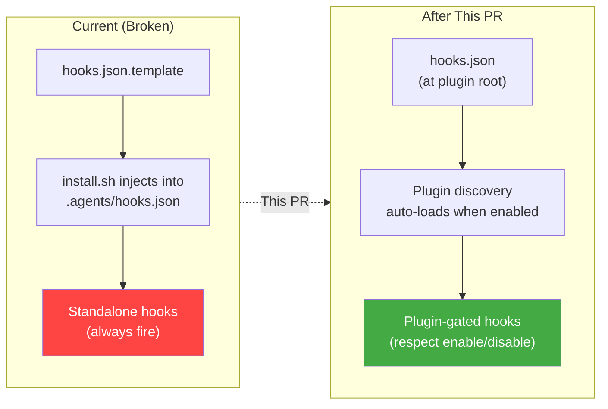

# PR Plan: Fix Plugin Hooks Architecture

> **Branch:** `fix/plugin-hooks-architecture` (from `main`)
> **Title:** `fix: move hooks into plugin bundle, remove .agents/hooks.json injection`

---

## Problem Statement

The plugin's hooks are hacked outside the plugin directory. `install.sh` reads a `hooks.json.template`, resolves placeholders to absolute paths, and injects hook entries directly into the target repo's `.agents/hooks.json` — a standalone workspace hooks file that bypasses the plugin enablement gate entirely.

**Consequences:**
- Hooks fire even when the plugin is disabled (`"disabled": true`)
- Hardcoded absolute paths break if the plugin/repo moves
- No clean `agy plugin enable/disable` lifecycle
- Uninstall must manually edit `.agents/hooks.json`
- The hollow `bug-fixer-loop-workspace` plugin override serves no real purpose

---

## Changes Overview



| # | File | Action | Risk |
|---|------|--------|------|
| 1 | `hooks.json` | **CREATE** — proper plugin hooks with relative paths | Low |
| 2 | `hooks.json.template` | **DELETE** — superseded by `hooks.json` | Low |
| 3 | `scripts/install.sh` | **MODIFY** — remove Step 2 (hooks injection), update Step 6 (enablement) | Medium |
| 4 | `scripts/uninstall.sh` | **MODIFY** — remove global hooks cleanup, add workspace hooks cleanup | Low |
| 5 | `plugin.json` | **MODIFY** — remove `"disabled": true` | Low |
| 6 | `scripts/pre_tool_gate.py` | **MODIFY** — fix f-string syntax error on line 298 | Low |
| 7 | `README.md` | **MODIFY** — update installation docs | Low |

---

## Change 1: Create `hooks.json` at Plugin Root

**File:** `hooks.json` (NEW — next to `plugin.json`)

This is the core fix. Antigravity auto-discovers this file when the plugin is enabled and resolves `command` paths relative to the plugin directory.

```json
{
  "bug-fixer-file-gate": {
    "PreToolUse": [
      {
        "matcher": "write_to_file|replace_file_content",
        "hooks": [
          {
            "type": "command",
            "command": "python3 scripts/pre_tool_gate.py",
            "timeout": 10
          }
        ]
      }
    ]
  },
  "bug-fixer-command-gate": {
    "PreToolUse": [
      {
        "matcher": "run_command",
        "hooks": [
          {
            "type": "command",
            "command": "python3 scripts/pre_tool_gate.py",
            "timeout": 10
          }
        ]
      }
    ]
  },
  "bug-fixer-url-gate": {
    "PreToolUse": [
      {
        "matcher": "read_url_content",
        "hooks": [
          {
            "type": "command",
            "command": "python3 scripts/github_url_gate.py",
            "timeout": 10
          }
        ]
      }
    ]
  }
}
```

> [!IMPORTANT]
> **Relative paths** — `scripts/pre_tool_gate.py` not `/absolute/path/to/scripts/pre_tool_gate.py`.
> The working directory for hook commands is the directory containing `hooks.json` (the plugin root), so relative paths Just Work.

---

## Change 2: Delete `hooks.json.template`

**File:** `hooks.json.template` → **DELETE**

No longer needed. The real `hooks.json` replaces it.

---

## Change 3: Modify `scripts/install.sh`

### 3a: Remove Step 2 (hooks injection) — Lines 232–269

**Delete the entire Step 2 block** that reads `hooks.json.template`, resolves `<plugin_dir>`, and merges into `<repo>/.agents/hooks.json`.

The plugin's `hooks.json` at the plugin root is now auto-discovered. No injection needed.

### 3b: Update Step 6 (enablement) — Lines 400–417

Replace the current Step 6, which writes a hollow `bug-fixer-loop-workspace/plugin.json` override, with proper plugin enablement via the `agy` CLI:

```bash
# ---------------------------------------------------------------------------
# Step 6: Enable the plugin
# ---------------------------------------------------------------------------
echo ""
echo "--> Step 6: Enabling plugin..."

# The plugin ships with "disabled": false in plugin.json, but config.json
# may have a stale "enabled": false entry from a prior install. Explicitly
# enable via the agy CLI to ensure config.json is set correctly.
if command -v agy >/dev/null 2>&1; then
  agy plugin enable bug-fixer-loop-plugin 2>/dev/null || true
  echo "    - Enabled plugin via: agy plugin enable bug-fixer-loop-plugin"
else
  echo "    ⚠  'agy' CLI not found. Enable manually:"
  echo "       agy plugin enable bug-fixer-loop-plugin"
fi
```

### 3c: Update the summary output — Lines 420–438

Remove the line about "Workspace hooks" from the summary since we no longer write them:

```bash
echo ""
echo "================================================================="
echo "  Bug Fixer Loop Plugin — installation complete!"
echo ""
echo "  Workspace config: ${WORKSPACE_CONFIG}"
echo "  Workspace rules:  ${TARGET_REPO_DIR}/.agents/rules/bug-fixer-AGENTS.md"
if [[ "$SKILLS_ONLY" = false ]]; then
  echo "  Sidecars:         ${SIDECARS_DIR}/{bug-fixer-engineering-loop,bug-fixer-triage-loop,bug-fixer-pr-review-loop,bug-fixer-trajectory-loop}--${REPO_SLUG}"
fi
echo ""
echo "  Plugin source:    ${PLUGIN_DIR} (scripts, skills, agents used in-place)"
echo "  Plugin hooks:     ${PLUGIN_DIR}/hooks.json (auto-loaded by plugin system)"
echo ""
echo "  Global writes:    Sidecar stubs only (cron + dispatcher path + workspace binding)"
echo "  Re-run to repair: ./scripts/install.sh -r ${TARGET_REPO} -d ${TARGET_REPO_DIR}"
echo "================================================================="
```

### 3d: Update the header comment — Lines 1–13

```bash
# install.sh — Provision Bug Fixer Loop plugin for a target repository.
#
# Architecture: The plugin is SELF-CONTAINED. This script writes:
#   1. Workspace instance config  → <repo>/.agents/plugins/bug-fixer-loop-workspace/config.json
#   2. Workspace rules            → <repo>/.agents/rules/AGENTS.md
#   3. Sidecar stubs (global)     → ~/.gemini/config/sidecars/<name>--<repo-slug>/sidecar.json
#
# Hooks are NOT written by this script. They live in the plugin's own
# hooks.json and are auto-discovered by Antigravity's plugin system.
#
# Sidecar stubs are the ONLY global write. They contain no plugin logic — just
# a cron schedule, absolute dispatcher path, and workspace_uris binding.
# Re-running install.sh repairs stubs if the plugin or repo directory moves.
# Skills, scripts, and agents are used in-place from the plugin directory.
```

---

## Change 4: Modify `scripts/uninstall.sh`

### 4a: Remove the global `~/.gemini/config/hooks.json` cleanup (lines 54–77)

This code tried to clean `bug-fixer-*` entries from `~/.gemini/config/hooks.json`. We never wrote there, and the new architecture doesn't write anywhere. Delete the block.

### 4b: Add workspace `.agents/hooks.json` cleanup

Add a new step that cleans up injected hooks from any target repo's `.agents/hooks.json` (for repos that had the old installer run):

```bash
# 6b. Clean up bug-fixer hooks injected into workspace hooks.json by old installer
# Accept --repo-dir to know where to clean, or default to current config
REPO_DIR="${TARGET_REPO_DIR:-}"
if [[ -z "$REPO_DIR" && -f "${PLUGIN_DIR}/config.json" ]]; then
  REPO_DIR="$(python3 -c "import json; print(json.load(open('${PLUGIN_DIR}/config.json')).get('repo_dir',''))" 2>/dev/null || true)"
fi

if [[ -n "$REPO_DIR" && -f "${REPO_DIR}/.agents/hooks.json" ]]; then
  python3 -c "
import json, sys
try:
    with open('${REPO_DIR}/.agents/hooks.json') as f:
        hooks = json.load(f)
    changed = False
    for key in list(hooks.keys()):
        if 'bug-fixer' in key:
            del hooks[key]
            changed = True
    if changed:
        with open('${REPO_DIR}/.agents/hooks.json', 'w') as f:
            json.dump(hooks, f, indent=2)
            f.write('\n')
        print(f'Cleaned bug-fixer hooks from: ${REPO_DIR}/.agents/hooks.json')
except Exception as e:
    print(f'Warning: Could not clean workspace hooks: {e}', file=sys.stderr)
" 2>/dev/null || true
fi
```

### 4c: Remove legacy global artifact cleanup (lines 9–34)

These clean up paths from an even earlier version of the installer that copied scripts/rules/skills into global locations. If all installs going forward use the new architecture, this can be removed. However, for safety during the transition, **keep them but add a deprecation comment** — remove in a follow-up PR once all consumers have re-installed.

---

## Change 5: Modify `plugin.json`

Change `"disabled": true` to `"disabled": false`:

```json
{
  "name": "bug-fixer-loop",
  "version": "0.4.0",
  "disabled": false,
  "description": "Autonomous bug fixer loop — a 4-loop background agent that triages, fixes, architect-reviews, and PRs small bugs and TODOs while you focus on major feature work."
}
```

> [!NOTE]
> **Why `disabled: false`?** The plugin is installed as a git submodule at `.agents/plugins/bug-fixer-loop-plugin/` in consumer repos. Shipping `disabled: true` means hooks never fire until someone explicitly enables it. Since `install.sh` now runs `agy plugin enable`, the explicit flag isn't needed. But setting `false` ensures the plugin works even if install.sh wasn't run (e.g., fresh clone).
>
> **Version bump** to `0.4.0` since this is a meaningful architectural change.

---

## Change 6: Fix `scripts/pre_tool_gate.py` Line 298

Fix the unterminated f-string:

```python
# Before (broken):
                sys.stderr.write(f"WARNING: Invalid leak pattern regex '{pat}': {exc}
")

# After (fixed):
                sys.stderr.write(f"WARNING: Invalid leak pattern regex '{pat}': {exc}\n")
```

---

## Change 7: Update `README.md`

Update the "Getting Started" section to reflect the new install flow:

```markdown
### 1. Install
```bash
./scripts/install.sh --repo <owner/repo> --repo-dir <path>
```
The installer provisions workspace config, rules, and sidecar stubs.
Plugin hooks are bundled in `hooks.json` at the plugin root and are
auto-discovered by Antigravity — no manual hook setup required.

### 2. Enable/Disable
```bash
# Enable the plugin (hooks + sidecars activate)
agy plugin enable bug-fixer-loop-plugin

# Disable the plugin (everything stops)
agy plugin disable bug-fixer-loop-plugin
```
```

---

## What NOT to Change

| Item | Reason |
|------|--------|
| **Sidecar templates** (`sidecars/*/sidecar.json`) | Sidecars must be written to `~/.gemini/config/sidecars/` with resolved absolute paths — this is correct. Sidecars are not bundled inside plugins; they use the global sidecar discovery mechanism. |
| **`configure.sh`** | Independent of hooks. Works correctly as-is. |
| **`config.json`** (plugin-local) | Runtime workspace config. Not affected by this change. |
| **install.sh Steps 1, 3, 4, 5** | Workspace config, rules, sidecars, gitignore — all correct. |
| **`agents/`, `skills/`, `rules/`** | Plugin-bundled customizations. Already in the right place and auto-discovered. |

---

## Post-PR Cleanup: Consumer Repos

After merging, each consumer repo (e.g., `esp32-app-foundation`) needs a one-time cleanup:

### 1. Remove injected hooks from `.agents/hooks.json`

Delete the `bug-fixer-file-gate`, `bug-fixer-command-gate`, and `bug-fixer-url-gate` entries from:
- [`esp32-app-foundation/.agents/hooks.json`](file:///Users/mcneillm/Documents/Projects/esp32-app-foundation/.agents/hooks.json#L44-L85)

### 2. Remove the hollow workspace plugin override

```bash
rm -rf <repo>/.agents/plugins/bug-fixer-loop-workspace/
```

This directory contains only a fake `plugin.json` and runtime config. The real plugin is the submodule at `.agents/plugins/bug-fixer-loop-plugin/`.

> [!WARNING]
> **Don't delete `bug-fixer-loop-workspace/config.json`** without migrating it first — it contains runtime configuration (target_repo, maintainer, cron schedules etc.) that the sidecars reference via `BUG_FIXER_CONFIG` env var.
>
> **Migration:** Move the config to the real plugin submodule directory, or update sidecar stubs to point at the new location. This is best handled as a separate follow-up PR.

### 3. Update the git submodule

```bash
cd <consumer-repo>
git submodule update --remote .agents/plugins/bug-fixer-loop-plugin
```

### 4. Enable the plugin (if config.json has a stale entry)

```bash
agy plugin enable bug-fixer-loop-plugin
```

---

## Testing Plan

| Test | Verification |
|------|-------------|
| `hooks.json` is valid JSON | `python3 -m json.tool hooks.json` |
| Plugin is discovered | Run `GetAllPlugins` RPC → check `bug-fixer-loop-plugin` appears with `hooksLoaded: true` |
| Hooks fire when plugin enabled | `agy plugin enable bug-fixer-loop-plugin` → run a command → verify `pre_tool_gate.py` is invoked |
| Hooks DON'T fire when plugin disabled | `agy plugin disable bug-fixer-loop-plugin` → run a command → verify no hook invocation |
| `install.sh` runs cleanly | `./scripts/install.sh --repo test/repo --repo-dir /tmp/test --skills-only` |
| `uninstall.sh` runs cleanly | `./scripts/uninstall.sh` |
| Unit tests pass | `python3 -m unittest discover -s tests -v` |
| No absolute paths in hooks.json | `grep -c '/' hooks.json` should return 0 |

---

## Files Changed Summary

```
 hooks.json              (NEW)       — Plugin-bundled hooks with relative paths
 hooks.json.template     (DELETED)   — Superseded by hooks.json
 plugin.json             (MODIFIED)  — disabled: true → false, version bump
 scripts/install.sh      (MODIFIED)  — Remove Step 2, update Step 6
 scripts/uninstall.sh    (MODIFIED)  — Remove global hooks cleanup, add workspace cleanup
 scripts/pre_tool_gate.py (MODIFIED) — Fix f-string syntax error line 298
 README.md               (MODIFIED)  — Update installation docs
```
