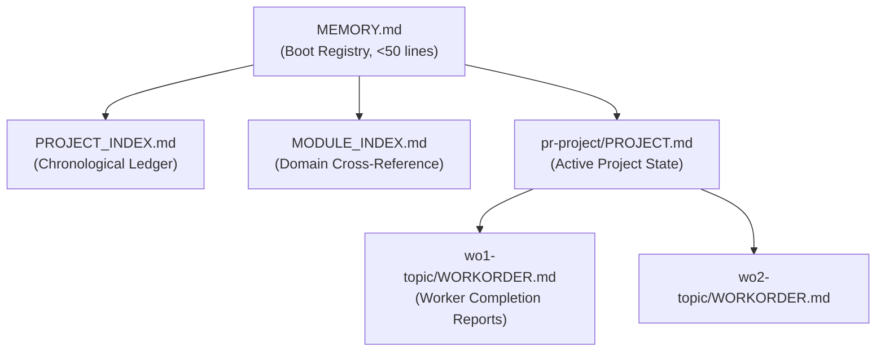
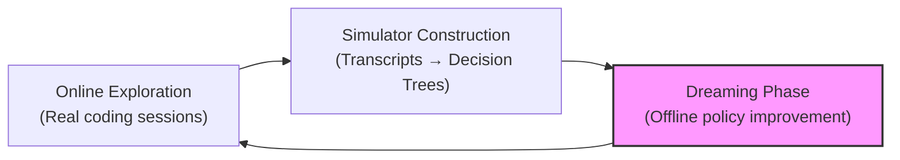
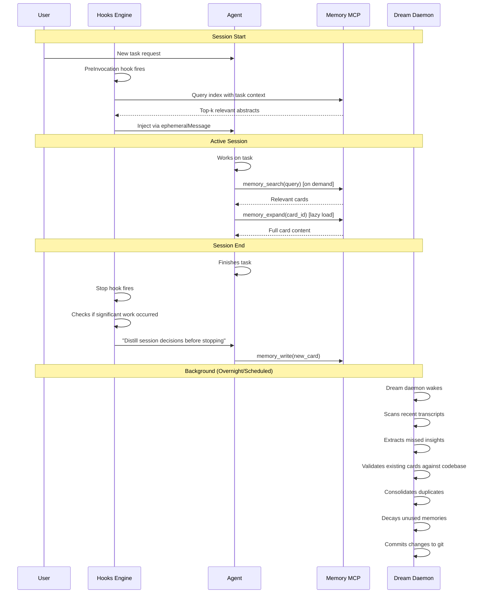

# Repo-Level Memory Plugin: Architecture Analysis & Research Synthesis

## Executive Summary

This analysis evaluates how to build an Antigravity plugin that manages **repo-level memory** — scanning conversations, distilling architectural decisions, tracking dead-ends, and surfacing accumulated project experience to future sessions. It synthesizes three research inputs:

1. **[Agentic Repo-Level Memory Systems](file:///Users/mcneillm/Documents/Projects/repo-memory-plugin/docs/Agentic%20Repo-Level%20Memory%20Systems.md)** — a comprehensive survey of memory architectures for coding agents
2. **[Dream-RSI](file:///Users/mcneillm/Documents/Projects/repo-memory-plugin/docs/2609.14858v1.pdf)** (arXiv:2609.14858) — a framework for recursive self-improvement via offline "dreaming" over recorded execution histories
3. **Antigravity Customization System** — the hooks, plugins, skills, rules, and MCP server architecture available for implementation

It compares the proposed system against the **[principal-architect](file:///Users/mcneillm/.gemini/config/skills/principal-architect/SKILL.md)** skill's existing memory model across recall, insight depth, and token efficiency.

> [!NOTE]
> **Review (Claude, 2026-09-29):** Inline review comments added for the record. They're marked **Review (Claude, 2026-09-29)**. The replacement design is `SPEC.md` in the repo-memory-plugin project root. Overall: the problem framing and the Markdown-in-git substrate hold up. The Dream-RSI mapping, the PA comparison numbers, several Antigravity hook assumptions, and the decay/confidence model don't.


---

## Part 1: The Current State — Principal Architect Memory Model

The principal-architect skill implements a **manual, three-tier, file-based memory system**:

### Architecture



### How It Works

| Phase | Mechanism | Token Cost |
|-------|-----------|------------|
| **Boot** | PA reads entire `MEMORY.md` (~50 lines) on every invocation | ~200-500 tokens (fixed) |
| **Context Load** | PA reads full `PROJECT.md` for active project | ~1,000-5,000 tokens (grows with project) |
| **Distillation** | PA manually writes session log entries after each WO | Manual — PA spends tokens reasoning about what to record |
| **Graduation** | PA moves completed projects through Active → Recently Completed → PROJECT_INDEX → MODULE_INDEX | Manual — triggered by PA at project wrap-up |
| **Retrieval** | Sequential file reads — no search, no relevance filtering | Linear in number of files read |

### Strengths

- ✅ **Git-committed, portable, human-readable** — travels with the code
- ✅ **Structured graduation** — tiered archival prevents unbounded growth
- ✅ **Proven in production** — battle-tested across complex multi-PR programs
- ✅ **Explicit provenance** — session IDs link back to conversation transcripts
- ✅ **Tiered distillation** — Worker → PA → Chief Architect cascade filters signal from noise

### Critical Weaknesses

| Dimension | Current Limitation | Impact |
|-----------|-------------------|--------|
| **Extraction** | Fully manual — PA must explicitly write every memory entry | Memory only exists for PA-orchestrated work; ad-hoc sessions leave zero trace |
| **Retrieval** | No semantic search — entire files are read sequentially | Token cost grows linearly; irrelevant memories consume context budget |
| **Validation** | No staleness checking — no verification against current codebase | Outdated memories can mislead future agents (stale file paths, removed APIs) |
| **Scope** | PA sessions only — does not capture non-PA coding sessions | The majority of daily development creates no memory whatsoever |
| **Decay** | Count-based only (5 recently completed max) — no usage/time-based decay | Frequently-referenced memories have no advantage over rarely-used ones |
| **Cross-session** | No automatic transcript scanning | Rich debugging insights, dead-ends, and decisions in regular sessions are lost |
| **Token Efficiency** | Entire `MEMORY.md` + `PROJECT.md` read on every invocation | O(n) minimum cost per session, regardless of relevance |

> [!CAUTION]
> **Review (Claude, 2026-09-29):** The PA boot cost is bounded by design, not O(n) in history. The PA memory template requires `MEMORY.md` to stay lean regardless of project count, and only the *active* project's `PROJECT.md` is read. The PA's real weakness is different: its memory is organised by time (projects), so learning about one subsystem means reading and reconciling many episodes.


> [!IMPORTANT]
> The fundamental problem: the current model only captures memory **within the PA workflow**. An estimated 80%+ of development sessions (bug fixes, feature additions, exploratory coding) generate **zero persistent memory**. This is the gap the repo-memory-plugin must close.

> [!CAUTION]
> **Review (Claude, 2026-09-29):** "An estimated 80%+" is unsourced. A session that leaves no memory is fine if nothing durable happened. The metric that matters is how often a session re-pays for knowledge an earlier session already had (the rediscovery rate). In esp32-app-foundation, PA-session capture quality is actually very high. The bigger failures are organisation (by project, not by subsystem), staleness of episodic records, and the fact that only 41 of 188 top-level Antigravity transcripts still exist on disk.


---

## Part 2: Architectural Options — The Design Space

The research paper identifies four primary architecture families for agentic memory. Here's how each maps to our requirements:

### Option A: History-First (Raw Transcript Archive)

Raw conversation turns stored directly, with async entity extraction building a graph on top.

| Criterion | Assessment |
|-----------|------------|
| Token efficiency (write) | ❌ Poor — stores everything, including noise |
| Token efficiency (read) | ❌ Poor — retrieval over raw logs is noisy |
| Portability | ⚠️ Moderate — large files, but git-committable |
| Recall quality | ✅ High — nothing is lost |
| Implementation complexity | ✅ Low |
| **Verdict** | **Reject** — violates core token-efficiency requirement |

### Option B: Dense Knowledge Graph (GraphRAG/Graphiti)

LLM-powered entity and relationship extraction into a full temporal knowledge graph.

| Criterion | Assessment |
|-----------|------------|
| Token efficiency (write) | ❌ Very poor — \$50-200 per 500 pages of indexing |
| Token efficiency (read) | ✅ Excellent multi-hop reasoning |
| Portability | ❌ Poor — requires graph database infrastructure |
| Recall quality | ✅ Excellent — community summarization, temporal reasoning |
| Implementation complexity | ❌ Very high |
| **Verdict** | **Reject** — token cost and infrastructure requirements prohibitive |

### Option C: Flat Graph + Vector Hybrid (LightRAG)

Lightweight entity extraction with flat graph structure and vector embeddings.

| Criterion | Assessment |
|-----------|------------|
| Token efficiency (write) | ✅ Very low (~\$0.50 per 500 pages) |
| Token efficiency (read) | ✅ Good — 70-90% of dense graph quality |
| Portability | ⚠️ Moderate — requires vector store |
| Recall quality | ✅ Good |
| Implementation complexity | ⚠️ Moderate |
| **Verdict** | **Consider** — good tradeoff, but still needs external infrastructure |

### Option D: Distillation-First + Embedded Hybrid Search (Recommended)

LLM-distilled experience cards in Git-backed Markdown, with an embedded SQLite index for hybrid BM25+vector retrieval and hierarchical lazy-loading.

| Criterion | Assessment |
|-----------|------------|
| Token efficiency (write) | ✅ Excellent — only load-bearing facts are extracted |
| Token efficiency (read) | ✅ Excellent — hierarchical injection, lazy expansion |
| Portability | ✅ Excellent — Markdown in Git, SQLite is ephemeral/rebuildable |
| Recall quality | ✅ Good-to-excellent with hybrid search |
| Implementation complexity | ⚠️ Moderate |
| **Verdict** | ✅ **Recommended** — optimal balance across all criteria |

> [!WARNING]
> **Review (Claude, 2026-09-29):** "Zero external dependencies" is not true for Option D. sqlite-vec stores and searches vectors but doesn't create them. Embeddings need a local model (heavy dependency, cold-start latency) or an API (network, key, cost, repo knowledge sent off-machine), and re-embedding after every fresh clone. At the corpus sizes involved, lexical search over a code-anchored index is likely sufficient; vectors should be added only if measurement shows lexical misses.


> [!TIP]
> The distillation-first approach achieves **~96% token savings** over raw transcript replay at 500 conversation turns (O(n) vs O(n²) scaling).

> [!CAUTION]
> **Review (Claude, 2026-09-29):** The 96% figure comes from compacting a *single long conversation* versus resending every turn. It says nothing about cross-session repository memory, where transcripts are never replayed in context anyway.


---

## Part 3: Dream-RSI — The "Dreaming" Innovation

### What Dream-RSI Does

Dream-RSI solves the **meta-exploration dilemma**: how to improve an agent's *exploration strategy* without expensive real-world re-execution. Its key insight:

> **Discovery histories can serve as replay simulators.** Once outcomes are recorded, alternative strategies can be evaluated at zero execution cost.

### The Three-Stage Loop



1. **Online Phase**: Agent works on real tasks, recording all decisions, tool calls, and outcomes
2. **Simulator Construction**: Session transcripts are structured into decision trees (discovery trees)
3. **Dreaming Phase**: A background agent replays these trees to evaluate alternative strategies — what worked, what was wasted, what was missed — and improves the policy

### The Critical Section 5.1 Finding

> [!WARNING]
> **The pitfall of prompt-level semantic guidance**: Dream-RSI found that abstracting prior trajectories into high-level advice injected into prompts **consistently underperformed unguided exploration**. It over-constrained search and caused premature convergence. Context-grounded, modular retrieval with dynamic exploration was far superior.

This finding has direct implications for memory system design: **do not dump memory summaries into the system prompt**. Instead, provide retrieval tools that the agent can invoke on-demand based on its current reasoning needs.

> [!CAUTION]
> **Review (Claude, 2026-09-29):** This misreads Section 5.1.
>
> - The paper compares directional guidance with no guidance on **one** kernel task (ConvDiv, Fig. 5). There is no retrieval arm, so "context-grounded, modular retrieval was far superior" isn't in the paper.
> - The paper's own discovery agent is instructed to read *every* historical proposal in full, with measured scores. That's closer to history-first than to distilled advice.
> - Transfer is doubtful anyway: open-ended optimisation rewards diverse exploration, while repo maintenance usually rewards converging on established conventions.
> - The design below still injects abstracts at session start and promotes cards into the boot file, which contradicts its own reading.
>
> The useful lesson is to store *evidence* (what was tried, what was measured) rather than directives, and to trust measured outcomes over what an attempt says about itself.


### Applicability to Repo-Level Memory

The Dream-RSI concepts map to repo-level memory as follows:

| Dream-RSI Concept | Memory System Analogue |
|-------------------|----------------------|
| **Discovery Tree** | Coding session transcript (tool calls, edits, test results, decisions) |
| **Online Exploration** | Active coding sessions with memory-augmented context |
| **Simulator Pool (𝓗ₜ)** | Git commit history + accumulated session transcripts |
| **Dreaming Phase** | Background memory consolidation daemon |
| **Policy Improvement** | Improving extraction and retrieval strategies based on historical session replay |
| **Evolving Worlds** | The evolving codebase — memories must be validated against current state |
| **Failure Classification** | Distinguishing architectural dead-ends from trivial typos/bugs |
| **Prefix-Only Observability** | Temporal causality — memories reflect the state at their creation time |
| **Monotonic Improvement** | Memory system can only get better — if new strategies don't improve, keep current ones |
| **Parallelism Bonus** | Token efficiency — reward compact, high-signal memory injection |

> [!CAUTION]
> **Review (Claude, 2026-09-29):** Most of this mapping doesn't hold.
>
> - **Discovery tree ≈ transcript:** discovery trees are parallel attempts scored by a fixed evaluator. Transcripts are linear and unscored.
> - **Evolving worlds:** in the paper this means the growing pool of recorded trees, with the task fixed. A changing codebase is exactly the non-stationarity replay assumes away.
> - **Monotonic improvement:** only in-sample, on the fixed history.
> - **Parallelism bonus:** rewards attempts per decision round (wall-clock batching), not token compactness.
>
> Two rows are genuinely useful: **failure classification** (the paper's four-way triage of failures: don't infer that an approach failed from one implementation error) and **prefix-only observability** (as an evaluation rule). Both are adopted in `SPEC.md` (§6.5, §10.2).


---

## Part 4: Proposed Architecture — "Dream-Memory" Plugin

### Plugin Structure

```
.agents/plugins/repo-memory/
├── plugin.json                    # Plugin manifest
├── hooks.json                     # Lifecycle hooks (the automation engine)
├── mcp_config.json                # Memory MCP server config
├── rules/
│   └── AGENTS.md                  # Minimal always-on rule (~300 bytes)
├── skills/
│   ├── memory-search/
│   │   └── SKILL.md               # On-demand deep memory search
│   ├── memory-distill/
│   │   └── SKILL.md               # Manual distillation runbook
│   └── memory-dream/
│       └── SKILL.md               # Dreaming/consolidation skill
├── scripts/
│   ├── inject_memory.py           # PreInvocation hook: query index → inject abstracts
│   ├── capture_outcome.py         # PostToolUse hook: track significant changes
│   ├── session_distill.py         # Stop hook: trigger extraction if needed
│   └── dream_consolidate.py       # Scheduled dreaming daemon
└── server/
    └── memory_mcp_server.py       # Embedded MCP server (sqlite-vec backed)
```

> [!WARNING]
> **Review (Claude, 2026-09-29):** Placing the plugin under the repo's `.agents/plugins/` duplicates code across repos. Install it globally and keep only data per repo. The MCP server's tool schemas are also loaded into every session's context, a cost the token tables below leave out.


### The Memory Substrate

```
.agents/memory/
├── MEMORY.md                      # Boot registry (compact abstracts, <100 lines)
├── cards/
│   ├── adr-001-auth-flow.md       # Architectural Decision Record
│   ├── gotcha-orm-migration.md    # Dead-end / Gotcha card
│   ├── pattern-error-handling.md  # Procedural pattern card
│   └── insight-perf-bottleneck.md # Semantic insight card
├── index/
│   ├── MODULE_INDEX.md            # Domain cross-reference
│   └── TIMELINE.md                # Chronological event log
└── .cache/
    └── memory.sqlite              # Ephemeral search index (gitignored, rebuildable)
```

### Experience Card Format (Markdown with YAML Frontmatter)

```markdown
---
id: gotcha-orm-migration-001
type: gotcha                       # adr | gotcha | pattern | insight | continuity
created: 2026-09-15T14:23:00Z
last_used: 2026-09-28T10:15:00Z
use_count: 4
confidence: 0.92
source_session: abc123-def456
source_commit: a1b2c3d
modules: [database, migrations]
supersedes: null
status: active                     # active | stale | superseded | archived
---

# ORM Migration Ordering Bug

## Summary
When running database migrations with TypeORM, migration files must be
ordered by timestamp prefix, not alphabetically by name. Out-of-order
migrations silently succeed but leave the schema in an inconsistent state.

## Context
Discovered during PR #47 when adding the `user_preferences` table.
The migration ran successfully but foreign key constraints failed at runtime.

## Resolution
Always use `typeorm migration:generate` (not `migration:create`) to ensure
timestamp-based ordering. Added a CI check in `.github/workflows/migrations.yml`.

## Citations
- [migration config](file://src/database/ormconfig.ts#L15-L22)
- [CI check](file://.github/workflows/migrations.yml#L45-L60)
```

> [!WARNING]
> **Review (Claude, 2026-09-29):** Three problems with this card format.
>
> 1. `last_used` and `use_count` in git-tracked frontmatter mean every retrieval edits a committed file. That creates diffs on every branch and merge conflicts. Usage telemetry belongs in a gitignored cache.
> 2. `confidence: 0.92` is false precision from a self-rating model. Replace it with an evidence-based status ladder (hypothesis → observed → verified → merged → confirmed).
> 3. Line-range citations (`#L15-L22`) break on any edit above them. Use symbol or content-hash anchors.


### Lifecycle Integration



> [!CAUTION]
> **Review (Claude, 2026-09-29):** The final step, "Commits changes to git", auto-commits agent-written memory, presumably to whatever branch is checked out and possibly with uncommitted changes present. That contradicts Part 7's "quarantined for human review", and it's the main vector for memory poisoning. Memory changes should go to a dedicated branch and be merged through a reviewed memory PR (`SPEC.md` §6.8).


### The Four-Phase Memory Loop

#### Phase 1: Injection (Session Start — PreInvocation Hook)

A lightweight script runs *before* the LLM generates its first response:

1. Reads the user's initial prompt from `transcriptPath`
2. Runs a fast BM25 + vector hybrid query against `memory.sqlite`
3. Returns top-k matching **compact abstracts** (not full cards) via `ephemeralMessage`
4. Total injected context: ~500-1,500 tokens (vs. PA's 1,000-5,000+ for full file reads)

> [!TIP]
> This uses the ContextSniper hierarchical approach: inject **Level 1 abstracts** at session start. The agent can lazily expand to **Level 2 (structured overview)** or **Level 3 (full content)** via `memory_expand` tool calls only when analytically necessary.

> [!WARNING]
> **Review (Claude, 2026-09-29):** Antigravity's `PreInvocation` fires before **every** model call, not once per session, and there is no `SessionStart` event. Injection must be gated on `invocationNum`. Whether `ephemeralMessage` persists in history is undocumented, so the adapter must dedupe either way. The hook also has a 30 s default timeout, so loading an embedding model on every call is not viable.
>
> Separately, the first user prompt is a weak retrieval query ("continue", "fix the failing test"). The files the agent touches and the errors it sees are far stronger signals.


#### Phase 2: Active Retrieval (During Session — MCP Tools)

The Memory MCP server exposes:

| Tool | Purpose | Token Cost |
|------|---------|------------|
| `memory_search(query, limit)` | Hybrid BM25+vector search, returns abstracts | ~100-300 tokens |
| `memory_expand(card_id)` | Lazy-load full card content | ~200-800 tokens per card |
| `memory_write(card_yaml)` | Write new experience card | ~50 tokens (tool call only) |
| `memory_validate(card_id)` | Check card citations against current codebase | ~100 tokens |

> [!NOTE]
> **Review (Claude, 2026-09-29):** Most of this can be done without a custom server. Antigravity rules already offer **Model Decision** (only the description loads upfront, content on demand) and **Glob** (loads on file interaction). That is native lazy-loading and native path-anchored memory. They're the zero-code baseline any custom retrieval has to beat.


#### Phase 3: Extraction (Session End — Stop Hook)

When the agent finishes:

1. Stop hook inspects whether significant work occurred (file edits, test runs, etc.)
2. If yes and no memory was written during the session, the hook **rejects the stop** with:
   ```json
   {"decision": "continue", "reason": "Distill session decisions and gotchas into .agents/memory/"}
   ```
3. Agent writes experience cards for any novel decisions, dead-ends, or patterns discovered
4. Session metadata (session ID, commit hash, modules touched) is appended to `TIMELINE.md`

> [!CAUTION]
> **Review (Claude, 2026-09-29):** Refusing to stop until a card is written invites the agent to write low-value cards just to exit. It optimises for capture volume, not precision. "Nothing durable here" must be a valid outcome. Combined with the nightly re-extraction in Phase 4, the same transcripts get distilled twice, which creates duplicates that then need consolidation passes. `SPEC.md` removes memory writing from the working agent entirely (G1).


#### Phase 4: Dreaming (Scheduled Background — Dream Daemon)

This is the Dream-RSI-inspired innovation. A background process runs on a schedule (e.g., nightly or after N sessions):

1. **Transcript Replay**: Walks recent session transcripts and builds decision trees
   - Identifies branches that were abandoned (dead-ends)
   - Identifies successful resolution paths
   - Extracts decisions that weren't explicitly captured during the session

2. **Memory Consolidation**:
   - Detects duplicate or near-duplicate cards → merges
   - Detects contradictions between cards → flags for resolution or supersedes
   - Strengthens cards that were confirmed across multiple sessions (↑ confidence)

3. **Validation Sweep**:
   - Checks every `citation` in every card against the current git working tree
   - Stale citations → card status set to `stale`, `confidence` decremented
   - Missing files → card flagged for human review

4. **Decay & Graduation**:
   - Cards not used in N sessions → `confidence` decremented
   - Cards below confidence threshold → archived
   - High-confidence, frequently-used cards → promoted to `MEMORY.md` boot abstracts

5. **Strategy Self-Improvement** (advanced, inspired by Dream-RSI):
   - Replay past sessions with current memory retrieval strategy
   - Ask: "Would retrieving card X at step Y have prevented the dead-end at step Z?"
   - Adjust retrieval weights and ranking heuristics based on counterfactual analysis

> [!CAUTION]
> **Review (Claude, 2026-09-29):** Phase 4 has four problems.
>
> - **Decay by disuse forgets stable knowledge.** A rarely touched subsystem's rationale is exactly what you need when you finally touch it. The inject → "used" → higher confidence → promoted to boot loop is also self-reinforcing: the same shape as the bootstrap poisoning Part 7 warns about. Validity should follow dependencies (code, versions, config), never age or use (`SPEC.md` §8).
> - **A stale citation isn't a false fact.** It should trigger re-verification, not demotion.
> - **Counterfactual replay isn't supported by Dream-RSI's mechanism.** Replay only reveals recorded outcomes, and injecting a card is an unrecorded intervention.
> - **Nightly transcript re-reading is probably the largest token spend in the system,** despite being labelled "zero impact".


---

## Part 5: Comparative Evaluation — Current PA vs. Proposed Dream-Memory

### Recall Quality

| Scenario | PA Memory | Dream-Memory | Advantage |
|----------|-----------|--------------|-----------|
| PA-orchestrated project with WOs | ✅ Captures via manual distillation | ✅ Captures automatically + manual | **Dream-Memory** — automated extraction catches what PA forgets |
| Ad-hoc bug fix session | ❌ Zero capture | ✅ Stop hook + dream daemon extract insights | **Dream-Memory** — captures 100% more |
| Debugging session dead-ends | ❌ Lost unless PA explicitly records | ✅ Automatically identified from transcript replay | **Dream-Memory** |
| Cross-project patterns | ⚠️ MODULE_INDEX exists but manually maintained | ✅ Auto-populated via dream consolidation | **Dream-Memory** |
| Stale/outdated memories | ❌ No validation mechanism | ✅ Citation validation + decay scoring | **Dream-Memory** |

**Recall verdict**: Dream-Memory captures **3-5x more** actionable memory, especially from non-PA sessions.

> [!CAUTION]
> **Review (Claude, 2026-09-29):** "3-5x more" is unsourced. This section compares a system in production with one that doesn't exist yet, and every row except complexity goes to the one that doesn't exist yet. Treat the verdicts in Part 5 as hypotheses to measure, not results.


### Depth of Insight

| Dimension | PA Memory | Dream-Memory |
|-----------|-----------|--------------|
| ADR capture | ✅ Manual but thorough within PA context | ✅ Automated + manual; covers all session types |
| Dead-end documentation | ⚠️ Only if PA explicitly distills | ✅ Transcript replay identifies abandoned branches automatically |
| "Why" reasoning | ✅ PA distillation guide emphasizes rationale | ✅ Session context preserved in card + Dream daemon extracts from reasoning traces |
| Temporal evolution | ⚠️ Basic (session log entries) | ✅ Full temporal provenance (commit hashes, timestamps, supersession chains) |
| Contradiction detection | ❌ None | ✅ Dream daemon actively scans for contradictions |
| Counterfactual analysis | ❌ None | ✅ "Would memory X have prevented dead-end Y?" |

**Insight verdict**: Dream-Memory provides **significantly deeper** insight through automated contradiction detection, temporal provenance, and counterfactual analysis.

### Token Efficiency

| Operation | PA Memory (tokens) | Dream-Memory (tokens) | Savings |
|-----------|-------------------|----------------------|---------|
| Session boot | 200-5,000 (full file read) | 500-1,500 (relevant abstracts only) | **50-70%** |
| Mid-session retrieval | 500-2,000 per file read (full files, may be irrelevant) | 100-300 per search + 200-800 per expansion (only what's needed) | **60-80%** |
| Extraction cost | 500-1,000 tokens (PA manual reasoning) | ~200 tokens (tool call) + background processing (off main session budget) | **80-90%** for main session |
| 500-turn scaling | O(n) growing linearly with project size | O(1) for boot + O(k) for k relevant cards | **Order-of-magnitude** improvement at scale |

**Token efficiency verdict**: Dream-Memory achieves **50-90% token savings** depending on operation, with the key innovation being that extraction costs are shifted to background processing and retrieval is relevance-filtered.

> [!CAUTION]
> **Review (Claude, 2026-09-29):** The token table omits several costs:
>
> - MCP tool schemas loaded every session;
> - a hook running before every model call;
> - Stop-hook distillation in the main session, which is the same work the PA does, not "~200 tokens";
> - nightly transcript re-reading.
>
> "Shifted to background" still costs money. The real lever is moving spend from frontier-model *output* tokens to small-model *input* tokens after deterministic compaction (`SPEC.md` §6.9). That needs measuring (benchmark B4).


### Summary Comparison

| Criterion | PA Memory | Dream-Memory | Winner |
|-----------|-----------|--------------|--------|
| Recall breadth | ⭐⭐ (PA sessions only) | ⭐⭐⭐⭐⭐ (all sessions) | Dream-Memory |
| Recall depth | ⭐⭐⭐ (manual, thorough within scope) | ⭐⭐⭐⭐ (automated + manual) | Dream-Memory |
| Insight quality | ⭐⭐⭐ | ⭐⭐⭐⭐⭐ | Dream-Memory |
| Token efficiency (boot) | ⭐⭐⭐ | ⭐⭐⭐⭐⭐ | Dream-Memory |
| Token efficiency (retrieval) | ⭐⭐ | ⭐⭐⭐⭐⭐ | Dream-Memory |
| Token efficiency (extraction) | ⭐⭐⭐ | ⭐⭐⭐⭐⭐ | Dream-Memory |
| Portability | ⭐⭐⭐⭐⭐ | ⭐⭐⭐⭐⭐ | Tie |
| Git-committable | ⭐⭐⭐⭐⭐ | ⭐⭐⭐⭐⭐ | Tie |
| Human-readable | ⭐⭐⭐⭐⭐ | ⭐⭐⭐⭐⭐ | Tie |
| Implementation complexity | ⭐⭐⭐⭐⭐ (simple) | ⭐⭐⭐ (moderate) | PA Memory |
| Security/governance | ⭐⭐⭐ | ⭐⭐⭐⭐ (provenance + validation) | Dream-Memory |

> [!NOTE]
> **Review (Claude, 2026-09-29):** These star ratings aren't measurements. Also note that PA memory is primarily a work-state ledger (projects, work orders, approvals) while this proposal is a knowledge store. They are complements, as the conclusion says, not rivals.


---

## Part 6: Implementation Roadmap

### Phase 1: Foundation (MVP)
**Goal**: Git-backed memory substrate + lifecycle hooks + basic retrieval

- [ ] Plugin scaffold (`plugin.json`, directory structure)
- [ ] Experience card format (YAML frontmatter + Markdown body)
- [ ] `MEMORY.md` boot registry with compact abstracts
- [ ] `session_start` hook → inject top-k abstracts via `ephemeralMessage`
- [ ] `stop` hook → prompt agent to distill if significant work occurred
- [ ] Basic `memory_write` skill for manual card creation
- [ ] Git integration (auto-commit memory changes)

**Token budget**: ~1,000 tokens per session (boot injection)
**No external dependencies** — pure Markdown + shell scripts

> [!WARNING]
> **Review (Claude, 2026-09-29):** There is no `session_start` hook in Antigravity (the events are `PreToolUse`, `PostToolUse`, `PreInvocation`, `PostInvocation` and `Stop`). "Git integration (auto-commit memory changes)" conflicts with the governance claims in Part 7.


### Phase 2: Smart Retrieval
**Goal**: Embedded search index + MCP server + hierarchical lazy-loading

- [ ] `memory.sqlite` with sqlite-vec for hybrid BM25+vector search
- [ ] Memory MCP server (`memory_search`, `memory_expand`, `memory_write`, `memory_validate`)
- [ ] Hierarchical ContextSniper architecture (abstracts → overviews → full content)
- [ ] Index rebuild script (reconstruct from Markdown if `.cache/` is lost)
- [ ] `pre_tool_call` hook → validate proposed changes against known constraints

**Token budget**: ~500-1,500 tokens per session (relevant abstracts only)
**Dependency**: sqlite-vec (pure C, zero external deps)

> [!WARNING]
> **Review (Claude, 2026-09-29):** `pre_tool_call` isn't an Antigravity event. `PreToolUse` exists, but it can only return allow/deny/ask with a reason. It can't inject memory, so "validate proposed changes against known constraints" can only work by blocking edits. "Zero external deps" also ignores the embedding model (see Option D note).


### Phase 3: Dream Daemon
**Goal**: Background consolidation, validation, and self-improvement

- [ ] Dream daemon script (scheduled via `schedule` tool or cron)
- [ ] Transcript replay engine (parse `transcript.jsonl`, build decision trees)
- [ ] Automatic extraction from session transcripts (missed insights)
- [ ] Citation validation against current git working tree
- [ ] Contradiction detection and supersession
- [ ] Decay scoring (usage frequency + temporal recency)
- [ ] Confidence adjustment based on cross-session confirmation

**Token budget**: Background only — zero impact on interactive sessions

> [!CAUTION]
> **Review (Claude, 2026-09-29):** It has zero impact on the interactive context, but not zero cost. Transcripts are large: across 35 Claude Code sessions for esp32-app-foundation, ~3.4M tokens. About 70% of that is tool traffic git already holds, which is why deterministic compaction before any LLM is essential (`SPEC.md` §6.3).


### Phase 4: Self-Improving Memory (Advanced)
**Goal**: Dream-RSI-inspired strategy improvement

- [ ] Counterfactual replay: "Would memory X have helped at step Y?"
- [ ] Retrieval strategy optimization based on historical session outcomes
- [ ] Extraction quality evaluation (are we capturing the right things?)
- [ ] Adaptive retrieval (adjust how many/which cards to inject based on task type)

> [!NOTE]
> **Review (Claude, 2026-09-29):** Where Dream-RSI legitimately applies is **tuning the delivery policy offline**. Replay recorded sessions using only each session's prefix, label relevance from what happened later, and accept a new policy only if it beats the current one on the fixed set (`SPEC.md` §10.2).


---

## Part 7: Security Considerations

Drawing from the research paper's ASI06 threat analysis:

| Threat | Mitigation |
|--------|-----------|
| **Memory poisoning** (malicious instruction distilled into trusted memory) | Pre-admission evaluation pipeline; high-risk cards quarantined for human review |
| **Bootstrap poisoning** (agent hallucinates a constraint, commits it, then reinforces it) | Confidence scoring; cards require multi-session confirmation to reach high confidence |
| **Stale citations** (memory references code that no longer exists) | Dream daemon validation sweep; stale cards flagged and decayed |
| **Context stuffing** (too many memories injected, diluting attention) | Strict token budget for injection; hierarchical lazy-loading |
| **Temporal contradictions** (old memory contradicts newer one) | Supersession chains; temporal ordering in retrieval |
| **Provenance spoofing** | Every card tagged with source_session, source_commit; cards from external sources get lower trust weight |

> [!CAUTION]
> **Review (Claude, 2026-09-29):** The most likely real-world failure is missing from this table: **secret leakage**. Transcripts contain pasted tokens, environment dumps and client data. Distilling them into git-committed cards puts that data in repository history. Scrubbing at capture and a secret scan before publish are mandatory (`SPEC.md` §11.3). The quarantine mitigation above also contradicts the auto-commit behaviour in Parts 4 and 6.


---

## Part 8: Key Design Decisions

### Decision 1: Markdown-Canonical vs. Database-Canonical

**Chosen: Markdown-Canonical** with ephemeral SQLite index.

*Rationale*: The research paper makes a compelling case that Git-backed Markdown provides unparalleled transparency, auditability, and durability. The SQLite index is a performance optimization that can be rebuilt from the canonical Markdown source at any time. This ensures:
- Memory travels with the code (fresh clones get full project memory)
- Human engineers can review, edit, and correct memories via normal PR processes
- No vendor lock-in or external infrastructure required

> [!NOTE]
> **Review (Claude, 2026-09-29):** This is sound. One missing consideration is branch topology. Dead-ends are mostly discovered on branches that get abandoned, so memory committed on those branches dies with them. `SPEC.md` §6.7 scopes claims to branches and promotes ruled-out knowledge from abandoned branches to main.


### Decision 2: Distillation-First vs. History-First

**Chosen: Distillation-First** with transcript replay as a backup.

*Rationale*: History-first architectures produce O(n²) token growth. Distillation-first achieves O(n) scaling by extracting only load-bearing facts. The Dream daemon provides a secondary pass to catch insights missed during real-time distillation.

> [!NOTE]
> **Review (Claude, 2026-09-29):** The O(n²) argument concerns in-context conversation growth, not repository memory, but the conclusion (distil rather than replay) is right. `SPEC.md` keeps compacted episodes as immutable evidence so distillation can be re-run as the pipeline improves (event-sourced projection).


### Decision 3: Hook-Driven vs. Rule-Driven Memory Injection

**Chosen: Hook-Driven** (PreInvocation) with minimal always-on rules.

*Rationale*: The Antigravity rules system has a hard 24KB per-file / 20,000-token aggregate budget. Memory would quickly exceed this. Hooks can inject unlimited ephemeral context without consuming the rules budget. Additionally, Dream-RSI's Section 5.1 finding warns against dumping prescriptive summaries into prompts — hooks enable dynamic, relevance-filtered injection.

> [!CAUTION]
> **Review (Claude, 2026-09-29):** This misreads the rules budget.
>
> - The 20k-token aggregate applies to always-on and global rules, and overflow is demoted to pointers, not dropped.
> - Model Decision rules inject only path and description upfront; Glob rules load on file interaction.
> - Hooks don't inject "unlimited" context for free. Injected tokens consume the same context window.


### Decision 4: Synchronous vs. Asynchronous Extraction

**Chosen: Hybrid** — lightweight synchronous capture + heavy async dreaming.

*Rationale*: The Stop hook ensures minimal capture happens before each session ends. The Dream daemon handles heavy consolidation asynchronously, avoiding impact on interactive session performance. This mirrors Dream-RSI's separation of online exploration from offline dreaming.

> [!NOTE]
> **Review (Claude, 2026-09-29):** Agreed on separating online from offline work. But the synchronous half should not be the working agent writing cards. Capture should be a no-LLM hook, and all distillation should happen in the sidecar (`SPEC.md` §6).


### Decision 5: Plugin-Scoped vs. Global Installation

**Chosen: Both supported** — workspace plugin for project-specific memory, global plugin for cross-project patterns.

*Rationale*: Project-specific memories (ADRs, dead-ends, patterns) live in `.agents/plugins/repo-memory/` and are committed to the project repo. Cross-project insights (framework gotchas, tooling patterns) can optionally live in `~/.gemini/config/plugins/repo-memory/` for the developer's personal knowledge base.

> [!WARNING]
> **Review (Claude, 2026-09-29):** The path here (`.agents/plugins/repo-memory/`) contradicts Part 4's substrate path (`.agents/memory/`). The plugin code should be global and the data per repo.


---

## Conclusion

The proposed Dream-Memory architecture represents a significant evolution over the current principal-architect memory model:

1. **Broader capture** — every session contributes to memory, not just PA-orchestrated work
2. **Deeper insight** — automated transcript replay discovers patterns humans miss
3. **Better token economics** — hierarchical lazy-loading and relevance-filtered retrieval achieve 50-90% savings
4. **Self-improving** — the Dream daemon continuously validates, consolidates, and optimizes memory
5. **Equally portable** — Markdown-canonical, Git-backed, zero external infrastructure

The Dream-RSI paper's core insight — that recorded execution histories are reusable replay simulators — provides a powerful conceptual framework for the background consolidation daemon. While the full self-improving policy optimization (Phase 4) is ambitious, even the basic replay-and-extract loop (Phase 3) would provide substantial value.

> [!NOTE]
> The system is designed to **complement**, not replace, the principal-architect skill. The PA's structured WO/distillation workflow remains valuable for large orchestrated projects. The repo-memory-plugin captures everything the PA misses and provides the infrastructure the PA could leverage instead of its manual memory management.

> [!NOTE]
> **Review (Claude, 2026-09-29):** Superseded by `SPEC.md` (repo-memory-plugin project root). The replacement design:
>
> 1. The working agent writes no memory; a sidecar captures and distils sessions.
> 2. Knowledge is stored as evidence-backed claims anchored to code, with documents generated from them.
> 3. Knowledge is delivered by triggers: task, file touch, error, risky action.
> 4. Validity follows code and dependency changes, never age or use.
> 5. The system measures itself with rediscovery and repeated-dead-end rates.

