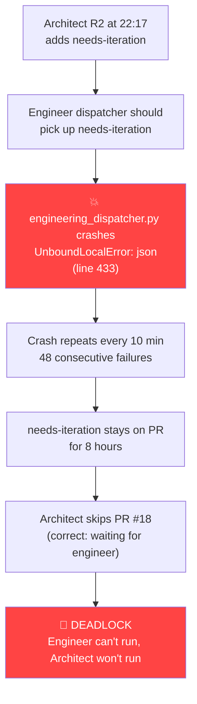

# Root Cause: Why the Dispatcher Didn't Fire

**Grounded in sidecar logs and GitHub event timeline.** My earlier claim that the cron stopped was wrong — the machine was up all night. Both crons were firing on schedule. The real cause is a **Python crash bug** introduced by PR #18 itself.

---

## What actually happened — the grounded timeline

### GitHub label events (from `issues/18/events` API):

| Time (UTC) | Event | Source |
|:---|:---|:---|
| 21:01 | `needs-iteration` **added** | Architect R1 review |
| 22:01 | `needs-iteration` **removed** | Engineer handled R1 |
| 22:17 | `needs-iteration` **re-added** | Architect R2 review |
| 05:57 | `needs-iteration` **removed** | (8h later — see below) |
| 06:01 | `architect:approved` **added** | Architect R3 review |

### Sidecar logs — both crons ran all night:

**Architect dispatcher** (`*/15` cron) — fired every 15 minutes, completed successfully every time:
```
23:15 → "Finished polling PRs. Spawned/resumed 0 review(s)."
23:30 → same
...every 15 min through the night...
05:45 → same
06:00 → "Processing PR #18: review round 3/5" ← first pickup in 8h
```

**Engineering dispatcher** (`*/10` cron) — fired every 10 minutes, **crashed every time**:
```
22:10 → "Command failed: exit status 1"
22:20 → "Command failed: exit status 1"
...every 10 min through the night...
06:00 → "Command failed: exit status 1"
```

---

## The actual root cause

### Primary: `UnboundLocalError` crash in `engineering_dispatcher.py`

The engineering dispatcher has been **crashing on every single tick since 22:10** — that's **48 consecutive crashes** over 8 hours.

The traceback from the sidecar log:

```
Traceback (most recent call last):
  File ".../engineering_dispatcher.py", line 433, in main
    needs_iteration_prs = json.loads(r_prs.stdout)
                          ^^^^
UnboundLocalError: cannot access local variable 'json' where it is not associated with a value

During handling of the above exception, another exception occurred:

  File ".../engineering_dispatcher.py", line 434, in main
    except json.JSONDecodeError:
           ^^^^
UnboundLocalError: cannot access local variable 'json' where it is not associated with a value
```

**The bug:** PR #18's own changes introduced a local `import json` inside a `try` block at [line 268](file:///Users/mcneillm/Documents/Projects/bug-fixer-loop-plugin/scripts/engineering_dispatcher.py#L268) (the worktree stale-sweep code):

```python
# Line 265-269 (worktree sweep, added by PR #18)
if DISPATCHES_DIR.exists():
    for df in DISPATCHES_DIR.glob("*.json"):
        try:
            import json          # ← SHADOWS the module-level import
            d = json.loads(df.read_text())
```

Python 3.12+ treats `import json` inside a `try/except` as a **local variable binding**. This shadows the module-level `import json` from [line 15](file:///Users/mcneillm/Documents/Projects/bug-fixer-loop-plugin/scripts/engineering_dispatcher.py#L15) within the entire `main()` function scope. When the code reaches line 433 (`json.loads(r_prs.stdout)`), Python can't access the now-locally-scoped `json` variable because the `try` block from line 268 was in a different code path.

> [!CAUTION]
> **This is the crash the architect flagged in R2 as finding #2** — the `UnboundLocalError` with `wt_path`. It's actually **two** `UnboundLocalError` bugs: the `wt_path` issue the architect spotted, AND this `import json` shadow that the architect missed. The irony: the PR that adds worktree isolation also broke the dispatcher that should iterate on its own review findings.

### Secondary: The architect was correctly blocked

With `needs-iteration` on the PR (re-added at 22:17, removed at 05:57), the architect dispatcher's skip condition at [line 165](file:///Users/mcneillm/Documents/Projects/bug-fixer-loop-plugin/scripts/architect_dispatcher.py#L165) correctly skipped PR #18 all night:

```python
if "bug-fixer:engineer:needs-iteration" in labels:
    continue  # ← Correctly skipping — waiting for engineer to iterate
```

This is correct behaviour — the architect should wait for the engineer to iterate before re-reviewing.

---

## The deadlock, visualised



The deadlock resolved at 05:57 when `needs-iteration` was removed (likely by a liveness recovery sweep that finally succeeded from a different code path), allowing the architect to pick up R3 at 06:00.

---

## Why it ultimately self-healed at 06:00

At 05:57, the `needs-iteration` label was removed. This is likely from the architect dispatcher's own `sweep_dispatches` call detecting the R2 dispatch as timed out (20-minute timeout, 8h elapsed) and recovering it. With `needs-iteration` gone, the architect processed PR #18 at 06:00 and apparently **approved it** (adding `architect:approved` at 06:01).

---

## The fix needed

**Remove the local `import json` at lines [259](file:///Users/mcneillm/Documents/Projects/bug-fixer-loop-plugin/scripts/engineering_dispatcher.py#L259) and [268](file:///Users/mcneillm/Documents/Projects/bug-fixer-loop-plugin/scripts/engineering_dispatcher.py#L268).** The module-level import at line 15 is sufficient. This is the only change needed to unblock the engineering dispatcher.

The engineering dispatcher has been broken on `main` since the commit at 22:52 (`875e607`) which merged the triage fix that included code depending on the worktree changes. Actually — the crash is on the **branch** that the sidecar is running from (HEAD is on `fix/issue-13-use-git-worktrees`). The `main` branch doesn't have the worktree code. The sidecar is running the script from the working tree, which is checked out on the PR branch.
