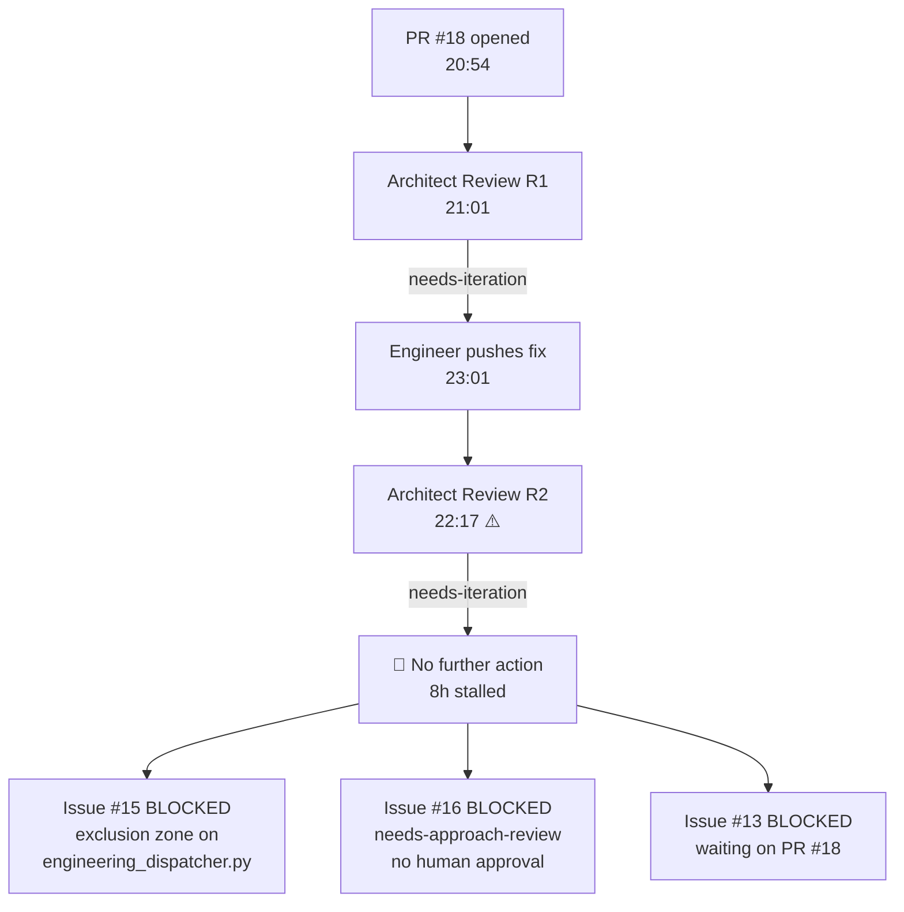

# Work State Investigation — Bug Fixer Loop Plugin

**Reviewed at:** 2026-10-02 06:52 BST  
**Period under review:** ~22:52 Oct 1 → 06:52 Oct 2 (last 8 hours)  
**Repo:** `matthewmcneill/bug-fixer-loop-plugin`

---

## TL;DR — You're stuck. Here's why.

The autonomous loop has been **dead-locked for ~8 hours** because of **one blocked PR creating a cascading exclusion zone freeze**. Everything traces back to **PR #18**.

---

## Timeline Reconstruction

| Time (BST) | Event | Actor |
|:---|:---|:---|
| 20:29 | Approach for Issue #13 (git worktrees) **approved** via detailed design comment | Human (you) |
| 20:54 | PR #18 opened: `Fix #13: Use git worktrees` | BugFixer engineer |
| 21:01 | **Architect Review Round 1**: Changes Requested — prompts still use `{REPO_DIR}` instead of `{wt_path}` | Architect dispatcher |
| 22:17 | **Architect Review Round 2**: Changes Requested — (1) Unauthorised removal of triage exclusion zone, (2) `UnboundLocalError` from `wt_path` used before assignment | Architect dispatcher |
| 22:52 | Triage hotfix merged to `main`: remove exclusion zone check from triage (separate fix) | Main branch |
| 23:01 | Single commit `6285ee0` on PR branch: "Fix prompt worktree path" | BugFixer engineer |
| **23:01** | **🔴 LAST ACTIVITY — 8 HOURS AGO** | — |

---

## The Drop Point: PR #18 is stuck in an architect review loop



### What went wrong

1. **PR #18 has the label `bug-fixer:engineer:needs-iteration`** — the architect flagged two issues in Review Round 2 (22:17 BST), but the engineer's commit at 23:01 appears to be a response to Round 1, not Round 2. The timeline shows:
   - Round 2 review was posted at 22:17
   - The fix commit was at 23:01 — **but it only addresses the `{wt_path}` prompt issue from Round 1**
   - **Round 2's two findings are unaddressed:** (a) the triage SKILL.md exclusion zone removal, and (b) the `UnboundLocalError` with `wt_path` being used before assignment

2. **After the 23:01 commit, the loop stopped.** The engineer didn't iterate further. The `needs-iteration` label is still on the PR, but **no dispatcher re-fired** to pick it up.

> [!CAUTION]
> **This is the drop point.** The engineer pushed a partial fix and the autonomous loop never re-triggered to address the remaining architect findings. The PR is stuck with `needs-iteration` and no agent is picking it up.

### Cascading blockage

Because PR #18 modifies `scripts/engineering_dispatcher.py`, the **Active PR Exclusion Zone rule** (Rule #4 in [bug-fixer-AGENTS.md](file:///Users/mcneillm/Documents/Projects/bug-fixer-loop-plugin/.agents/rules/bug-fixer-AGENTS.md#L23-L27)) blocks:

| Issue | Title | Why Blocked |
|:---|:---|:---|
| **#15** | 24h Trajectory Review (dispatcher churn, agentapi liveness) | Needs to modify `engineering_dispatcher.py` — same file as PR #18 |
| **#16** | pre_tool_gate.py false positives on test files | Has `bug-fixer:human:needs-approach-review` — **awaiting your approval** |
| **#13** | Use git worktrees | Parent issue of PR #18 — can't close until PR merges |

---

## Root Cause Analysis

The loop stalled because of a **gap in the iteration dispatch cycle**:

1. The **architect dispatcher** posted review findings on PR #18
2. The **engineer dispatcher** should have re-dispatched to address the `needs-iteration` label
3. **But it didn't fire again after 23:01.** Possible reasons:
   - The sidecar cron may have stopped (machine sleep, IDE closed, etc.)
   - The engineer may have considered its work done after the 23:01 commit
   - A circuit breaker or concurrency cap may have blocked the re-dispatch

---

## Open Items Requiring Your Action

### 🔴 Critical — Unblock the loop

1. **PR #18 needs manual triage.** You have two options:
   - **Option A (quick):** Merge PR #18 as-is and file the remaining architect findings as new issues. The prompt path fix is in, the `UnboundLocalError` and triage exclusion zone issues can be follow-ups.
   - **Option B (proper):** Manually trigger the engineer to iterate on the remaining R2 findings, or fix them yourself and push.

### 🟡 Awaiting human approval

2. **Issue #16** (`pre_tool_gate.py` false positives) — has `bug-fixer:human:needs-approach-review`. Needs you to reply with `approved` on the issue to let the loop pick it up.

3. **Issue #15** (trajectory review findings) — also has `needs-approach-review` and a detailed proposal. Needs your `approved` reply, but will remain blocked by exclusion zone until PR #18 merges anyway.

---

## Summary

```
Active work items:     3 open issues, 1 open PR
Items actually moving: 0
Blocked by PR #18:     2 issues (#13, #15)
Blocked by human:      2 issues (#15, #16)  
Drop point:            23:01 Oct 1 — engineer stopped iterating on PR #18
Time since last activity: ~8 hours
```

The single biggest unlock is **resolving PR #18** — everything else is downstream of it.
