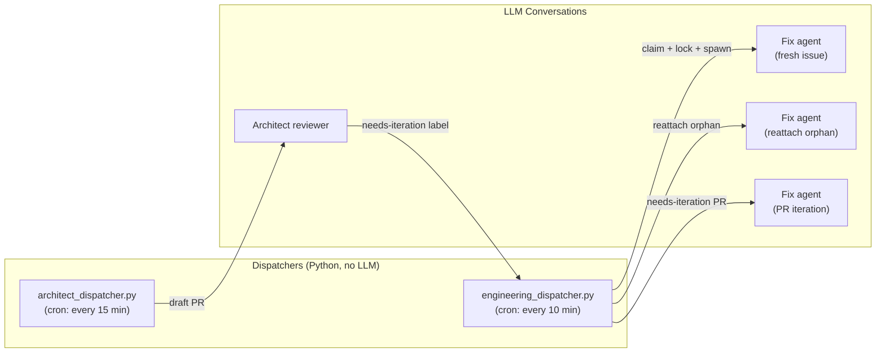
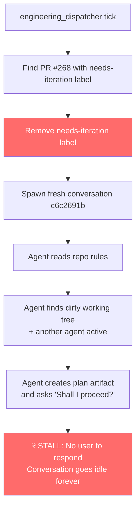

# Bug Fixer Control Loop — Gap Analysis

## How the Loop Works Today



## The Three Dispatch Paths

| Path | Dispatcher | Lock File? | Conv ID Tracked? | Recovery on Stall? |
|------|-----------|------------|------------------|--------------------|
| **Fresh issue fix** | `engineering_dispatcher` | ✅ `claims/<N>.lock` | ✅ In lock file | ✅ 3-layer (PID → transcript → reattach) |
| **Orphan reattach** | `engineering_dispatcher` | ✅ Updates lock | ✅ In lock file | ✅ Same as above |
| **PR iteration (needs-iteration)** | `engineering_dispatcher` | ❌ None | ❌ Nowhere | ❌ **BLIND SPOT** |
| **Architect review** | `architect_dispatcher` | ❌ None | ⚠️ In PR body HTML comment | ⚠️ Partial (resumes if PR still draft) |

## The Blind Spot — What Happened to `c6c2691b`



> [!CAUTION]
> **Line 341** of `engineering_dispatcher.py` removes `needs-iteration` _before_ the spawned conversation completes. If the conversation stalls or crashes, the label is gone, the architect dispatcher won't re-review (PR is no longer draft without the label), and nobody re-dispatches the iteration. The work is silently dropped.

## All Failure Modes

| # | Failure Mode | Lock File? | Who Detects? | Recovery? |
|---|-------------|-----------|-------------|-----------|
| 1 | Fresh fix agent crashes mid-work | ✅ | Engineering dispatcher (Step 1) | ✅ Reattach or re-claim |
| 2 | Fresh fix agent stalls (plan gate, etc.) | ✅ | PID alive → skip → **never detected** | ❌ PID is the _dispatcher's_ PID, not the agent's |
| 3 | PR iteration agent crashes | ❌ | Nobody | ❌ Label already removed |
| 4 | PR iteration agent stalls | ❌ | Nobody | ❌ Label already removed |
| 5 | Agent hits context window limit | ✅/❌ | Depends on path | Partial |
| 6 | Agent infinite-loops (reads forever) | ✅/❌ | Nobody — no timeout | ❌ No watchdog |

> [!WARNING]
> **Failure mode #2 has a subtle bug:** The lock file records `"pid": os.getpid()` — which is the **dispatcher's** PID, not the spawned LLM conversation's PID. The `agentapi new-conversation` call returns a conversation ID but no PID. So the 3-layer PID liveness check in Step 1 is actually checking whether the _dispatcher process_ (long dead by the next tick) is alive — which means every claim looks orphaned after the dispatcher exits. The system works by accident because the transcript mtime check (Layer 2) catches recently-active conversations before they're wrongly classified as orphaned.

## Proposed Fix: Conversation Tracking File

The core issue is fire-and-forget dispatch. The fix is a **tracking file** that records every spawned conversation and its expected outcome, checked on every tick.

### Design

```
${STATE_DIR}/dispatches/
  <conversation_id>.json
```

Each file:
```json
{
  "conversation_id": "c6c2691b-...",
  "type": "pr_iteration",
  "pr_number": 268,
  "issue_number": null,
  "spawned_at": "2026-10-01T11:46:43Z",
  "expected_outcome": "push_to_pr_branch",
  "labels_removed": ["needs-iteration"],
  "timeout_minutes": 30
}
```

### Liveness Check (added to both dispatchers, runs first)

```python
for dispatch_file in DISPATCHES_DIR.glob("*.json"):
    dispatch = json.load(dispatch_file)
    conv_id = dispatch["conversation_id"]
    
    # 1. Transcript mtime — is the agent still working?
    transcript = BRAIN_DIR / conv_id / ".system_generated/logs/transcript.jsonl"
    age = file_mtime_age_seconds(transcript)
    
    if age is not None and age < 300:
        continue  # Still active, skip
    
    # 2. Check expected outcome — did it succeed?
    if dispatch["type"] == "pr_iteration":
        # Check if PR branch has new commits since spawn
        # If yes → success, clean up tracking file
        # If no → stalled, need recovery
        pass
    elif dispatch["type"] == "fresh_fix":
        # Check if PR was opened for the issue
        # Check if lock file still exists
        pass
    
    # 3. Timeout check
    spawn_age = (now - parse(dispatch["spawned_at"])).total_seconds()
    if spawn_age > dispatch["timeout_minutes"] * 60:
        # STALLED — recover
        recover(dispatch)
        dispatch_file.unlink()
    
    # 4. Stall signature detection
    if transcript.exists():
        last_step = read_last_transcript_step(transcript)
        if is_stalled(last_step):
            # Last step is PLANNER_RESPONSE with no tool_calls
            # and content ends with "?" → waiting for user
            recover(dispatch)
            dispatch_file.unlink()
```

### Stall Signature Detection

A conversation is **stalled** if:
1. Transcript mtime > 5 minutes old
2. Last step is `PLANNER_RESPONSE`
3. Last step has no `tool_calls`
4. Last step `content` ends with a question mark

This is exactly the signature of `c6c2691b` — the agent wrote a response ending with _"Shall I proceed?"_ and went idle.

### Recovery Actions

| Dispatch Type | Recovery |
|--------------|----------|
| `pr_iteration` | Re-add `needs-iteration` label so next architect tick re-dispatches |
| `fresh_fix` | Remove `status:in-progress` label, delete lock file (same as existing orphan cleanup) |
| `reattach` | Same as fresh fix |

### Changes Required

1. **`engineering_dispatcher.py`** — 3 changes:
   - Record spawned conversation in `dispatches/` for all three paths (fresh, reattach, PR iteration)
   - Don't remove `needs-iteration` label until checking the agent completed (or move the removal into the agent itself, post-push)
   - Add liveness sweep at start of each tick

2. **`architect_dispatcher.py`** — 1 change:
   - Record spawned conversation in `dispatches/`

3. **New utility: `liveness.py`** — shared module with:
   - `is_conversation_stalled(conv_id) → bool`
   - `read_last_transcript_step(conv_id) → dict`
   - `recover_dispatch(dispatch) → None`

4. **Lock file PID fix** — Record a sentinel or the conversation ID instead of `os.getpid()`, since the dispatcher PID is meaningless after the dispatcher exits. Use transcript mtime as the primary liveness signal.
