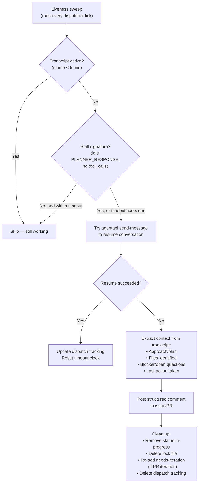

# Implementation Plan: Control Loop Liveness & Recovery (v2)

## Design Principles

1. **GitHub issue/PR is the source of truth** — all durable state lives in comments, labels, and PR bodies. Local files are just an in-flight registry.
2. **Resume first, don't re-dispatch** — a stalled conversation already has context loaded. Wake it up instead of burning fresh tokens.
3. **If resume fails, dump state to the issue** — extract what the agent figured out from the transcript and post it as a structured comment. A human or the architect can pick it up.
4. **No new labels** — dispatch tracking files prevent re-dispatch; no `iteration-in-progress` label needed.

---

## Recovery Cascade



---

## Change 1: New file `scripts/liveness.py`

~120 lines. Shared utility used by both dispatchers.

### Constants & paths

```python
BRAIN_DIR = Path.home() / ".gemini/antigravity/brain"
STALE_THRESHOLD = 300        # 5 minutes — transcript must be fresher than this
DEFAULT_TIMEOUT = 45 * 60    # 45 minutes — hard ceiling before forced recovery
```

### Core functions

```python
def transcript_age_seconds(conv_id: str) -> int | None
    """Seconds since transcript.jsonl was last modified. None if missing."""

def read_last_transcript_step(conv_id: str) -> dict | None
    """Parse last line of transcript.jsonl."""

def is_stalled(conv_id: str) -> bool
    """True if:
    - Transcript mtime > STALE_THRESHOLD
    - Last step is PLANNER_RESPONSE with no tool_calls
    (Agent emitted text and went idle — waiting for input that won't come)
    """
```

### Resume function

```python
def try_resume(conv_id: str, message: str) -> bool
    """Send a message to wake a stalled conversation.
    Returns True if agentapi send-message succeeded.
    
    The message should include:
    - Acknowledgement that the plan gate doesn't apply (Rule 17)
    - Instruction to proceed with implementation
    - If dirty tree: instruction to stash or exit cleanly (Rule 18)
    """
    result = subprocess.run(
        ["agentapi", "send-message", conv_id, message],
        capture_output=True, text=True
    )
    return result.returncode == 0
```

### Context extraction

```python
def extract_context_from_transcript(conv_id: str) -> dict
    """Read the transcript and extract a structured summary:
    
    Returns:
        {
            "approach": str,       # What the agent planned to do
            "files_identified": list[str],  # Files it read or planned to edit  
            "blocker": str,        # Why it stopped (dirty tree, plan gate, error, etc.)
            "last_action": str,    # Last tool call or response summary
            "artifacts": list[str] # Any plan artifacts it created
        }
    
    Extraction strategy:
    - Scan PLANNER_RESPONSE steps for thinking/content about approach
    - Collect file paths from view_file and write_to_file tool calls
    - Last step content = blocker (usually ends with a question)
    - Check for write_to_file calls to artifact dir = plan artifacts
    """
```

### State dump posting

```python
def post_state_dump(target_repo: str, target_type: str, target_number: int,
                    conv_id: str, context: dict, dispatch: dict) -> bool:
    """Post a structured comment to the issue or PR.
    
    Format:
    [BUG-FIXER] ⚠️ Session stalled — context preserved
    
    **Session:** `<conv_id>` (started <spawned_at>)
    **Task:** <dispatch_type description>
    **Stalled after:** <duration>
    
    ### What was accomplished
    <approach summary>
    
    ### Files investigated  
    - `path/to/file1.cpp`
    - `path/to/file2.hpp`
    
    ### Blocker
    <why it stopped — e.g. "Waiting for user approval (plan gate)",
     "Workspace busy — another agent active", "Error: ...">
    
    ### Open questions
    <extracted from last response, if any>
    
    ### Artifacts
    - [Implementation plan](<link to artifact>)
    
    ---
    _This context was automatically extracted from the stalled session's
    transcript. A human or the next bug-fixer cycle can continue from here._
    """
    body = format_state_dump(conv_id, context, dispatch)
    
    cmd = "issue" if target_type == "issue" else "pr"
    result = subprocess.run(
        ["gh", cmd, "comment", str(target_number),
         "--repo", target_repo, "--body", body],
        capture_output=True, text=True
    )
    return result.returncode == 0
```

### Dispatch tracking

```python
def record_dispatch(dispatches_dir: Path, conv_id: str,
                    dispatch_type: str, **kwargs) -> None
    """Write dispatches/<conv_id>.json with:
    {
        "conversation_id": conv_id,
        "type": dispatch_type,         # fresh_fix | reattach | pr_iteration | architect_review
        "spawned_at": iso_now,
        "timeout_minutes": 45,
        "resume_attempts": 0,
        # Plus kwargs: issue_number, pr_number, labels_removed, etc.
    }
    """

MAX_RESUME_ATTEMPTS = 2

def sweep_dispatches(dispatches_dir: Path, target_repo: str,
                     log_fn) -> list[dict]
    """Main liveness sweep. For each dispatch tracking file:
    
    1. Transcript active (< 5 min, no stall signature) → skip
    2. Stalled or timed out:
       a. resume_attempts < MAX_RESUME_ATTEMPTS → try_resume()
          - If success: increment resume_attempts, update tracking file
          - If fail: go to (b)
       b. Extract context, post state dump to issue/PR
       c. Clean up (labels, lock files, tracking file)
    3. Expected outcome achieved (PR opened, commits pushed):
       → Clean up tracking file (success path)
    
    Returns list of recovered dispatches for logging.
    """
```

---

## Change 2: Modify `scripts/engineering_dispatcher.py`

### 2a. Add liveness sweep (insert after circuit-breaker, ~line 123)

```python
from liveness import (record_dispatch, sweep_dispatches,
                      transcript_age_seconds, is_stalled)

DISPATCHES_DIR = STATE_DIR / "dispatches"

# Step 0: Sweep previous dispatches for stalled/completed conversations
recovered = sweep_dispatches(DISPATCHES_DIR, TARGET_REPO, log)
for r in recovered:
    log(f"Recovered: {r['type']} conv={r['conversation_id'][:8]}... "
        f"action={r.get('action', 'unknown')}")
```

### 2b. Fix Step 1 PID check (lines 140-170)

Replace PID-based liveness with transcript-based:

```python
# BEFORE (broken — checks dispatcher PID):
if pid_alive(claim_pid):
    log(f"Issue #{issue_num} — PID {claim_pid} alive, skipping.")
    continue

# AFTER (checks conversation transcript):
age = transcript_age_seconds(conv_id)
if age is not None and age < 300 and not is_stalled(conv_id):
    log(f"Issue #{issue_num} — conv {conv_id[:8]}... active ({age}s ago), skipping.")
    continue
```

### 2c. Track all spawned conversations

**Fresh fix** (after line ~439):
```python
record_dispatch(DISPATCHES_DIR, new_conv_id, "fresh_fix",
                issue_number=issue_num, timeout_minutes=45)
```

**Reattach** (after line ~236):
```python
record_dispatch(DISPATCHES_DIR, new_conv_id, "reattach",
                issue_number=issue_num, timeout_minutes=45)
```

**PR iteration** (after line ~336):
```python
record_dispatch(DISPATCHES_DIR, new_conv_id, "pr_iteration",
                pr_number=pr_num,
                labels_to_restore=["needs-iteration"],
                timeout_minutes=30)
```

### 2d. Defer `needs-iteration` label removal (line 341)

Don't remove the label in the dispatcher. Let the **agent** remove it after pushing, or let the sweep remove it on confirmed success. To prevent re-dispatch on the next tick, check dispatch tracking:

```python
# At the start of Step 2.5, filter out PRs with active dispatches:
active_pr_dispatches = {
    d["pr_number"]
    for f in DISPATCHES_DIR.glob("*.json")
    if (d := json.loads(f.read_text())).get("type") == "pr_iteration"
}

for pr in needs_iteration_prs:
    if pr["number"] in active_pr_dispatches:
        log(f"PR #{pr['number']} — iteration already dispatched, skipping.")
        continue
    # ... rest of dispatch logic
```

Remove line 341 (`--remove-label needs-iteration`). The label stays until:
- Agent succeeds → agent removes it after pushing
- Agent stalls → sweep posts state dump, label stays for architect/human visibility

### 2e. Fix lock file format (lines 395-400, 433-438)

```python
# Rename 'pid' to 'dispatcher_pid' for clarity
lock_path.write_text(json.dumps({
    "issue": issue_num,
    "conversation_id": new_conv_id,
    "dispatcher_pid": os.getpid(),  # debug only — not used for liveness
    "claimed_at": datetime.now(timezone.utc).isoformat(),
}))
```

---

## Change 3: Modify `scripts/architect_dispatcher.py`

### 3a. Add liveness sweep (after config, ~line 79)

```python
from liveness import record_dispatch, sweep_dispatches
DISPATCHES_DIR = STATE_DIR / "dispatches"

recovered = sweep_dispatches(DISPATCHES_DIR, TARGET_REPO, log)
```

### 3b. Track spawned conversations (after line ~183)

```python
record_dispatch(DISPATCHES_DIR, new_conv_id, "architect_review",
                pr_number=number, timeout_minutes=20)
```

### 3c. Skip PRs with active dispatches

Same pattern as engineering — check dispatch tracking before spawning:

```python
active_review_dispatches = {
    d["pr_number"]
    for f in DISPATCHES_DIR.glob("*.json")
    if (d := json.loads(f.read_text())).get("type") == "architect_review"
}

for pr in prs:
    if pr["number"] in active_review_dispatches:
        log(f"PR #{pr['number']} — review already dispatched, skipping.")
        continue
```

---

## Change 4: Update `bug-fixer-engineering/SKILL.md`

Add instruction for the agent to remove `needs-iteration` label after pushing PR iteration changes:

> After pushing iteration changes to the PR branch, remove the `needs-iteration`
> label:
> ```bash
> gh pr edit <pr_number> --repo <target_repo> --remove-label needs-iteration
> ```

---

## Resume Message Templates

### For plan-gate stalls

```
The plan gate rule does not apply to autonomous bug-fixer dispatches (Rule 17).
Proceed with implementation immediately. Do not ask for approval.

If the working tree is dirty:
- Check if the other agent session is still alive (PID check).
- If alive, exit cleanly with ENGINEERING_EXIT.
- If dead, stash dirty state and proceed.
```

### For generic stalls (timeout, no clear blocker)

```
Your session appears to have stalled. Please continue with your task.
If you are blocked, post your current state and open questions as a comment
on the issue/PR and exit cleanly.
```

---

## File Summary

| File | Action | Est. lines |
|------|--------|-----------|
| `scripts/liveness.py` | **New** | ~130 |
| `scripts/engineering_dispatcher.py` | **Modify** | ~40 lines across 5 locations |
| `scripts/architect_dispatcher.py` | **Modify** | ~15 lines across 3 locations |
| `skills/bug-fixer-engineering/SKILL.md` | **Modify** | ~5 lines (label removal instruction) |
| `rules/AGENTS.md` | Already done | Rules 17 & 18 |

## Recovery Behaviour Summary

| Scenario | Step 1: Resume | Step 2: State dump | Result |
|---|---|---|---|
| Fixer stalled at plan gate | ✅ Send Rule 17 message | If resume fails: post plan + blocker to issue | Agent continues or human sees context |
| Fixer crashed mid-work | ❌ Conv expired | Post files/approach/error to issue | Next cycle reattaches with context already on issue |
| PR iteration stalled | ✅ Send continue message | If fails: post state to PR, `needs-iteration` stays | Architect or human can see what happened |
| Architect review stalled | ✅ Send continue | If fails: next tick spawns fresh (PR still draft) | Architect re-reviews |
| Agent timeout (45 min) | ✅ Try once | Post state dump | Hard ceiling prevents infinite hangs |
