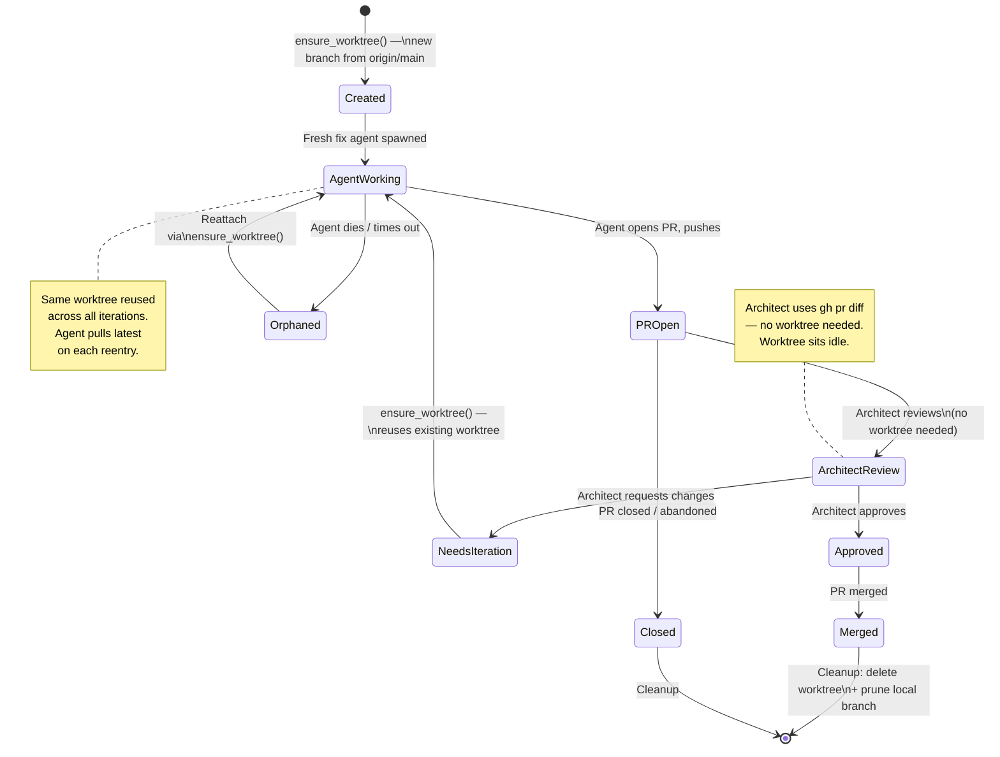

# Worktree Architecture: Robust Isolation for Bug-Fixer Agents (v2)

## Design Principles

1. **The main repo belongs to the user.** The bug-fixer must never modify its branch, working tree, or index state.
2. **One worktree per PR.** A worktree is created when work starts on an issue, then **reused** across the entire PR lifecycle — fresh fix, reattach, architect iterations, everything. No unnecessary create/destroy thrash.
3. **Worktrees are created on demand and cleaned up on merge/close.** If a worktree doesn't exist when something triggers (e.g. after a reboot), it is recreated from the remote branch. If the PR is merged or closed, the worktree and local branch are deleted.
4. **Failures are bounded.** Repeated worktree failures trigger escalation, not infinite retry.
5. **Self-application safety.** When the bug-fixer operates on its own repo, changes to dispatcher scripts are only active in the worktree until merged.

---

## Current State vs Proposed

### What's wrong today

| Problem | Current behaviour | Proposed |
|---------|------------------|----------|
| Worktree per action | Every fresh fix, reattach, and PR iteration creates a **new** worktree (destroying the old one) | One worktree per branch, reused across actions |
| No collision handling | `git worktree add` fails if branch is checked out in main repo → silent deadlock | Detect collision, work around it via remote ref |
| No circuit breaker | Same failure retried 36+ times over 6 hours | Escalate after 3 failures |
| Agent containment | `Work in: {path}` hint in prompt, no enforcement | Hardened prompts + skill rules |
| Cleanup on merge | Stale sweep checks claims/dispatches only | Also checks PR state (merged/closed) |
| Worktree naming | `issue-{N}` for fresh, `issue-{pr_num}` for iteration — inconsistent | `branch-{slug}` keyed by branch name |

---

## Architecture

### Core Concept: `ensure_worktree()`

Replace the current `create_worktree()` (which always destroys and recreates) with an **idempotent** `ensure_worktree()` that reuses an existing worktree if one already exists for the target branch.

```python
def ensure_worktree(branch_name: str, label: str = "") -> Path | None:
    """
    Ensure a worktree exists for `branch_name`. Returns the worktree path.
    
    - If a worktree already exists for this branch → reuse it (pull latest)
    - If the branch is checked out in the main repo → create from remote ref
    - If no worktree exists → create one
    - Returns None on failure
    
    `label` is a human-readable slug for the directory name (e.g. "issue-42").
    """
    # 1. Check if a worktree already exists for this branch
    existing_path = _find_worktree_for_branch(branch_name)
    if existing_path:
        # Pull latest changes from remote (in case another agent pushed)
        run(["git", "-C", str(existing_path), "pull", "--ff-only",
             "origin", branch_name], check=False)
        log(f"Reusing existing worktree at {existing_path} for {branch_name}")
        return existing_path

    # 2. Determine worktree directory name
    slug = label or _branch_to_slug(branch_name)
    wt_path = WORKTREES_DIR / slug
    wt_path.parent.mkdir(parents=True, exist_ok=True)

    # If a directory exists at this path but for a different branch, remove it
    if wt_path.exists():
        remove_worktree(wt_path)

    # 3. Check if this branch is checked out somewhere problematic
    checked_out_at = _branch_checked_out_at(branch_name)

    if checked_out_at == str(REPO_DIR):
        # Branch is in the main repo — DO NOT touch main repo.
        # Create worktree from remote ref instead.
        log(f"WARNING: {branch_name} is checked out in main repo. "
            f"Creating worktree from remote ref.")
        _fetch_branch(branch_name)
        r = run(["git", "-C", str(REPO_DIR), "worktree", "add",
                 "--detach", str(wt_path)])
        if r.returncode == 0:
            run(["git", "-C", str(wt_path), "checkout",
                 "-B", branch_name, f"origin/{branch_name}"])
            return wt_path
        log(f"Failed to create detached worktree: {r.stderr}")
        return None

    elif checked_out_at:
        # Branch is in another worktree (not at wt_path, already handled above)
        # This shouldn't happen with proper naming, but handle it
        log(f"Branch {branch_name} unexpectedly at {checked_out_at}. "
            f"Returning that path.")
        return Path(checked_out_at)

    # 4. Normal creation — branch exists on remote but not checked out locally
    branch_exists_remote = _remote_branch_exists(branch_name)
    if branch_exists_remote:
        _fetch_branch(branch_name)
        r = run(["git", "-C", str(REPO_DIR), "worktree", "add",
                 str(wt_path), branch_name])
    else:
        # New branch from origin/main
        run(["git", "-C", str(REPO_DIR), "fetch", "origin", "main"],
            check=False)
        r = run(["git", "-C", str(REPO_DIR), "worktree", "add",
                 "-b", branch_name, str(wt_path), "origin/main"])

    if r.returncode == 0:
        return wt_path

    log(f"Failed to create worktree for {branch_name}: {r.stderr or r.stdout}")
    return None
```

### Key properties

| Property | Behaviour |
|----------|-----------|
| **Idempotent** | Calling `ensure_worktree("fix/issue-42-foo")` multiple times returns the same path |
| **Reuses existing** | If a worktree exists for that branch, pulls latest and returns it |
| **Handles collisions** | If the branch is checked out in the main repo, works around it via remote ref |
| **Recreates from remote** | If the worktree was deleted (e.g. after reboot), recreates it from `origin/<branch>` |
| **Creates new branches** | For fresh fixes, creates a new branch from `origin/main` |

---

### Worktree Lifecycle (One Per PR)



### How each dispatcher action uses the worktree

| Action | Today | Proposed |
|--------|-------|----------|
| **Fresh fix** | `create_worktree(issue_num, branch, existing_branch=False)` — creates new | `ensure_worktree(branch)` — creates new branch from `origin/main` |
| **PR iteration** | `create_worktree(pr_num, pr_branch, existing_branch=True)` — destroys and recreates | `ensure_worktree(pr_branch)` — **reuses** existing worktree, pulls latest |
| **Reattach** | `create_worktree(issue_num, branch, existing_branch=True)` — destroys and recreates | `ensure_worktree(branch)` — reuses if exists, recreates from remote if not |
| **Architect review** | N/A (no worktree) | No change — architect reads via `gh pr diff` |

> [!TIP]
> The biggest win: PR iteration no longer destroys and recreates the worktree. The agent picks up where it left off — same directory, same build state, same file contents. Just `git pull` and start working.

---

### Circuit Breaker

Track consecutive failures per branch. After 3, stop retrying and label for human intervention.

```python
WORKTREE_FAILURES_FILE = STATE_DIR / "worktree_failures.json"
MAX_WORKTREE_FAILURES = 3

def _record_failure(branch: str) -> int:
    counts = _load_failures()
    counts[branch] = counts.get(branch, 0) + 1
    _save_failures(counts)
    return counts[branch]

def _clear_failure(branch: str):
    counts = _load_failures()
    counts.pop(branch, None)
    _save_failures(counts)
```

On worktree failure in the dispatcher:
```python
wt_path = ensure_worktree(branch_name, label=f"issue-{issue_num}")
if not wt_path:
    count = _record_failure(branch_name)
    if count >= MAX_WORKTREE_FAILURES:
        log(f"CIRCUIT BREAKER: {branch_name} failed {count} times. Escalating.")
        gh("issue", "edit", str(num), "--repo", TARGET_REPO,
           "--add-label", "bug-fixer:human:needs-intervention")
    continue
else:
    _clear_failure(branch_name)  # Reset on success
```

---

### Agent Containment (3 layers)

#### Layer 1: Prompt hardening

All agent prompts get explicit containment instructions:

```python
CONTAINMENT = (
    "\n\n## CRITICAL: Working Directory Rules\n"
    "- Your working directory is: {wt_path}\n"
    "- ALL file reads, edits, and git operations MUST happen inside this directory\n"
    "- NEVER run git commands against the main repo at {repo_dir}\n"
    "- NEVER run `git checkout` or `git switch` outside your working directory\n"
    "- To commit: `git -C {wt_path} add -A && git -C {wt_path} commit -m '...'`\n"
    "- To push: `git -C {wt_path} push origin HEAD`\n"
    "- To pull latest: `git -C {wt_path} pull --ff-only origin {branch}`\n"
)
```

#### Layer 2: Skill prompt update

Add to [`SKILL.md`](file:///Users/mcneillm/Documents/Projects/bug-fixer-loop-plugin/skills/bug-fixer-engineering/SKILL.md):

```markdown
## Worktree Isolation

You are working in a **git worktree** — an isolated checkout separate from the main
repository. This worktree persists across review iterations.

### Rules
1. **All work happens in your worktree path** (provided in your prompt as "Work in: <path>")
2. **Never** run `git checkout`, `git switch`, or `git branch` in the main repo directory
3. **Never** modify files outside your worktree path
4. Use `git -C <your_worktree_path>` for all git commands
5. Push with: `git -C <your_worktree_path> push origin HEAD`

### Why
The main repo belongs to the user. Checking out a branch there will deadlock the
engineering dispatcher and potentially block all bug-fixer activity for hours.
```

#### Layer 3: Pre-tool gate (future)

> [!NOTE]
> Lower priority — implement after prompt-based containment is validated. The gate could reject `run_command` calls where CWD is the main repo and the command contains `git checkout` / `git switch`, but this requires knowing the caller is a bug-fixer agent.

---

### PR-Lifecycle Cleanup (Step 0.5 enhancement)

Add a new sub-step that checks for merged/closed PRs and cleans up their worktrees:

```python
# Step 0.5b: Clean up worktrees for completed PRs
def _cleanup_merged_worktrees():
    """Delete worktrees and local branches for merged/closed bug-fixer PRs."""
    for state in ["merged", "closed"]:
        r = gh("pr", "list", "--repo", TARGET_REPO, "--state", state,
               "--label", "bug-fixer", "--json", "number,headRefName",
               "--limit", "20")
        if r.returncode != 0:
            continue
        try:
            prs = json.loads(r.stdout)
        except json.JSONDecodeError:
            continue

        for pr in prs:
            branch = pr["headRefName"]
            wt_path = _find_worktree_for_branch(branch)

            if wt_path:
                log(f"Cleaning up worktree for {state} PR #{pr['number']} "
                    f"(branch {branch})")
                remove_worktree(wt_path)

            # Prune local branch (safe — PR is done)
            run(["git", "-C", str(REPO_DIR), "branch", "-D", branch],
                check=False)
            _clear_failure(branch)
```

---

### Worktree Directory Naming

Today naming is inconsistent: `issue-{issue_num}` for fresh fixes, `issue-{pr_num}` for iterations.

Proposed: derive the directory name from the **branch name** since that's the stable identifier across the PR lifecycle:

```python
def _branch_to_slug(branch_name: str) -> str:
    """Convert a branch name to a filesystem-safe directory name.
    
    fix/issue-42-add-health-check → issue-42-add-health-check
    """
    # Strip common prefixes
    for prefix in ["fix/", "feature/", "bugfix/"]:
        if branch_name.startswith(prefix):
            branch_name = branch_name[len(prefix):]
            break
    # Sanitise
    return re.sub(r'[^a-z0-9-]+', '-', branch_name.lower()).strip('-')[:60]
```

This means:
- Fresh fix creates `worktrees/issue-42-add-health-check/`
- PR iteration reuses the same directory (found via `_find_worktree_for_branch()`)
- Reattach reuses the same directory
- No more `issue-{N}` vs `issue-{pr_num}` mismatch

---

### Helper Functions

```python
def _find_worktree_for_branch(branch_name: str) -> Path | None:
    """Find the worktree path where branch_name is checked out, or None.
    
    Only returns worktrees under WORKTREES_DIR (ignores the main repo).
    """
    r = run(["git", "-C", str(REPO_DIR), "worktree", "list", "--porcelain"])
    current_wt = None
    for line in r.stdout.splitlines():
        if line.startswith("worktree "):
            current_wt = line.split(" ", 1)[1]
        elif line.startswith("branch "):
            ref = line.split(" ", 1)[1]
            if ref == f"refs/heads/{branch_name}":
                path = Path(current_wt)
                # Only return worktrees we manage (under WORKTREES_DIR)
                if str(path).startswith(str(WORKTREES_DIR)):
                    return path
    return None


def _branch_checked_out_at(branch_name: str) -> str | None:
    """Return the worktree path where branch_name is checked out, or None.
    
    Unlike _find_worktree_for_branch, this returns ANY location including
    the main repo.
    """
    r = run(["git", "-C", str(REPO_DIR), "worktree", "list", "--porcelain"])
    current_wt = None
    for line in r.stdout.splitlines():
        if line.startswith("worktree "):
            current_wt = line.split(" ", 1)[1]
        elif line.startswith("branch "):
            ref = line.split(" ", 1)[1]
            if ref == f"refs/heads/{branch_name}":
                return current_wt
    return None


def _remote_branch_exists(branch_name: str) -> bool:
    """Check if a branch exists on the remote."""
    r = run(["git", "-C", str(REPO_DIR), "ls-remote", "--heads",
             "origin", branch_name])
    return bool(r.stdout.strip())


def _fetch_branch(branch_name: str):
    """Fetch latest from remote for a specific branch."""
    run(["git", "-C", str(REPO_DIR), "fetch", "origin", branch_name],
        check=False)
```

---

## Implementation Order

> [!IMPORTANT]
> Given self-application risk, implement and merge incrementally with manual verification between each phase.

| Phase | Change | Risk | Can bug-fixer self-apply? |
|-------|--------|------|--------------------------|
| **1** | Prompt hardening (containment instructions in all 4 prompt templates) | Very low — additive text | ✅ Yes |
| **2** | Skill prompt update (worktree isolation rules in SKILL.md) | Very low — doc change | ✅ Yes |
| **3** | Replace `create_worktree()` with `ensure_worktree()` + helpers | Medium — core logic | ❌ Human review required |
| **4** | Circuit breaker (failure tracking + escalation) | Low — new code path | ✅ Yes (additive) |
| **5** | PR-lifecycle cleanup in Step 0.5 | Low — additive | ✅ Yes |
| **6** | Clean up vestigial `worktree_path` from root `config.json` | Very low | ✅ Yes |

---

## Open Questions

1. **Should worktrees live outside the repo?** Currently `<repo>/worktrees/`. Could move to `~/.gemini/antigravity/worktrees/<repo>/` for cleaner separation. Trade-off: paths are harder to find/debug.

2. **`workspace_uris` scoping** — sidecar config currently points at the main repo. Should spawned agents get scoped `workspace_uris` pointing at their worktree? Trade-off: agents need to read repo source files (specs, configs, existing code) from the main repo for context.

3. **Build artefact persistence** — with reused worktrees, should we `.gitignore` build artefacts within worktrees, or let them accumulate? For most repos this is fine (`.gitignore` already covers them), but worth noting.
