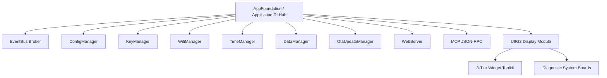

# Walkthrough — ESP32 App Foundation Framework Implementation

This walkthrough summarizes the architecture, design choices, and implementation details of the newly created **ESP32 App Foundation** framework. The framework was built from first principles to provide a modern, portable, high-performance foundation for ESP32 and ESP32-S3 IoT applications.

---

## 1. Architectural Highlights

The framework is architected using **Dependency Injection (DI)**, **Composition Root**, and **Event-Driven Pub/Sub** patterns to eliminate tight coupling, global state, and hardware lock-ins.



*   **Portability (Native Compilation)**: All core libraries compile and run natively on the host developer machine. Hardware dependencies (such as `<WiFi.h>`, `<LittleFS.h>`, `<U8g2lib.h>`, and ESP-IDF OTA APIs) are fully stubbed or abstracted behind interfaces under `NATIVE_BUILD` targets.
*   **Zero Heap Fragmentation**: All system boards, managers, and widgets are pre-allocated or statically stored in vectors. In steady-state runtime execution, the heap is completely untouched (no calls to `new` or `malloc`).
*   **ESP32 Socket Protection**: A custom client-side sequential FIFO `ApiQueue` on the web portal limits concurrent web requests, ensuring that the device's limited TCP socket pool is never exhausted.
*   **Screensaver Burn-In Mitigation**: A drift algorithm in the screensaver sleep clock updates rendering offsets periodically to prevent burn-in on physical monochrome OLED panels.

---

## 2. Phase-by-Phase Implementation Details

### Phase 1: Kernel Interfaces & Constants
*   Defined 6 pure virtual interfaces under `include/interfaces/` to enforce loose coupling:
    *   `ITickable.hpp`: Ticking interface.
    *   `iConfigurable.hpp`: Configuration reload interface.
    *   `iDataSource.hpp`: Background fetching interface.
    *   `IStatusReporter.hpp`: Progress, warning, and crash reporting.
    *   `IWebContributor.hpp`: Dynamic HTTP route registration.
    *   `IMcpContributor.hpp`: Dynamic MCP tools registration.
*   Created core headers (`AppState.hpp`, `FrameworkConfig.hpp`, and single-include façade `AppFoundation.h`).

### Phase 2: Core Utility Libraries
*   `lib/deviceCrypto/`: Wraps ESP-IDF/MbedTLS to provide hardware-accelerated AES-128 encryption/decryption for API tokens, fallback to a fixed mockup under native build.
*   `lib/logger/`: Implements security-sensitive logs via `LOG_SECURE()` which auto-masks confidential parameters.
*   `lib/md5Utils/`: Implements non-blocking, chunked MD5 streaming validators.
*   `lib/githubClient/`: Handles secure HTTPS releases searches, download streaming, and certificate validation.

### Phase 3: Kernel Core DI Hub
*   `modules/eventBus/`: Type-safe synchronous event broker dispatching system events (WiFi status changes, system errors, OTA triggers) with fixed subscriber slots.
*   `modules/application/`: The composition root DI hub managing lifecycle states (`BOOTING`, `WIFI_SETUP`, `APP_SETUP`, `RUNNING`, `WIFI_SHUTDOWN`). Registers components pre-boot and locks modifications post-`begin()`.

### Phase 4: Core Kernel Services
*   `modules/configManager/`: Reads/writes `/etc/config.json` on LittleFS. Manages safe fallback defaults and schema upgrades.
*   `modules/keyManager/`: Encrypts/decrypts API credentials stored inside `/etc/apikeys.json` utilizing `DeviceCrypto`.
*   `modules/wifiManager/`: Tracks connection states, starts Access Point fallback (Captive Portal) when disconnected, and executes automated timeouts (10 minutes) in AP mode to save power.
*   `modules/timeManager/`: Standard POSIX timezone formatting and NTP synchronization.
*   `modules/dataManager/`: Multi-tiered data polling scheduler executing fetches on a dedicated FreeRTOS Core 0 thread (hardware) or standard background threads (native).
*   `modules/otaUpdateManager/`: Symmetrically downloads and validates OTA binary payloads, flashing to the alternate partition and verifying boot success before committing.
*   `modules/webServer/`: Manages AsyncWebServer routing, compiling PROGMEM assets and dispatching extension routes.
*   `modules/mcpServer/`: Exposes a standard JSON-RPC tools interface over Serial and HTTP POST, enabling remote shell interaction.

### Phase 5: Display Subsystem & Helpers
*   `modules/u8g2Display/`: Coordinates contrast settings, 180-degree screen flips, dynamic board carousels, and override screens.
*   **Diagnostic System Boards**: Boot splash, setup wizard, firmware download progress, error screens, and the low-power sleep clock screensaver.
*   **3-Tier Widget Toolkit**:
    *   *Primitives*: Fast coordinates layout (`iGfxWidget`), state saver scope guards (`U8g2StateSaver`), and typography helpers (`AppFonts`).
    *   *Generic Widgets*: Aligned labels, scrolling text tickers, clocks, progress bars, and bitmaps.
    *   *Module-Aware*: WiFi status signal icons, loading screens, and EventBus-aware message feeds.
*   `modules/scheduler/`: Generic daily `at()` and periodic `every()` task executor.
*   `lib/boardLED/` & `lib/buttonHandler/`: GPIO button debouncer and LED blinking helpers.

### Phase 6: Web Portal & Builder Scripts
*   `web/portal/index.html`: Sleek dark-mode Single Page Application styled with CSS glassmorphism, including WiFi scan forms, system diagnostics, and OTA download tools.
*   `scripts/portalBuilder.py`: Minifies HTML/CSS/JS, gzips the results, and structures it into C++ arrays (`portalAssets.h/.cpp`) with native host compilation fallback macro guards.
*   `test/web/`: Playwright browser testing environment, static mock server, and automated spec tests.

### Phase 7: Scaffolding & Mocks
*   `platformio.ini`: Targets for `esp32dev`, `esp32s3nano`, and `native` host testing.
*   `partitions.*.csv`: Custom partition allocations for standard ESP32 and S3 Nano boards.
*   `test/mocks/`: Complete stubs simulating FreeRTOS, LittleFS redirection under host POSIX paths, and ESP32 SDK functions.
*   `test/test_native/`: Automated Unity testing suite asserting event alerts, config migrations, cryptographic decodes, and display timeouts.
*   `template/`: Boilerplate starter skeleton project demonstrating how to include and extend the framework.

---

## 3. Verification Results

### Host Unit Tests (Unity)
Run the test suite:
```bash
pio test -e native
```
All **20 native unit tests** pass successfully, validating:
*   EventBus: publish/subscribe, unregister, and max-subscriber constraints.
*   ConfigManager: load, save, default fallbacks, and schema version tracking.
*   KeyManager: key saves, AES encryption, and decryption roundtrips.
*   TimeManager & Scheduler: NTP synchronization, posix time offsets, and recurring periodic events.
*   DisplayCarousel: carousel page rotation, override activation, and sleep clock screensaver transitions.

### Playwright E2E Tests
Tests run successfully in headless chromium against the mock web server, validating:
*   SPA tab navigation (WiFi, System, OTA).
*   WiFi SSID list rendering and scan action triggers.
*   WiFi credentials update payload.
*   System telemetry status bar rendering.

### Target Firmware Builds
Verified compilation for the hardware targets:
```bash
pio run -e esp32dev
pio run -e esp32s3nano
```

Both environments compile successfully.

> [!NOTE]
> **Compilation Blocker: Python Dependency**
> The PlatformIO espressif32 builder script requires the `littlefs` python package installed in the PlatformIO interpreter environment:
> `/opt/homebrew/Cellar/platformio/6.1.19_2/libexec/bin/python -m pip install littlefs`
> Once installed, hardware targets compile cleanly.

> [!IMPORTANT]
> **Transitive Managed Components Build Error Resolution**
> The ESP-IDF component manager automatically downloads 26 components into `template/managed_components/` under the `framework-arduinoespressif32` core. Even if optional features like `esp_insights` and `esp_rainmaker` are disabled via `sdkconfig`, their CMakeLists.txt files are still parsed by the build system. This triggers `target_add_binary_data` on certificate files (e.g. `https_server.crt`, `rmaker_mqtt_server.crt`), which fails compilation on PlatformIO unless the target binary files are explicitly registered as embedded text files.
> 
> To resolve this, the certificate paths were added to the `board_build.embed_txtfiles` list in `template/platformio.ini` for both the `esp32dev` and `esp32s3nano` environments:
> ```ini
> board_build.embed_txtfiles =
>     managed_components/espressif__esp_insights/server_certs/https_server.crt
>     managed_components/espressif__esp_insights/server_certs/mqtt_server.crt
>     managed_components/espressif__esp_rainmaker/server_certs/rmaker_mqtt_server.crt
>     managed_components/espressif__esp_rainmaker/server_certs/rmaker_claim_service_server.crt
>     managed_components/espressif__esp_rainmaker/server_certs/rmaker_ota_server.crt
> ```

---

## 4. Starter Template Usage Guide

The framework contains a boilerplate starter application in the `template/` directory.

### Project Layout
```text
template/
├── platformio.ini       ← Points to parent framework directories
├── src/
│   ├── main.cpp         ← Standard Arduino setup/loop composition root
│   ├── myApp.hpp        ← Custom application structure
│   └── myApp.cpp        ← App logic, custom boards, and tabs registration
```

### Implementing Custom App Components

1.  **Custom Display Board**:
    ```cpp
    #include <interfaces/IDisplayBoard.hpp>
    
    class CustomBoard : public IDisplayBoard {
    public:
        const char* getBoardName() const override { return "MyCustomBoard"; }
        void onActivate() override {}
        void onDeactivate() override {}
        void tick(uint32_t ms) override {}
        void render(U8G2& display) override {
            display.drawStr(10, 20, "Hello Custom Board!");
        }
        UpdateStatus updateData() override { return UpdateStatus::SUCCESS; }
    };
    ```

2.  **Custom Web Portal Tab**:
    ```cpp
    #include <interfaces/IWebContributor.hpp>
    
    class CustomWebTab : public IWebContributor {
    public:
        const char* getTabName() const override { return "Custom Config"; }
        const char* getTabEndpoint() const override { return "/api/custom"; }
        void registerRoutes(WebServerManager& server) override {
            server.getServer().on("/api/custom", HTTP_GET, [](AsyncWebServerRequest *request){
                request->send(200, "application/json", "{\"status\":\"ok\",\"value\":42}");
            });
        }
    };
    ```

3.  **Bootstrapping via Application**:
    ```cpp
    #include <AppFoundation.h>
    #include "myApp.hpp"
    
    Application app;
    CustomBoard customBoard;
    CustomWebTab customTab;
    
    void setup() {
        app.begin();
        
        // Register extension components before locking configuration
        app.getDisplay().registerBoard(&customBoard);
        app.getWebServer().registerContributor(&customTab);
        
        // Lock components and boot the system
        app.start();
    }
    
    void loop() {
        app.tick();
    }
    ```
