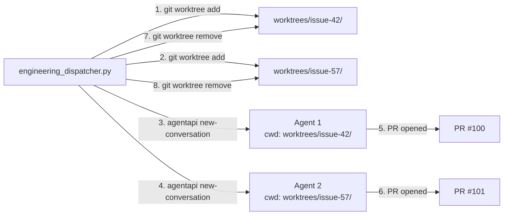

# Issue #13: Use git worktrees to isolate concurrent agent sessions

## Problem Summary

When `max_concurrent_prs` > 1, the `engineering_dispatcher.py` spawns multiple LLM agent sessions that all operate in the **same** `REPO_DIR`. This causes:

1. **Branch cross-contamination** — Agent B checks out its branch while Agent A has uncommitted edits; git carries over the dirty working tree.
2. **Lost work** — Agent A's branch is switched out from under it, causing test failures or lost changes.
3. **Incorrect commits** — Agent B commits Agent A's files into the wrong PR.

## Current State

The infrastructure for worktrees is **partially built but never wired into the dispatcher**:

| Component | Status |
|-----------|--------|
| `config.json` `worktree_path` field | ✅ Exists (set during configure) |
| `configure.sh` Step 6 | ✅ Creates a single static worktree |
| `README.md` docs | ✅ Mentions dedicated worktree operation |
| `engineering_dispatcher.py` | ❌ **Never uses** `worktree_path` — always passes `REPO_DIR` |
| `SKILL.md` | ❌ Says "Work in: `REPO_DIR`" — no worktree awareness |

The existing single static worktree would still collide when multiple agents run concurrently — it's the same problem shifted to a different directory. **We need per-issue ephemeral worktrees.**

---

## Proposed Approach

### Design: Per-Issue Ephemeral Worktrees

Each spawned agent session gets its own `git worktree`, created by the dispatcher before spawning and cleaned up after the PR is opened (or on failure). The worktree lifecycle is entirely owned by the dispatcher and liveness system — agents never create or destroy worktrees.

### Worktree Location

Worktrees live at **`<repo_root>/worktrees/`** — inside the consuming repo root, not inside the plugin directory structure. This is critical because:

1. **Stays within `workspace_uris` boundary** — the sidecar's `agent_permissions.workspace_uris` points to the repo root (`file://<repo_dir>`). Worktrees inside this boundary don't trigger Antigravity's permission prompt for editing files outside the project.
2. **Clean separation** — the plugin directory (`.agents/plugins/bug-fixer-loop/`) contains code; the workspace directory (`.agents/plugins/bug-fixer-loop-workspace/`) contains runtime state like claims and dispatches; worktrees are full working copies and belong at the repo level.

```
myrepo/                                    ← REPO_DIR (workspace_uris root)
├── .agents/plugins/
│   ├── bug-fixer-loop/                    ← plugin code (symlinked)
│   └── bug-fixer-loop-workspace/          ← runtime state
│       ├── config.json
│       ├── claims/
│       └── dispatches/
├── worktrees/                             ← ephemeral agent worktrees
│   ├── issue-42/                          ← full working copy for agent A
│   └── issue-57/                          ← full working copy for agent B
├── src/
└── .gitignore                             ← must include "worktrees/"
```

Path derivation in the dispatcher:
```python
REPO_DIR = STATE_DIR.parent.parent.parent  # already exists (line 168)
WORKTREES_DIR = REPO_DIR / "worktrees"     # at repo root
```

### Architecture Diagram



### Changes Required

#### 1. `engineering_dispatcher.py` — Core worktree lifecycle

**Create worktree** (before spawning each agent):

```python
WORKTREES_DIR = REPO_DIR / "worktrees"

def create_worktree(issue_num: int, branch_name: str) -> Path:
    """Create an ephemeral worktree for a specific issue."""
    wt_path = WORKTREES_DIR / f"issue-{issue_num}"
    if wt_path.exists():
        # Stale worktree from previous failed run — clean it up
        remove_worktree(wt_path)
    
    WORKTREES_DIR.mkdir(parents=True, exist_ok=True)
    r = run(["git", "-C", str(REPO_DIR), "worktree", "add",
             str(wt_path), "-b", branch_name, "origin/main"],
            check=False)
    if r.returncode != 0:
        # Fallback: create worktree at detached HEAD, agent will checkout
        r = run(["git", "-C", str(REPO_DIR), "worktree", "add",
                 "--detach", str(wt_path), "origin/main"], check=True)
    return wt_path


def remove_worktree(wt_path: Path):
    """Remove a worktree and prune."""
    run(["git", "-C", str(REPO_DIR), "worktree", "remove",
         "--force", str(wt_path)], check=False)
    run(["git", "-C", str(REPO_DIR), "worktree", "prune"], check=False)
```

**Wire into spawn paths** — Every place that builds a prompt must:
1. Create a worktree before spawning
2. Replace `Work in: {REPO_DIR}` with `Work in: {wt_path}`
3. Store the worktree path in the claim/lock file
4. Record the worktree path in the dispatch tracking file

There are **three spawn paths** that need updating:

| Spawn Path | Lines | Type |
|---|---|---|
| Step 1: Reattach orphaned issues | L274-L294 | `reattach` |
| Step 2.5: PR iteration dispatch | L390-L447 | `pr_iteration` |
| Step 4: Fresh fix dispatch | L523-L562 | `fresh_fix` |

> **Note:** PR iteration dispatches (Step 2.5) need a worktree too, but should check out the **existing PR branch** rather than creating a new branch from `origin/main`.

**Clean up worktrees** — Add cleanup in three places:

a. **On successful completion** (in `liveness.py` `sweep_dispatches`): When `_check_success()` returns True, remove the worktree before deleting the dispatch file.

b. **On recovery** (in `liveness.py` `_recover`): When a dispatch is abandoned after failed resume attempts, remove the worktree.

c. **Stale worktree sweep** (new, in dispatcher startup): Scan `WORKTREES_DIR` for directories that don't have a corresponding active claim or dispatch file, and prune them.

#### 2. Lock file schema update

Add `worktree_path` to the claim lock file so recovery knows which worktree to clean up:

```json
{
  "issue": 42,
  "dispatcher_pid": 12345,
  "conversation_id": "abc-123",
  "claimed_at": "2026-10-01T...",
  "worktree_path": "/path/to/myrepo/worktrees/issue-42"
}
```

#### 3. Dispatch record schema update

Add `worktree_path` to `record_dispatch()` kwargs so `sweep_dispatches` can clean up:

```python
record_dispatch(DISPATCHES_DIR, new_conv_id, "fresh_fix",
                issue_number=issue_num, timeout_minutes=45,
                worktree_path=str(wt_path))
```

#### 4. `skills/bug-fixer-engineering/SKILL.md` updates

- Step 6 (Branch): Update to reflect that the dispatcher already created the branch inside the worktree. The agent should **not** run `git checkout -b` — the branch is already checked out.
- Step 11 (Push): Push works the same from within the worktree — no changes needed.
- Remove references to "Work in: REPO_DIR" — the prompt will say the worktree path.
- Add a note: "Do NOT create or destroy git worktrees — the dispatcher manages worktree lifecycle."

#### 5. `configure.sh` / `install.sh` updates

- **`install.sh`**: Add `worktrees/` to the consuming repo's root `.gitignore` during installation (append if not already present).
- **`configure.sh`**: The existing Step 6 creates a single static worktree at `worktree_path`. This should be removed or repurposed — the dispatcher now creates ephemeral worktrees on demand. The `worktree_path` config field becomes unnecessary (or can remain as a legacy/override).

#### 6. `pre_tool_gate.py` awareness

`pre_tool_gate.py` already handles worktrees in `_git_dir()` — it calls `git rev-parse --git-dir` which correctly resolves inside worktrees. No code changes needed, but verify the `repo_dir` derivation works when the agent's cwd is a worktree subpath.

#### 7. `.gitignore` updates

Add `worktrees/` to:
- The consuming repo's root `.gitignore` (via `install.sh`)
- The workspace `.gitignore` template (for `dispatches/` — already exists at runtime but not gitignored)

---

## Risk Assessment

| Risk | Severity | Mitigation |
|------|----------|------------|
| Orphaned worktrees consume disk space | Medium | Stale worktree sweep at dispatcher startup + `git worktree prune` |
| Worktree creation fails (lock contention) | Low | Fallback to `--detach` mode; circuit breaker already handles spawn failures |
| Agent tries to operate outside its worktree | Medium | Prompt explicitly says "Work in: {wt_path}" — same pattern already used for REPO_DIR |
| Existing `worktree_path` config field semantics change | Low | Backward compatible: field can remain for legacy; dispatcher ignores it in favour of ephemeral worktrees |
| Multiple agents pushing to same remote concurrently | Low | Each agent pushes a different branch — no conflict at the git remote level |
| Worktree `.git` file confuses tools/scripts | Low | `pre_tool_gate.py` already handles this correctly |

---

## Implementation Order

1. **Add worktree helper functions** to `engineering_dispatcher.py` (`create_worktree`, `remove_worktree`, `sweep_stale_worktrees`)
2. **Update the three spawn paths** to create worktrees and pass worktree paths in prompts
3. **Update lock file and dispatch record schemas** to include `worktree_path`
4. **Update `liveness.py`** to clean up worktrees on success and recovery
5. **Update `SKILL.md`** to reflect the new worktree-based workflow
6. **Update `install.sh`** to add `worktrees/` to the consuming repo's `.gitignore`
7. **Update `configure.sh`** to remove or repurpose the static worktree creation
8. **Add tests** for worktree creation, cleanup, and stale sweep
9. **Update docs** (`README.md`, `plugin-architecture.md`)

## Design Decisions

- **Always use worktrees**, even for `max_concurrent_prs: 1` — protects against user working in the repo simultaneously.
- **Worktrees at `<repo_root>/worktrees/`**, not inside the plugin dir — stays within `workspace_uris` boundary (no Antigravity permission prompts), clean separation of concerns.
- **Dispatcher owns worktree lifecycle** — agents never create or destroy worktrees; they just work inside the provided directory.
- **Pre-create branches** — dispatcher does `git worktree add -b <branch> <path> origin/main` so the agent starts coding immediately. For reattach/iteration, use `git worktree add <path> <existing-branch>`.
