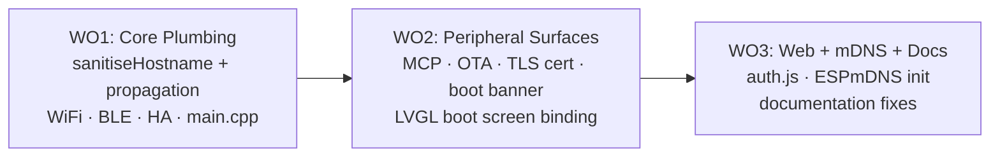

# Issue #232 — Device Identity Centralisation Plan

> **Resolves:** [#232 — Device name inconsistency — app name doesn't propagate to WiFi AP SSID, BLE, or Home Assistant](https://github.com/matthewmcneill/esp32-app-foundation/issues/232)

## Problem

`Application::setAppName()` only propagates to **2 of 17** identity surfaces. Consumers need 3+ separate setter calls, and BLE advertising name is completely unwired. The extended audit (issue comment) uncovered additional fragmentation: hardcoded TLS cert CN, hardcoded MCP server name, broken LVGL boot screen binding, and mDNS documented but unimplemented.

## Solution — Option A (Centralised Identity in `Application`)

Make `Application::begin()` auto-propagate the app name to all modules. Add a `sanitiseHostname()` utility. No breaking changes — all existing setter APIs remain as overrides.

### After this PR, a consumer needs ONE call:

```cpp
app.setAppName("Weather Station");
app.begin();  // auto-propagates to WiFi, BLE, HA, MCP, OTA, TLS, mDNS...
```

## Work Order Decomposition — 3 WOs, serialised



### WO1 — Core Identity Propagation (`standard`)
| Item | Detail |
|------|--------|
| **Files** | `Application.hpp/cpp`, `WifiManager.hpp`, `src/main.cpp` |
| **Changes** | Add `sanitiseHostname()` static utility. Extend `begin()` to auto-propagate app name to WiFi hostname, BLE advertised name (`setDefaultAdvertisedName()` already exists!), and HA module. Simplify consumer `main.cpp` to a single `setAppName()` call. |
| **Key concern** | Call-order guard: if consumer calls `setDefaultHostname()` before `begin()`, the auto-propagation must not overwrite their explicit choice. |

### WO2 — Peripheral Identity Surfaces (`standard`)
| Item | Detail |
|------|--------|
| **Files** | `MCPServer.cpp`, `OTADownloadEngine.cpp`, `AuthManager.cpp`, `Application.cpp`, `screen_boot.xml` |
| **Changes** | Wire MCP server name → `getAppName()`. OTA User-Agent → `"<name>/<version> (ESP32)"`. TLS cert CN → `getHostname()` (not display name). Boot banner → include app name. LVGL boot screen → add `bind_text="sys_app_title"`. |
| **Key concern** | TLS cert CN must be a valid hostname, not a display name with spaces. |

### WO3 — Web, mDNS & Documentation (`standard`)
| Item | Detail |
|------|--------|
| **Files** | `web/portal/auth.js`, `WifiManager.cpp`, docs |
| **Changes** | `auth.js` OpenSSL CN → use `window.location.hostname`. Add explicit `ESPmDNS` init in WifiManager on STA connect. Verify doc claims are now accurate. |
| **Key concern** | mDNS init must survive WiFi reconnections. |

## Surface Coverage Matrix

| # | Surface | WO | Fix |
|---|---------|----|----|
| 1 | WiFi AP SSID | WO1 | Auto-derived from `sanitiseHostname(appName)` |
| 2 | WiFi STA hostname | WO1 | Same |
| 3 | BLE advertised name | WO1 | Auto-call `setDefaultAdvertisedName()` |
| 4 | Home Assistant name | WO1 | Auto-call `setAppName()` |
| 5 | MCP server name | WO2 | Use `getAppName()` |
| 6 | OTA User-Agent | WO2 | Include identity + version |
| 7 | TLS cert CN | WO2 | Use `getHostname()` |
| 8 | Boot serial banner | WO2 | Add app name line |
| 9 | LVGL boot title | WO2 | Fix `bind_text` |
| 10 | auth.js OpenSSL CN | WO3 | Dynamic hostname |
| 11 | mDNS | WO3 | Implement with ESPmDNS |
| 12-17 | Already correct | — | No changes needed |

## Migration Impact

- **Framework code**: Moderate — touches 10 files across 8 modules
- **Consumer code**: **Simplifies** — one `setAppName()` call replaces three
- **Breaking changes**: **None** — all existing setter APIs remain as overrides
- **Risk**: Low — all WOs build on well-established patterns already in the codebase

---

> [!IMPORTANT]
> **Approval required before execution.** Does this decomposition look correct? If approved, I'll create the WO1 branch and spawn the first worker immediately.
