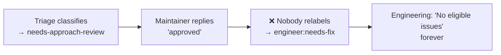
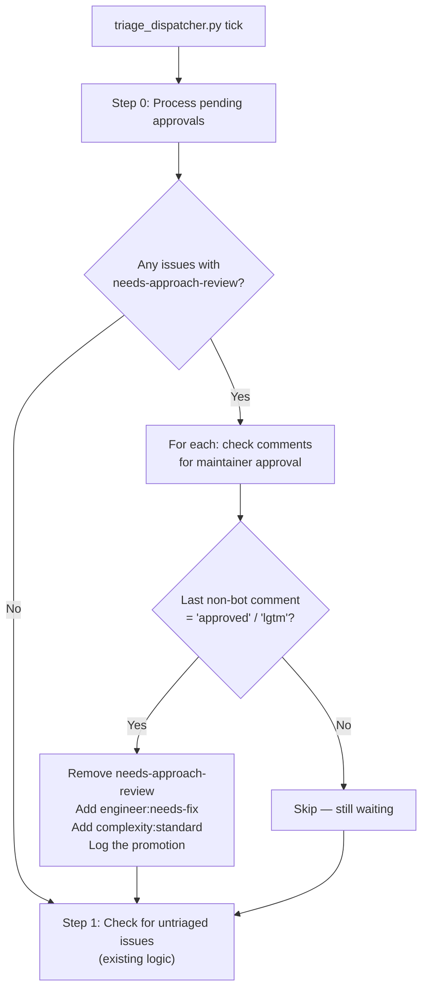

# Fix: Triage Dispatcher Should Process Approach Approvals

## Problem

When an issue is classified `bug-fixer:human:needs-approach-review`, the triage agent posts a proposed approach and waits for the maintainer to reply "approved". But **no loop ever checks for that reply**:



- **Triage** only scans issues **without** a classification label
- **Engineering** only picks up `engineer:needs-fix`
- **Architect** only handles PR approvals

## Design

Add a lightweight **pre-LLM pass** to `triage_dispatcher.py` that runs every tick (same 60-min cadence). Before the untriaged-issues check, it:

1. Queries open issues with label `bug-fixer:human:needs-approach-review`
2. For each, checks comments (newest-first) for an approval from a trusted user
3. If approved: relabels to `engineer:needs-fix` + applies complexity label
4. If not: no-op (leave it waiting)



### What counts as an approval?

Reuse the existing `APPROVAL_TEXT_REGEX` from `safe_post.py`:
```python
r"^\s*/?(?:approved?|lgtm)\s*[.!]*\s*$"
```

But also match comments that **start** with "Approved" followed by direction (like your comment: "Approved — but **do not modify enroll.sh...**"). The regex should be relaxed slightly for issue approvals:
```python
# Matches "approved", "Approved — but do X", "lgtm!", etc.
ISSUE_APPROVAL_RE = re.compile(r"^\s*(?:approved?|lgtm)\b", re.IGNORECASE)
```

### Who can approve?

Must be a **trusted user**. Check in order:
1. `config.maintainer` (if set)
2. `config.trusted_users` list (if set)
3. Fallback: comment `authorAssociation` is `OWNER`, `MEMBER`, or `COLLABORATOR`

> [!IMPORTANT]
> The approval comment must come **after** the `[BUG-FIXER]` approach comment. If the maintainer's approval predates the approach, it's not approving the approach.

### Complexity label on promotion

When promoting from `needs-approach-review` to `engineer:needs-fix`, apply `bug-fixer:complexity:standard` by default. The approach was already reviewed and scoped — standard is appropriate.

## Files to modify

| File | Change |
|------|--------|
| [`triage_dispatcher.py`](file:///Users/mcneillm/Documents/Projects/bug-fixer-loop-plugin/daemon/workspace-plugin/bug-fixer/scripts/triage_dispatcher.py) | Add `process_pending_approvals()` function + call it before the untriaged-issues check |
| [`tests/test_triage_dispatcher.py`](file:///Users/mcneillm/Documents/Projects/bug-fixer-loop-plugin/tests/) | New tests for approval detection, trusted-user gating, temporal ordering |

> [!NOTE]
> No changes needed to `architect_dispatcher.py`, `engineering_dispatcher.py`, or the triage skill. This is purely dispatcher plumbing — the triage agent's classification logic is unchanged.

## Implementation

### New function in `triage_dispatcher.py`

```python
ISSUE_APPROVAL_RE = re.compile(r"^\s*(?:approved?|lgtm)\b", re.IGNORECASE)
BUG_FIXER_APPROACH_PREFIX = "[BUG-FIXER] Proposed approach"

TRUSTED_ASSOCIATIONS = {"OWNER", "MEMBER", "COLLABORATOR"}


def _is_trusted_commenter(comment: dict, config: dict) -> bool:
    """Check if the comment author is a trusted user."""
    login = (comment.get("author") or {}).get("login", "").lower()
    assoc = comment.get("authorAssociation", "")

    maintainer = (config.get("maintainer") or "").lower()
    trusted = [u.lower() for u in (config.get("trusted_users") or [])]

    if maintainer and login == maintainer:
        return True
    if login in trusted:
        return True
    if assoc in TRUSTED_ASSOCIATIONS:
        return True
    return False


def process_pending_approvals(target_repo: str, config: dict) -> None:
    """Scan needs-approach-review issues for maintainer approval comments."""
    r = run([sys.executable, str(SAFE_INGEST), "issue-list",
             "--repo", target_repo, "--state", "open",
             "--label", "bug-fixer:human:needs-approach-review",
             "--json", "number,title,comments"])
    if r.returncode != 0:
        return

    try:
        issues = json.loads(r.stdout)
    except json.JSONDecodeError:
        return

    for issue in issues:
        number = issue["number"]
        comments = issue.get("comments", [])
        if not comments:
            continue

        # Find the approach comment timestamp
        approach_time = None
        for c in comments:
            if BUG_FIXER_APPROACH_PREFIX in (c.get("body") or ""):
                approach_time = c.get("createdAt", "")

        if not approach_time:
            continue  # No approach posted yet

        # Check comments AFTER the approach for an approval from a trusted user
        for c in comments:
            if c.get("createdAt", "") <= approach_time:
                continue
            if not _is_trusted_commenter(c, config):
                continue
            body = (c.get("body") or "").strip()
            if ISSUE_APPROVAL_RE.match(body):
                log(f"Issue #{number}: Maintainer approval detected — "
                    f"promoting to engineer:needs-fix")
                r_edit = run(["gh", "issue", "edit", str(number),
                              "--repo", target_repo,
                              "--remove-label",
                              "bug-fixer:human:needs-approach-review",
                              "--add-label",
                              "bug-fixer:engineer:needs-fix,"
                              "bug-fixer:complexity:standard"])
                if r_edit.returncode != 0:
                    log(f"Issue #{number}: Failed to relabel: "
                        f"{r_edit.stderr.strip()}")
                break  # Only process first approval
```

### Call site (before existing untriaged check, ~line 117)

```python
process_pending_approvals(TARGET_REPO, config)
```

### Tests to add

1. **Approval from owner promotes issue** — comment with "Approved" + authorAssociation=OWNER → relabeled
2. **Approval from configured maintainer promotes** — login matches config.maintainer
3. **Approval from untrusted user ignored** — authorAssociation=NONE, not in trusted_users
4. **Approval before approach comment ignored** — temporal ordering enforced
5. **No approach comment = no promotion** — issue with needs-approach-review but no [BUG-FIXER] comment
6. **"Approved — but..." still matches** — multi-word approval with direction
7. **"lgtm" matches** — alternative approval text
8. **No comments = no-op** — graceful handling

## Risk

**Low.** This is additive dispatcher plumbing:
- No changes to triage classification logic
- No changes to engineering or architect dispatchers
- Uses existing `gh issue edit` for relabeling (same as triage agent)
- Worst case failure mode: approval not detected → issue stays in `needs-approach-review` (same as today)
