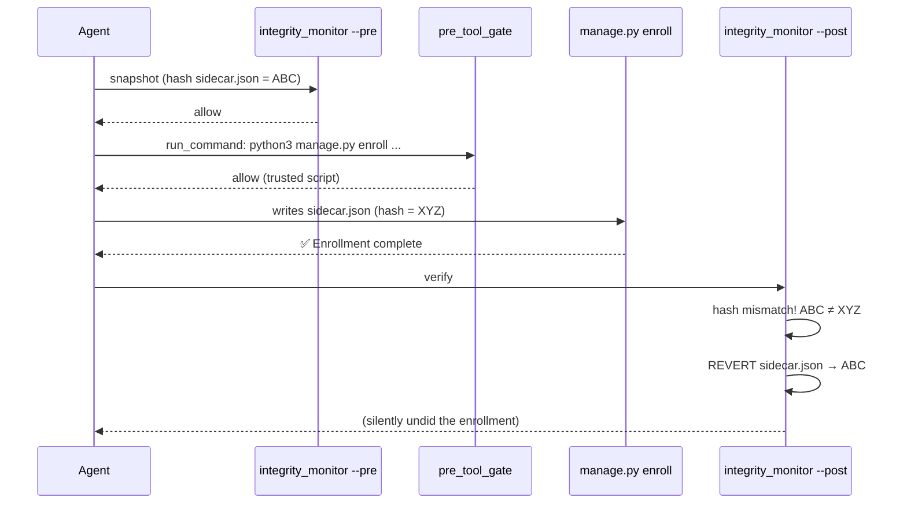
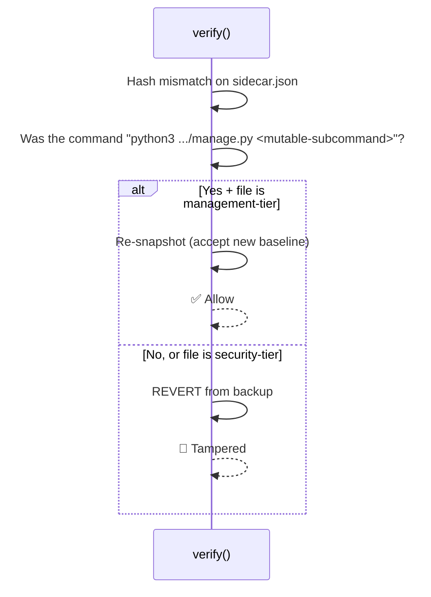

# Integrity Monitor × manage.py — Design Proposal

## The Problem



## What Can Be Mutated?

Split files into two tiers:

| Tier | Files | Mutated by manage.py? |
|------|-------|----------------------|
| **Security** | `pre_tool_gate.py`, `safe_ingest.py`, `safe_post.py`, `injection_scanner.py`, `integrity_monitor.py`, `shell_analysis.py`, `github_url_gate.py`, `hooks.json`, `plugin.json` | ❌ Never |
| **Management** | `sidecar.json`, `config.json` | ✅ By enroll, unenroll, config --set |

The integrity monitor must **always revert** security-tier changes. It should **allow** management-tier changes — but only when they came from a trusted operation.

---

## Option A: Post-hook inspects the command (Recommended)

The integrity monitor's `verify()` already receives the PostToolUse payload on stdin, which contains the command that just ran. It can inspect it.

### Flow



### Abuse analysis

| Attack | Blocked by |
|--------|-----------|
| Agent runs `manage.py enroll` autonomously via prompt injection | `ask_question` HITL blocks (no human in autonomous sessions) |
| Agent runs `python3 integrity_monitor.py --update ...` directly | Pre-tool gate blocks (host security script in command text) |
| Agent writes `/tmp/evil.py` that modifies sidecar.json | integrity monitor reverts (evil.py is not manage.py) |
| Agent writes `/tmp/evil.py` that calls integrity_monitor API | Pre-tool gate blocks writing code that references integrity_monitor |
| Agent bypasses skill and runs `manage.py config --set protected_files=[]` | **⚠️ Gap** — see below |

### The remaining gap

The HITL enforcement is currently **skill-instruction-level only**. An injected prompt could tell the agent to skip the skill and run manage.py directly. Defenses:

1. **Code-level HITL in manage.py** — mutable subcommands refuse to run unless a `--confirm-token` is passed, and the token is only obtainable from `ask_question` output. But tokens are hard to make non-replayable without shared state.

2. **Pre-tool gate enforcement** — the gate could parse manage.py subcommands and block mutable ones (`enroll`, `unenroll`, `config --set`, `reset`) unless the preceding tool call was `ask_question`. The gate already has conversation-level context.

3. **Environment check** — manage.py refuses mutable ops if `ANTIGRAVITY_SESSION_TYPE=autonomous` (or equivalent env var). Simpler, but depends on the env var existing and being trustworthy.

> [!IMPORTANT]
> **Recommendation**: Start with Option A's post-hook inspection now (solves the revert problem). Add pre-tool gate enforcement for mutable manage.py subcommands as a follow-up — it's the most robust defense since the gate is already the policy enforcement point.

---

## Option B: manage.py calls integrity_monitor via subprocess

manage.py would call `python3 integrity_monitor.py --update-snapshots file1 file2` after mutations.

### Why this is worse

- **New API surface** on a host security script — the `--update-snapshots` flag is callable by anyone who can invoke integrity_monitor.py
- **Caller verification is hard** — Python can't reliably verify who called a subprocess
- **manage.py needs to know about integrity internals** — snapshot format, file paths, etc.
- **The post-hook would still revert** — because it runs AFTER manage.py returns, so the subprocess would need to run in the right order relative to verify()

---

## Implementation (Option A)

Changes needed in `integrity_monitor.py` only — manage.py stays clean:

```python
# New constant — files that manage.py is allowed to mutate
MANAGEMENT_MUTABLE_BASENAMES = frozenset({
    "sidecar.json",
    "config.json",
})

# Trusted management script basename
_TRUSTED_MANAGER = "manage.py"

# Mutable subcommands that justify allowing management-tier file changes
_MUTABLE_SUBCOMMANDS = frozenset({
    "enroll", "unenroll", "config", "reset",
    "labels", "refresh-sidecars",
})
```

In `verify()`, before reverting:

```python
def _was_trusted_management_command(stdin_data: dict) -> bool:
    """Check if the just-executed command was a trusted manage.py mutation."""
    tool_call = stdin_data.get("toolCall", {})
    if tool_call.get("name") != "run_command":
        return False
    cmd = (tool_call.get("args", {}).get("CommandLine") or "").strip()
    # Must invoke manage.py
    if _TRUSTED_MANAGER not in cmd:
        return False
    # Must use a mutable subcommand
    parts = cmd.split()
    return any(p in _MUTABLE_SUBCOMMANDS for p in parts)

# In verify():
if actual_hash != expected_hash:
    basename = os.path.basename(path)
    if (basename in MANAGEMENT_MUTABLE_BASENAMES 
            and _was_trusted_management_command(stdin_data)):
        # Legitimate management mutation — update snapshot baseline
        expected[path] = actual_hash
        # Update backup copy
        backup_name = hashlib.sha256(path.encode("utf-8")).hexdigest()
        backup_path = snapshot_dir / backup_name
        try:
            shutil.copy2(path, backup_path)
        except OSError:
            pass
        continue  # don't revert
    # else: REVERT as before
```

### What this achieves

- **Zero changes to manage.py** — it doesn't know about integrity snapshots
- **Strict allowlist** — only sidecar.json and config.json, never security scripts
- **Command verification** — only allows changes when the actual command was manage.py
- **All logic in integrity_monitor.py** — single owner of the integrity policy
