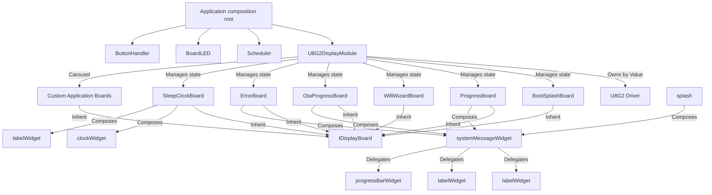

# Phase 5 Walkthrough — Display Subsystem, Widget Toolkit, Scheduler, and Hardware Drivers

This document details the completed implementation of Phase 5 of the ESP32 App Foundation framework. All components are written in C++14, strictly adhere to the project's house style, and include fallback mocks to guarantee portability on host native targets.

---

## 1. Architectural Layout

---

## 2. Component Files Created

### Interfaces (`include/interfaces/`)
*   **[IDisplayBoard.hpp](file:///Users/mcneillm/Documents/Projects/esp32-app-foundation-t2/include/interfaces/IDisplayBoard.hpp)**: Represents a display layout screen compiled for U8G2 carousels, providing hooks for activation, ticking, rendering, and lifecycle checks.

### Display Module (`modules/u8g2Display/`)
*   **[AppFonts.hpp](file:///Users/mcneillm/Documents/Projects/esp32-app-foundation-t2/modules/u8g2Display/fonts/AppFonts.hpp)**: Typography wrapper declaring built-in Helvetica fonts on hardware and fallback pointers under native compilation.
*   **[iBoardLayout.hpp](file:///Users/mcneillm/Documents/Projects/esp32-app-foundation-t2/modules/u8g2Display/boards/interfaces/iBoardLayout.hpp)**: Interface decoupling layout rendering from raw hardware and driver implementations.
*   **[u8g2DisplayModule.hpp](file:///Users/mcneillm/Documents/Projects/esp32-app-foundation-t2/modules/u8g2Display/u8g2DisplayModule.hpp)** / **[u8g2DisplayModule.cpp](file:///Users/mcneillm/Documents/Projects/esp32-app-foundation-t2/modules/u8g2Display/u8g2DisplayModule.cpp)**: Coordinates visual loops, screen sleep timers, and carousel rotation intervals. Serializes preferences to `/mod/display.json`.

### 3-Tier Widget Toolkit (`modules/u8g2Display/widgets/`)
*   **Tier 1: Graphics Context & Primitives**
    *   **[iGfxWidget.hpp](file:///Users/mcneillm/Documents/Projects/esp32-app-foundation-t2/modules/u8g2Display/widgets/iGfxWidget.hpp)**: Widget base compiling positions and dimensions as concrete members to avoid virtual lookup overhead.
    *   **[drawingPrimitives.hpp](file:///Users/mcneillm/Documents/Projects/esp32-app-foundation-t2/modules/u8g2Display/widgets/drawingPrimitives.hpp)** / **[drawingPrimitives.cpp](file:///Users/mcneillm/Documents/Projects/esp32-app-foundation-t2/modules/u8g2Display/widgets/drawingPrimitives.cpp)**: RAII display state saver (`U8g2StateSaver`) and stateless text alignment/clipping helpers.
*   **Tier 2: Generic Components**
    *   **[labelWidget.hpp](file:///Users/mcneillm/Documents/Projects/esp32-app-foundation-t2/modules/u8g2Display/widgets/labelWidget.hpp)** / **[labelWidget.cpp](file:///Users/mcneillm/Documents/Projects/esp32-app-foundation-t2/modules/u8g2Display/widgets/labelWidget.cpp)**: Displays aligned static text lines.
    *   **[scrollingTextWidget.hpp](file:///Users/mcneillm/Documents/Projects/esp32-app-foundation-t2/modules/u8g2Display/widgets/scrollingTextWidget.hpp)** / **[scrollingTextWidget.cpp](file:///Users/mcneillm/Documents/Projects/esp32-app-foundation-t2/modules/u8g2Display/widgets/scrollingTextWidget.cpp)**: Renders horizontal scrolling text (marquees) with pixel-perfect clipping.
    *   **[clockWidget.hpp](file:///Users/mcneillm/Documents/Projects/esp32-app-foundation-t2/modules/u8g2Display/widgets/clockWidget.hpp)** / **[clockWidget.cpp](file:///Users/mcneillm/Documents/Projects/esp32-app-foundation-t2/modules/u8g2Display/widgets/clockWidget.cpp)**: Integrates NTP timezone values to paint local clock layouts with blinking colons.
    *   **[progressBarWidget.hpp](file:///Users/mcneillm/Documents/Projects/esp32-app-foundation-t2/modules/u8g2Display/widgets/progressBarWidget.hpp)** / **[progressBarWidget.cpp](file:///Users/mcneillm/Documents/Projects/esp32-app-foundation-t2/modules/u8g2Display/widgets/progressBarWidget.cpp)**: Paints frames and progress loading levels.
    *   **[imageWidget.hpp](file:///Users/mcneillm/Documents/Projects/esp32-app-foundation-t2/modules/u8g2Display/widgets/imageWidget.hpp)** / **[imageWidget.cpp](file:///Users/mcneillm/Documents/Projects/esp32-app-foundation-t2/modules/u8g2Display/widgets/imageWidget.cpp)**: Renders binary XBM pixel arrays.
*   **Tier 3: Module-Aware Components**
    *   **[wifiStatusWidget.hpp](file:///Users/mcneillm/Documents/Projects/esp32-app-foundation-t2/modules/u8g2Display/widgets/wifiStatusWidget.hpp)** / **[wifiStatusWidget.cpp](file:///Users/mcneillm/Documents/Projects/esp32-app-foundation-t2/modules/u8g2Display/widgets/wifiStatusWidget.cpp)**: Queries `WifiManager` states to render connected arcs, AP tags, connecting blinks, or error crosses.
    *   **[systemMessageWidget.hpp](file:///Users/mcneillm/Documents/Projects/esp32-app-foundation-t2/modules/u8g2Display/widgets/systemMessageWidget.hpp)** / **[systemMessageWidget.cpp](file:///Users/mcneillm/Documents/Projects/esp32-app-foundation-t2/modules/u8g2Display/widgets/systemMessageWidget.cpp)**: Renders a header, detail logs, and a loading bar.
    *   **[scrollingMessagePoolWidget.hpp](file:///Users/mcneillm/Documents/Projects/esp32-app-foundation-t2/modules/u8g2Display/widgets/scrollingMessagePoolWidget.hpp)** / **[scrollingMessagePoolWidget.cpp](file:///Users/mcneillm/Documents/Projects/esp32-app-foundation-t2/modules/u8g2Display/widgets/scrollingMessagePoolWidget.cpp)**: Connects to `EventBus` topic `"display.message"` using a thread-safe circular ring-buffer.

### System Boards (`modules/u8g2Display/boards/`)
*   **[BootSplashBoard.hpp](file:///Users/mcneillm/Documents/Projects/esp32-app-foundation-t2/modules/u8g2Display/boards/BootSplashBoard.hpp)** / **[BootSplashBoard.cpp](file:///Users/mcneillm/Documents/Projects/esp32-app-foundation-t2/modules/u8g2Display/boards/BootSplashBoard.cpp)**: Branding logo and notice screen.
*   **[ProgressBoard.hpp](file:///Users/mcneillm/Documents/Projects/esp32-app-foundation-t2/modules/u8g2Display/boards/ProgressBoard.hpp)** / **[ProgressBoard.cpp](file:///Users/mcneillm/Documents/Projects/esp32-app-foundation-t2/modules/u8g2Display/boards/ProgressBoard.cpp)**: Database/service setup progress screen.
*   **[WifiWizardBoard.hpp](file:///Users/mcneillm/Documents/Projects/esp32-app-foundation-t2/modules/u8g2Display/boards/WifiWizardBoard.hpp)** / **[WifiWizardBoard.cpp](file:///Users/mcneillm/Documents/Projects/esp32-app-foundation-t2/modules/u8g2Display/boards/WifiWizardBoard.cpp)**: Captive portal configuration and SSID/IP details screen.
*   **[OtaProgressBoard.hpp](file:///Users/mcneillm/Documents/Projects/esp32-app-foundation-t2/modules/u8g2Display/boards/OtaProgressBoard.hpp)** / **[OtaProgressBoard.cpp](file:///Users/mcneillm/Documents/Projects/esp32-app-foundation-t2/modules/u8g2Display/boards/OtaProgressBoard.cpp)**: Firmware flashing percentage indicator.
*   **[ErrorBoard.hpp](file:///Users/mcneillm/Documents/Projects/esp32-app-foundation-t2/modules/u8g2Display/boards/ErrorBoard.hpp)** / **[ErrorBoard.cpp](file:///Users/mcneillm/Documents/Projects/esp32-app-foundation-t2/modules/u8g2Display/boards/ErrorBoard.cpp)**: Diagnostic crashes/logs viewer.
*   **[SleepClockBoard.hpp](file:///Users/mcneillm/Documents/Projects/esp32-app-foundation-t2/modules/u8g2Display/boards/SleepClockBoard.hpp)** / **[SleepClockBoard.cpp](file:///Users/mcneillm/Documents/Projects/esp32-app-foundation-t2/modules/u8g2Display/boards/SleepClockBoard.cpp)**: NTP clock screensaver drifting positions dynamically to prevent pixel burn-in.

### Task Scheduler (`modules/scheduler/`)
*   **[Scheduler.hpp](file:///Users/mcneillm/Documents/Projects/esp32-app-foundation-t2/modules/scheduler/Scheduler.hpp)** / **[Scheduler.cpp](file:///Users/mcneillm/Documents/Projects/esp32-app-foundation-t2/modules/scheduler/Scheduler.cpp)**: Coordinates periodic timer events and daily callback schedules, storing states in `/mod/scheduler.json`.

### Hardware Drivers (`lib/`)
*   **[BoardLED.hpp](file:///Users/mcneillm/Documents/Projects/esp32-app-foundation-t2/lib/boardLED/BoardLED.hpp)** / **[BoardLED.cpp](file:///Users/mcneillm/Documents/Projects/esp32-app-foundation-t2/lib/boardLED/BoardLED.cpp)**: GPIO state toggling and asynchronous blinking controller.
*   **[buttonHandler.hpp](file:///Users/mcneillm/Documents/Projects/esp32-app-foundation-t2/lib/buttonHandler/buttonHandler.hpp)** / **[buttonHandler.cpp](file:///Users/mcneillm/Documents/Projects/esp32-app-foundation-t2/lib/buttonHandler/buttonHandler.cpp)**: Debounces switch bounces, executing press, release, and long-press callback loops.

---

## 3. Notable Design Implementations

### OLED Burn-in Mitigation
The `SleepClockBoard` protects screens from pixel degradation by shifting its layout coordinates periodically:
*   A drift offset (`xOffset, yOffset`) is recalculated every 60 seconds.
*   Widget rendering is offset dynamically within a safe coordinates grid, keeping static items constantly in motion.

### Power Management & Two-Stage Sleep
The `U8G2DisplayModule` acts as an idle state machine:
1.  **First Stage (Screensaver)**: After `sleepTimeoutMs` (e.g. 10 minutes of inactivity), the display transitions to screensaver sleep by showing the floating `SleepClockBoard`.
2.  **Second Stage (Power Off)**: If inactivity continues for an additional 10 minutes, the physical panel is completely powered down via `setPowerSave(1)` to conserve battery power.
3.  **Wake Trigger**: Any user interaction (such as button clicks or active service overrides) wakes the module, restores power via `setPowerSave(0)`, and returns the screen to the active board carousel.
