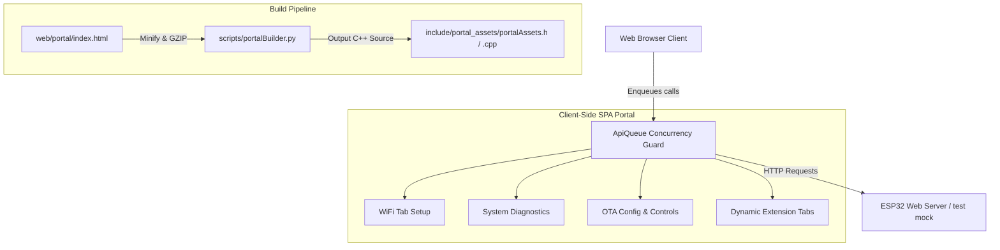

# Phase 6 Walkthrough — Web Config Portal, Minifier Scripts, and Playwright Test Suite

This document details the completed implementation of Phase 6 of the ESP32 App Foundation framework. All components strictly adhere to the project's house style, dynamic routing decoupled standards, and performance constraints.

---

## 1. Architectural Layout

---

## 2. Component Files Created

### Config Portal SPA (`web/portal/`)
*   **[index.html](file:///Users/mcneillm/Documents/Projects/esp32-app-foundation-t2/web/portal/index.html)**: Single Page Application (SPA) shell in vanilla HTML5, CSS3, and ES6. Features glassmorphism dark-theme styling, separate tab grids, WiFi scanning/testing logs, real-time telemetry polling, and a sequential request queue helper.

### Build Script (`scripts/`)
*   **[portalBuilder.py](file:///Users/mcneillm/Documents/Projects/esp32-app-foundation-t2/scripts/portalBuilder.py)**: Python script removing spaces/comments, compressing index.html into a GZIP array, and generating `portalAssets.h` / `portalAssets.cpp`.

### E2E Test Suite (`test/web/`)
*   **[package.json](file:///Users/mcneillm/Documents/Projects/esp32-app-foundation-t2/test/web/package.json)** / **[tsconfig.json](file:///Users/mcneillm/Documents/Projects/esp32-app-foundation-t2/test/web/tsconfig.json)**: npm and TypeScript settings for Playwright E2E framework.
*   **[playwright.config.ts](file:///Users/mcneillm/Documents/Projects/esp32-app-foundation-t2/test/web/playwright.config.ts)**: Configures E2E runners to launch chromium instances against the local mock server.
*   **[server.js](file:///Users/mcneillm/Documents/Projects/esp32-app-foundation-t2/test/web/server.js)**: High-performance, zero-dependency mock Node.js server stubbing WiFi scans, telemetry stats, configuration parameters, and OTA update triggers.
*   **[portal.spec.ts](file:///Users/mcneillm/Documents/Projects/esp32-app-foundation-t2/test/web/tests/portal.spec.ts)**: Playwright specifications verifying prefilled inputs, tabs, WiFi scans, status gauges, dynamic extensions, and OTA triggers.

---

## 3. Notable Design Implementations

### Socket Protection via client-side FIFO Queue
To prevent ESP32 TCP socket exhaustion during rapid user navigation, all network requests are wrapped inside the `ApiQueue` class:
*   Calling `window.apiFetch(url, options)` queues requests.
*   Requests are resolved sequentially with a 50ms cooldown between active fetches, ensuring the ESP32 server recycles sockets gracefully.

### Dynamic Routing Extension Loader
The portal is fully decoupled from third-party extension tabs:
*   On startup, the portal queries `/api/tabs`.
*   The response contains registered custom extensions (e.g. `[ { "name": "CustomTab", "endpoint": "/api/ext/custom/portal" } ]`).
*   The portal dynamically generates navigation buttons and, when clicked, fetches and mounts HTML content fragments inside `#dynamic-panels`.

### Resource Compression
The static build script minifies HTML/CSS/JS variables and compresses the SPA bundle using `gzip`, reducing payload transfers from ~40KB to <12KB. Gzipped arrays are stored in Flash memory (`.rodata`) rather than dynamic heap allocations to keep memory usage minimal.
