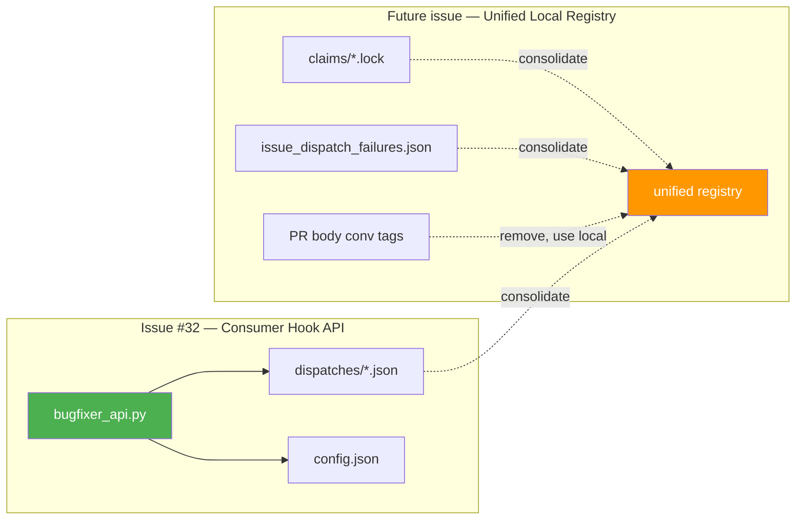

# Issue #32 — Refined Approach: Consumer Hook API

## The Idea

Instead of a single-purpose `is_autonomous_session()` helper, ship a proper **consumer hook API** — a module that consumer PreToolUse hooks import to get a rich, structured session context. This abstracts consumers from the plugin's internal state tracking (dispatch files, claims, config layout) and gives us a stable contract we can evolve without breaking consumers.

---

## What Data Would Consumers Want?

Thinking from the perspective of a consumer hook (like `esp32-app-foundation`'s `pio-cli-gate.py`):

| Data | Consumer use case | Source |
|------|------------------|--------|
| **Is this autonomous?** | `deny` vs `force_ask` decision | Dispatch files exist for conv_id |
| **Session type** | Different rules for engineer vs architect vs triage | Dispatch `type` field |
| **Issue number** | Apply issue-specific rules or exceptions | Dispatch `issue_number` field |
| **PR number** | Apply PR-specific rules | Dispatch `pr_number` field |
| **Worktree path** | Validate `Cwd` is inside expected worktree | Dispatch `worktree_path` field |
| **Target repo** | Multi-project consumers with shared hooks | Config `target_repo` |
| **Plugin config** | Consumer-specific fields (e.g., `test_command`) | `config.json` |
| **Protected files** | Consumer may want to enforce additional rules | Config `protected_files` |

---

## API Design

### New file: [`scripts/bugfixer_api.py`](file:///Users/mcneillm/Documents/Projects/bug-fixer-loop-plugin/scripts/bugfixer_api.py)

```python
"""Consumer Hook API for bug-fixer-loop plugin.

Provides a stable, namespaced interface for consumer PreToolUse hook scripts
to query bug-fixer session context. Abstracts consumers from the plugin's
internal state files (dispatch tracking, claims, config layout).

Usage in consumer hooks:
    import sys, json
    sys.path.insert(0, "/path/to/bug-fixer-loop-plugin/scripts")
    from bugfixer_api import BugFixer

    payload = json.loads(sys.stdin.read())
    ctx = BugFixer.get_session_context(payload.get("conversationId", ""))

    if ctx.is_autonomous:
        print(json.dumps({"decision": "deny", "reason": "..."}))
    else:
        print(json.dumps({"decision": "force_ask"}))
"""

from __future__ import annotations
from dataclasses import dataclass, field
from pathlib import Path
import json
import os


@dataclass(frozen=True)
class SessionContext:
    """Structured context for a bug-fixer session.

    All fields have safe defaults — if the session is not autonomous
    or the plugin state can't be found, consumers get a safe "unknown
    interactive session" context.
    """

    is_autonomous: bool = False
    """True if this conversation was spawned by a bug-fixer dispatcher."""

    session_type: str | None = None
    """Dispatch type: 'fresh_fix', 'reattach', 'pr_iteration',
    'architect_review', 'triage', 'trajectory', or None if unknown."""

    issue_number: int | None = None
    """GitHub issue number this session is working on, if applicable."""

    pr_number: int | None = None
    """GitHub PR number this session is working on, if applicable."""

    worktree_path: str | None = None
    """Path to the git worktree this session is operating in."""

    target_repo: str | None = None
    """GitHub owner/repo this plugin instance targets."""

    config: dict = field(default_factory=dict)
    """Full plugin config.json contents. Includes protected_files,
    spec_file_path, test_command, etc."""


class BugFixer:
    """Consumer Hook API for the bug-fixer-loop plugin.

    All methods are static — no instantiation required.
    Import and use directly in consumer PreToolUse hook scripts:

        from bugfixer_api import BugFixer

        ctx = BugFixer.get_session_context(conversation_id)
        if ctx.is_autonomous:
            ...
    """

    @staticmethod
    def get_session_context(conversation_id: str) -> SessionContext:
        """Look up session context for a conversation ID.

        Scans dispatch tracking files to determine if this conversation
        was spawned by a bug-fixer dispatcher, and if so, returns the
        full session context (type, issue/PR number, worktree, config).

        Returns a SessionContext with safe defaults (is_autonomous=False)
        if the conversation is not found or plugin state can't be located.
        """
        ...

    @staticmethod
    def is_autonomous(conversation_id: str) -> bool:
        """Convenience shorthand for the most common check.

        Equivalent to: BugFixer.get_session_context(conv_id).is_autonomous
        """
        return BugFixer.get_session_context(conversation_id).is_autonomous

    @staticmethod
    def get_config() -> dict:
        """Return the plugin's config.json as a dict.

        Useful for consumers that need config values (e.g., protected_files,
        target_repo) without caring about a specific session.
        """
        ...
```

### Consumer usage (the full picture)

```python
#!/usr/bin/env python3
"""pio-cli-gate.py — Consumer PreToolUse hook for esp32-app-foundation.

Blocks direct `pio` CLI usage (must use PlatformIO MCP instead).
In interactive mode: force_ask (human can approve exceptions).
In autonomous mode: deny (no human to approve).
"""
import json, sys
from bugfixer_api import BugFixer

def main():
    raw = sys.stdin.read().strip()
    if not raw:
        print(json.dumps({"decision": "allow"}))
        return

    payload = json.loads(raw)
    tool_call = payload.get("toolCall", {})
    tool_name = tool_call.get("name", "")
    args = tool_call.get("args", {})
    cmd = args.get("CommandLine", "")

    if tool_name != "run_command" or "pio" not in cmd:
        print(json.dumps({"decision": "allow"}))
        return

    # ---- Bug-fixer session context ----
    ctx = BugFixer.get_session_context(payload.get("conversationId", ""))

    if ctx.is_autonomous:
        print(json.dumps({
            "decision": "deny",
            "reason": (
                f"Direct `pio` CLI blocked in autonomous mode "
                f"(session_type={ctx.session_type}, "
                f"issue=#{ctx.issue_number}). "
                f"Use PlatformIO MCP tools instead."
            )
        }))
    else:
        print(json.dumps({"decision": "force_ask"}))

if __name__ == "__main__":
    main()
```

The `BugFixer.` prefix makes it immediately clear in any consumer codebase that these calls belong to the bug-fixer plugin — no ambiguity when the consumer also imports other hook helpers or utility modules.

---

## Gap Found: Triage and Trajectory Don't Register Dispatches

While auditing, I confirmed that **only engineering and architect dispatchers call `record_dispatch()`**:

| Dispatcher | Calls `record_dispatch()`? | Has `DISPATCHES_DIR`? |
|-----------|:-:|:-:|
| [`engineering_dispatcher.py`](file:///Users/mcneillm/Documents/Projects/bug-fixer-loop-plugin/scripts/engineering_dispatcher.py) | ✅ 3 sites (fresh_fix, reattach, pr_iteration) | ✅ |
| [`architect_dispatcher.py`](file:///Users/mcneillm/Documents/Projects/bug-fixer-loop-plugin/scripts/architect_dispatcher.py) | ✅ 1 site (architect_review) | ✅ |
| [`triage_dispatcher.py`](file:///Users/mcneillm/Documents/Projects/bug-fixer-loop-plugin/scripts/triage_dispatcher.py) | ❌ | ❌ |
| [`trajectory_dispatcher.py`](file:///Users/mcneillm/Documents/Projects/bug-fixer-loop-plugin/scripts/trajectory_dispatcher.py) | ❌ | ❌ |

This means triage and trajectory sessions are **invisible** to any dispatch-based lookup. For the hook API to be complete, we need to add `record_dispatch()` calls to those two dispatchers. This is a small change — ~3 lines each — and also fixes a pre-existing gap in liveness tracking for those session types.

---

## Discovery Mechanism

The hook API module needs to find `STATE_DIR/dispatches/` without relying on env vars that may not propagate to hook subprocesses.

### How hooks are invoked

From [`.agents/hooks.json`](file:///Users/mcneillm/Documents/Projects/bug-fixer-loop-plugin/.agents/hooks.json):

```json
{
  "command": "python3 /absolute/path/to/bug-fixer-loop-plugin/scripts/pre_tool_gate.py",
  "timeout": 10
}
```

Key facts:
- Hook scripts are invoked with **absolute paths** (resolved at install time)
- Hook cwd is `.agents/` ([plugin-architecture.md L275](file:///Users/mcneillm/Documents/Projects/bug-fixer-loop-plugin/docs/plugin-architecture.md#L275))
- The script's own `__file__` path → `PLUGIN_DIR/scripts/bugfixer_api.py`

So `bugfixer_api.py` can derive everything from its own location:

```python
# bugfixer_api.py knows where it lives
SCRIPT_DIR = Path(__file__).resolve().parent          # .../bug-fixer-loop-plugin/scripts/
PLUGIN_DIR = SCRIPT_DIR.parent                        # .../bug-fixer-loop-plugin/
WORKSPACE_DIR = PLUGIN_DIR.parent / "bug-fixer-loop-workspace"  # sibling workspace
DISPATCHES_DIR = WORKSPACE_DIR / "dispatches"
CONFIG_FILE = WORKSPACE_DIR / "config.json"
```

This is the same path derivation pattern the dispatchers already use. No env vars needed.

> [!TIP]
> Because hook commands use absolute paths, and `bugfixer_api.py` lives inside the plugin, the `__file__`-based discovery always works regardless of hook cwd.

### Consumer hook import path

The consumer hook needs `bugfixer_api` on `sys.path`. Two clean options:

**Option A: Consumer adds plugin scripts to sys.path explicitly**
```python
import sys
sys.path.insert(0, "/path/to/bug-fixer-loop-plugin/scripts")
from bugfixer_api import get_session_context
```

**Option B: Consumer hook command includes PYTHONPATH**

In the consumer's `.agents/hooks.json`:
```json
{
  "command": "PYTHONPATH=/path/to/bug-fixer-loop-plugin/scripts python3 /path/to/consumer/hooks/pio-cli-gate.py",
  "timeout": 10
}
```

Option B is cleaner — the consumer hook script just does `from bugfixer_api import get_session_context` with no path manipulation. The plugin's `install.sh` could even offer to set this up.

---

## Implementation Plan

| Step | File | Change | Size |
|------|------|--------|------|
| 1 | **New:** `scripts/bugfixer_api.py` | `SessionContext` dataclass + `get_session_context()` | ~80 lines |
| 2 | [`scripts/triage_dispatcher.py`](file:///Users/mcneillm/Documents/Projects/bug-fixer-loop-plugin/scripts/triage_dispatcher.py) L165-170 | Add `record_dispatch()` call after spawn | ~5 lines |
| 3 | [`scripts/trajectory_dispatcher.py`](file:///Users/mcneillm/Documents/Projects/bug-fixer-loop-plugin/scripts/trajectory_dispatcher.py) L199-204 | Add `record_dispatch()` call after spawn | ~5 lines |
| 4 | [`docs/plugin-architecture.md`](file:///Users/mcneillm/Documents/Projects/bug-fixer-loop-plugin/docs/plugin-architecture.md) | New "Consumer Hook API" section | ~30 lines |
| 5 | [`README.md`](file:///Users/mcneillm/Documents/Projects/bug-fixer-loop-plugin/README.md) | Document `bugfixer_api.py` for consumers | ~20 lines |

**Zero changes to engineering or architect dispatchers** — they already register dispatches correctly.

---

## Broader Conversation ID Architecture (Separate Issue)

You asked whether we should revisit the full conv-ID-to-issue/PR mapping. I think that's worth a separate issue because it touches different concerns:



The hook API design is **forward-compatible** with a future unified registry. If you later consolidate claims + dispatches + failures into a single local registry, the `get_session_context()` implementation changes but the consumer-facing `SessionContext` dataclass stays identical. That's the whole point of the abstraction — consumers import the API, not the internal state files.

> [!NOTE]
> The `<!-- agy_dev_conv_id: ... -->` tags in PR bodies are the most architecturally questionable piece — they bake machine-local conversation IDs into portable GitHub state. But that's a separate discussion (they serve the resume-on-same-machine use case, which is valid today). The hook API doesn't depend on them at all.
