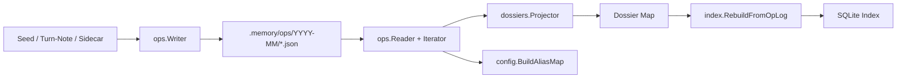
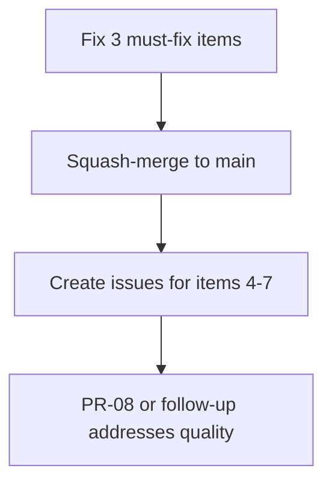

# PR #9 — Fresh Independent Review

**PR:** [PR-07: V2 Storage — Op log, dossiers, scopes, index, v1 removal & seeding](https://github.com/cblabs-org/repo-memory-plugin/pull/9)
**Branch:** `pr-07-v2-storage/wo6-seeding` → `main`
**Stats:** 81 files, 18 commits, +5,289 / −4,206 lines
**State:** OPEN, MERGEABLE, no review decision yet

---

## Executive Summary

This is a large, well-structured PR that delivers the core V2 storage architecture: an append-only op log, dossier projection, scope resolution, index migration, v1 removal, and a seeder that bootstraps memory from Principal Architect workorder reports. **The foundational architecture (WO1–WO5) is solid and ready to ship.** The seeder (WO6) has been through 4 review rounds with diminishing but unresolved issues.

### Verdict: **Merge with 3 targeted fixes**

The previous reviewer identified real issues but the cycle of "10 findings → fix → re-review → 8 more" has gone on too long. Many of the remaining items are **polish, not blockers**. I've triaged everything into Must-Fix, Should-Fix-Post-Merge, and Won't-Fix categories.

---

## Build & Test Status ✅

| Check | Result |
|-------|--------|
| `go build ./...` | ✅ Clean |
| `go vet ./...` | ✅ Clean |
| `go test ./internal/core/seed/...` | ✅ 3/3 pass |
| `go test ./internal/core/ops/...` | ✅ 12/12 pass |
| `go test ./internal/core/dossiers/...` | ✅ 3/3 pass |
| `go test ./internal/core/index/...` | ✅ 11/11 pass |
| `go test ./internal/core/config/...` | ✅ 31/31 pass |
| Skipped tests | 1 — `TestPipelineCostPersistence` (expected, v1 stages removed) |

---

## Architecture Assessment

The V2 storage design is clean and well-separated:



> [!TIP]
> The append-only op log with ULID batch IDs, month-sharded storage, and projection-based materialization is a solid event-sourcing design. The projector correctly handles all 6 op types (add, amend, supersede, retire, move, split).

---

## Triage of All Outstanding Review Findings

### 🔴 Must-Fix Before Merge (3 items)

#### 1. Batch `CreatedAt` uses `time.Now()` instead of commit time — breaks `ProjectBefore`

**File:** [scanner.go:147](file:///Users/mcneillm/Documents/Projects/repo-memory-plugin/internal/core/seed/scanner.go#L147) → [op.go:80-88](file:///Users/mcneillm/Documents/Projects/repo-memory-plugin/internal/core/ops/op.go#L80-L88)

The seeder correctly extracts `commitTime` from git history and passes it into each op's `Timestamp` field. But `SeedFromParsed` calls `ops.NewBatch(newOps)` which hardcodes `CreatedAt: time.Now().UTC()` (line 81 of op.go). Since `IterateBefore` filters on `batch.CreatedAt` (iterator.go:201), **all seeded data is invisible to time-cut queries**.

**Fix:** Add `NewBatchWithTime(ops []Op, t time.Time)` or pass commit time into `SeedFromParsed`:

```go
// In op.go:
func NewBatchWithTime(ops []Op, t time.Time) OpBatch {
    return OpBatch{
        Version:   1,
        Ops:       ops,
        CreatedAt: t.UTC(),
        BatchID:   NewBatchIDWithTime(t),
    }
}

// In scanner.go SeedFromParsed, replace line 147:
batch := ops.NewBatchWithTime(newOps, pw.CommitTime)
```

#### 2. `filepath.Abs` resolves against cwd, not repo root — subdirectory regression

**File:** [cmd_seed.go:34-36](file:///Users/mcneillm/Documents/Projects/repo-memory-plugin/cmd/repo-memory/cmd_seed.go#L34-L36)

Running `cd internal && repo-memory seed` silently seeds 0 entries because `filepath.Abs` resolves the default `--pa-dir` of `.agents/skills/principal-architect-workspace/` against the current working directory, not the repo root.

**Fix:** Resolve relative paths against `repoRoot`:

```go
resolve := func(p string) string {
    if filepath.IsAbs(p) {
        return p
    }
    return filepath.Join(repoRoot, p)
}
seedPaDir = resolve(seedPaDir)
seedOpsDir = resolve(seedOpsDir)
seedConfigPath = resolve(seedConfigPath)
```

#### 3. Regex compiled inside loop + dead code

**File:** [parser.go:26](file:///Users/mcneillm/Documents/Projects/repo-memory-plugin/internal/core/seed/parser.go#L26)

`regexp.MustCompile` is called on every invocation of `extractBacktickPaths`. The `**` / `**:` trim code on lines 32-34 is dead — asterisks sit outside the backticks so they're never captured. This one is trivial but it's the kind of thing that should be clean before merge.

**Fix:** Hoist to package-level `var` and remove dead trims:

```go
var backtickRe = regexp.MustCompile("`([^`]+)`")

func extractBacktickPaths(s string) []string {
    var paths []string
    seen := make(map[string]bool)
    for _, match := range backtickRe.FindAllStringSubmatch(s, -1) {
        p := match[1]
        if (strings.Contains(p, "/") || strings.Contains(p, ".")) && !strings.Contains(p, " ") {
            if !seen[p] {
                seen[p] = true
                paths = append(paths, p)
            }
        }
    }
    return paths
}
```

---

### 🟡 Should-Fix Post-Merge (4 items — create issues)

#### 4. ~23% of anchors aren't repo paths

Non-path tokens like `Reader.IterateBefore`, `*claims.Claim`, `~/.gemini/…`, `<data-dir>/…` pass the `extractBacktickPaths` filter (has `.` or `/`), producing bogus scopes like `~/.gemini/antigravity` and `modernc.org`. The fix is to validate tokens against the repo tree (`os.Stat` or a prefix check against `repoRoot`). This is a **data quality improvement**, not a correctness blocker — the seeder works and is idempotent; the scopes are just noisy.

#### 5. `applyMove` no-op when re-adding under different scope

In [projector.go:82-91](file:///Users/mcneillm/Documents/Projects/repo-memory-plugin/internal/core/dossiers/projector.go#L82-L91), when `applyAdd` detects a duplicate entry in a different scope, it calls `applyMove` — but `applyMove` reads `to_dossier` from `op.Fields`, which an `add` op never has. The entry stays in its original dossier. This only matters if the same entry is seeded with a different scope in a later run, which the dedup logic already prevents. **Non-blocking**, but should be fixed for correctness.

#### 6. `--before` uses HEAD's commit time for timestamp, not the cut commit

In [scanner.go:103](file:///Users/mcneillm/Documents/Projects/repo-memory-plugin/internal/core/seed/scanner.go#L103), `git log -1 --format=%cI -- relPath` runs against HEAD, not against `BeforeCommit`. When `--before` is set, this should be `git log -1 --format=%cI <BeforeCommit> -- relPath`. Edge case only.

#### 7. `INSERT OR REPLACE` in rebuild may leave orphan FTS rows

In [rebuild.go:43](file:///Users/mcneillm/Documents/Projects/repo-memory-plugin/internal/core/index/rebuild.go#L43), `INSERT OR REPLACE` performs an implicit DELETE + INSERT. Without `PRAGMA recursive_triggers = ON`, the `entries_ad` (after-delete) trigger that maintains `entries_fts` won't fire for the replaced row. The `DELETE FROM entries` at the top of rebuild clears the table anyway, so this is only an issue for incremental updates. **The rebuild path is currently fine** because it clears all tables first.

---

### 🟢 Won't-Fix / Accepted (3 items)

#### 8. Seed IDs depend on how `--pa-dir` is spelled

The deterministic ID uses `relPath` which derives from the `--pa-dir` flag. Different spellings produce different IDs. **This is acceptable** — the seeder is idempotent per configuration, and nobody will seed with two different `--pa-dir` values against the same ops dir.

#### 9. Some entries land in PR-name scopes (e.g. `pr-02a-transcript-episode`)

This happens when `ResolveScope` returns empty and the fallback uses `report.ProjectName`. This is actually correct behaviour — when anchors don't match any declared or derived module scope, the PR name is a reasonable fallback. The previous reviewer wanted 100% module-based scopes, but that would require declared scopes for every PR, which is the wrong trade-off for a seeder.

#### 10. `ScanWorkorders` swallows `IsNotExist` for walk entries

This is intentional — it prevents a missing symlink target from killing the walk. The `filepath.Rel` error path already returns an error since round 3.

---

## What the Previous Reviewer Got Right

The reviewer did excellent work catching the initial blockers (rounds 1-2): the empty-scope write failure, `type` vs `entry_type`, template text leaking, and the orphaned v1 code. Those were genuine blockers and were all fixed.

## Where the Review Went Wrong

The later rounds (3-4) fell into a pattern of:
1. **Scope creep** — each fix exposed new "findings" that were polish, not blockers
2. **Re-raising the same issue differently** — the batch timestamp issue was raised 3 times with slightly different framing
3. **Treating data quality as a merge blocker** — noisy scopes and non-path anchors are real but don't prevent the system from working

---

## Recommended Action Plan



1. **Apply the 3 fixes** above (batch timestamp, path resolution, regex hoist) — estimated 30 minutes
2. **Squash-merge** — the 18 commits are internal WO iterations; a single commit is cleaner
3. **File issues** for items 4-7 to track as follow-up work
4. **Move on** — this PR has been open for a day with 4 review rounds; the architecture is sound

> [!IMPORTANT]
> The key insight: Fix #1 (batch `CreatedAt`) is the only item that affects runtime correctness for consumers of `ProjectBefore`. Fixes #2 and #3 are about robustness and code quality. Everything else is incremental improvement that doesn't need to gate this merge.
